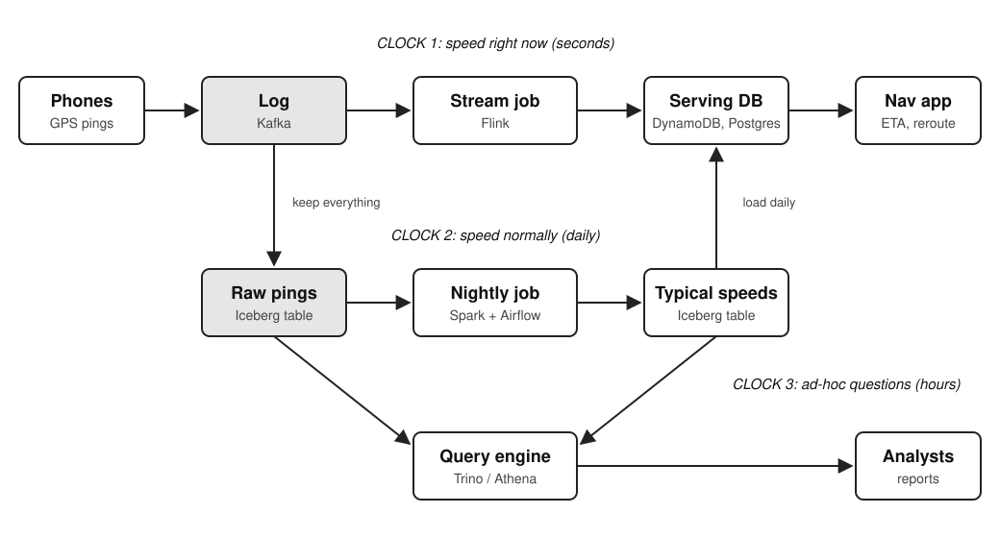
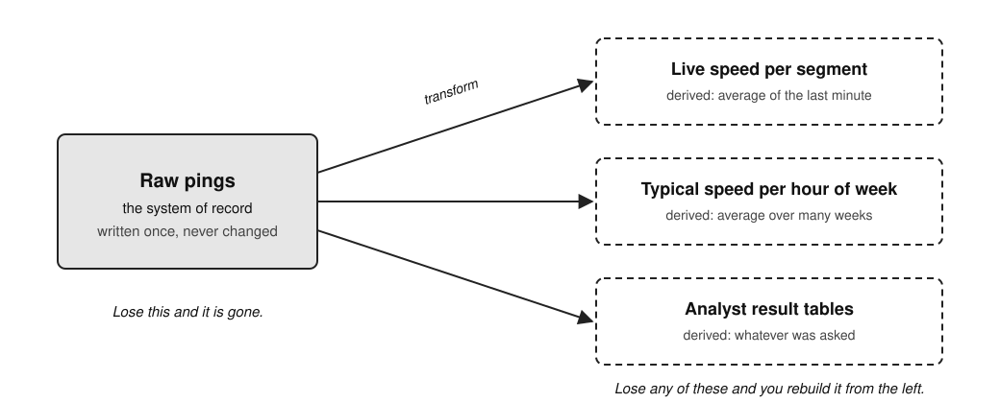
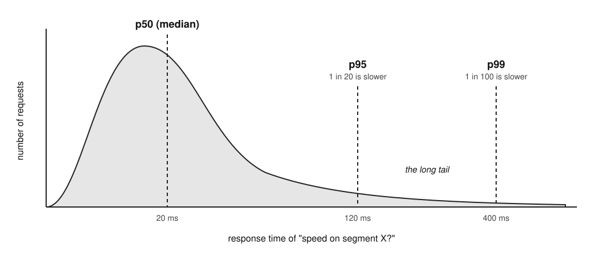

# Chapter 1 — One Question, Three Clocks

## The story

Wayline is a maps and navigation company. Two million phones run its app. While a phone is in a moving car, it sends a small message every five seconds:

> "I am device 81f3. I am on road segment 4471. I am doing 38 km/h. The time is 08:14:05."

We call that message a **ping**. A ping on its own is worthless. Millions of pings together answer the one question this whole book is about:

> **How fast is traffic on this road right now, and how does that compare with normal?**

The question sounds like one question. It is really three, because three different people ask it, and each of them is working to a different clock.

| Who asks | What they ask | How fresh must the answer be? | How much data does one answer need? |
|---|---|---|---|
| A driver's app, mid-journey | "Speed on segment 4471 right now?" | seconds | the last minute of pings for one road |
| A driver's app, planning tomorrow | "Speed on 4471 on a normal Tuesday at 08:00?" | a day old is fine | months of pings for one road, boiled down |
| An analyst | "Which 10 roads in Pune were most congested last week?" | hours old is fine | a week of pings for a whole city |

No single tool is good at all three. A tool that answers in milliseconds does so by looking at very little data. A tool that reads a week of data for a whole city cannot do it in milliseconds. So the system splits into three paths, one per clock.

Read the diagram left to right, top to bottom:

1. **Clock 1, seconds.** Pings land in a log. A stream job reads them as they arrive, keeps a running one-minute average per road, and writes it to a small, fast database that the app reads.
2. **Clock 2, daily.** The same pings are also kept long-term in cheap storage. Every night a batch job reads the day's pings and updates the "typical speed" table: one row per road, per hour of the week.
3. **Clock 3, hours.** Analysts point a query engine at the stored pings and ask whatever they like.

The rest of the book walks through these boxes one at a time. This chapter is about the shape of the whole thing and the vocabulary for judging it.

## Idea 1: one truth, many views

Notice that nothing in the diagram ever *edits* a ping. Pings are facts about the past. The car was doing 38 km/h at 08:14:05, and that will be true forever.

Everything else in the system is worked out from the pings.

Kleppmann gives these two kinds of data names:

- A **system of record** holds the authoritative version. Each fact is written there once. If two places disagree, this one is right by definition.
- **Derived data** is what you get by taking existing data and transforming it. A cache, an index, an average and a report are all derived.

The distinction matters because it tells you **what you are allowed to lose**. If the live-speed database is wiped, the app is blind for a few minutes while the stream job refills it. That is annoying, but nothing is gone. If the raw pings are lost, no amount of engineering brings them back.

It also tells you how to fix mistakes. Suppose the nightly job had a bug and computed wrong typical speeds for a month. Because the raw pings are untouched, you fix the bug and run the job again over the same month. Being able to recompute is the main reason to keep raw data.

## Idea 2: how big is it? (load)

Before choosing any tool, write down the load in plain numbers. Kleppmann calls these **load parameters**: the few numbers that describe what the system has to cope with.

For Wayline:

| Load parameter | Value | How we got it |
|---|---|---|
| Pings per second | 400,000 | 2,000,000 phones ÷ 5 seconds |
| Bytes per second | 40 MB | 400,000 × ~100 bytes |
| Raw data per day | ~3.5 TB | 40 MB × 86,400 seconds |
| Raw data per year | ~1.3 PB | 3.5 TB × 365 |
| App lookups per second | 50,000 (assumed) | each active trip re-checks its route regularly |
| Analyst queries | a few hundred a day | each may read hundreds of GB |

This is an upper bound: it pretends every phone drives all day. That is fine. The point of the arithmetic is to see the *shape* of the problem, and three things stand out:

- **Writes dwarf reads in volume.** 400,000 small writes a second is the hard part of the top path.
- **Storage is a petabyte-a-year problem.** Whatever holds raw pings must be cheap per gigabyte. That rules out keeping them in a database built for fast lookups.
- **Analyst queries are few but huge.** Each one touches more data than a million app lookups do.

A system that works at one load can fall over at ten times that load. **Scalability** is not a yes/no property. It is the answer to: "if this number grows, what do we do?" You can only ask that once you know which number.

## Idea 3: how fast is it? (percentiles)

"The lookup takes 30 ms on average" hides the thing users feel. Response times are not symmetric. Most requests are quick and a few are very slow.

So we describe speed with **percentiles**:

- **p50 (median):** half the requests are faster than this. The typical experience.
- **p95:** 1 request in 20 is slower than this.
- **p99:** 1 request in 100 is slower than this.

Why care about 1 in 100? Because one screen in the app is rarely one request. Planning a route across 100 road segments means 100 lookups, and the route is only ready when the slowest one returns. With 100 lookups, most routes will hit at least one "1 in 100" response. So the app's *typical* experience is the database's *tail*. Kleppmann calls this **tail latency amplification**.

Wayline's targets, as an example of how to state them:

- Live speed lookup: p99 under 50 ms.
- Live speed freshness: a ping affects the answer within 60 seconds.
- Typical speeds: yesterday is included by 06:00.

## Idea 4: three words for "good"

Kleppmann opens his book with three goals. Here is what each means for Wayline.

| Goal | Meaning | At Wayline |
|---|---|---|
| **Reliable** | keeps working correctly when things go wrong | a server dies and no pings are lost; a phone sends the same ping twice and the average is not skewed; an engineer deploys a bug and the data can be recomputed |
| **Scalable** | has a plan for growth | 2 M phones become 20 M and we add machines, not redesign |
| **Maintainable** | people can run it and change it for years | a new field is added to the ping without breaking old phones; a new engineer can tell which box owns which data |

A *fault* is one part misbehaving. A *failure* is the whole system letting the user down. You cannot prevent faults: disks die, networks drop, people make mistakes. The job is to stop faults from becoming failures.

## Decision points

These are the choices this chapter's diagram quietly made. Each is argued properly in a later chapter.

**Why not write pings straight into the serving database?**
At 400,000 writes a second and 3.5 TB a day, a database tuned for fast lookups would spend all its effort absorbing writes it will almost never read back one by one. Worse, if it slowed down, phones would have nowhere to send pings. A log in front absorbs the flood, and each reader takes pings at its own pace. *(Chapter 2)*

**Why keep raw pings at all, if we only need averages?**
Because the questions change. Today it is the average speed. Next quarter someone wants the median, or speeds split by weather. Averages cannot be un-averaged. Raw facts can answer questions nobody has thought of yet, and they let you recompute after a bug. *(Chapter 3)*

**Why both a stream job and a nightly job? Couldn't one do both?**
It could, and some companies do that. The stream job must answer in seconds, so it works with incomplete information: some pings arrive late, after the minute has been published. The nightly job waits until the day is complete, so it can be exact. Fast-and-approximate plus slow-and-exact is a common pairing. The cost is two pieces of code that must agree. *(Chapters 4, 5 and 9)*

**Why is the analyst path separate from the app path?**
One analyst query reading 500 GB would starve thousands of app lookups if they shared a machine. Two workloads this different need different storage layouts as well as different hardware. *(Chapters 6 and 7)*

## In Kleppmann's book

| Idea in this chapter | Where in *Designing Data-Intensive Applications* (1st ed.) |
|---|---|
| Reliable, scalable, maintainable; faults vs failures | Ch. 1, "Reliability", "Scalability", "Maintainability" |
| Load parameters | Ch. 1, "Describing Load" |
| Percentiles, tail latency amplification | Ch. 1, "Describing Performance" |
| System of record vs derived data | Introduction to Part III, "Derived Data" |
| One log feeding many derived views | Ch. 11, "Databases and Streams"; Ch. 12, "Data Integration" |
| Fast-approximate plus slow-exact (lambda architecture) | Ch. 12, "Batch and Stream Processing" |

## Check yourself

1. The live-speed database is deleted by accident. What is lost, and for how long? Now answer the same for the raw pings.
2. Wayline launches in a second country and phones double. Which load parameters change, and which boxes in the diagram feel it first?
3. A lookup has p50 of 5 ms and p99 of 300 ms. A route needs 200 lookups. Roughly what does the driver experience, and why?
4. Product asks for "median speed" instead of "average speed" for last year. Why is this easy for Wayline, and when would it have been impossible?

## In the interview room

*The candidate answers as an engineer who built Wayline's system.*

**Interviewer:** Walk me through the system at a high level.

**Candidate:** Phones send a GPS ping every five seconds. The pings land in a log. From there the data takes three paths, because three consumers need different freshness. A stream job keeps a per-road average for the last minute and writes it to a small database that the app reads in milliseconds. The same pings are stored long-term in cheap storage, and a nightly job turns them into typical speeds per road per hour of the week. Analysts query that same storage directly. The raw pings are the source of truth, and everything else is computed from them.

**Interviewer:** Three paths sounds like a lot. Why not one database?

**Candidate:** Because the three workloads want opposite things. The app does 50,000 tiny lookups a second and needs each in a few milliseconds. An analyst runs a handful of queries that each read hundreds of gigabytes. And we take in 400,000 writes a second, about 3.5 TB a day. A database tuned for fast lookups is expensive per gigabyte and would be swamped by the writes. Storage that is cheap enough for a petabyte cannot answer in milliseconds. If the volume were a thousand times smaller, I would use one database and be done.

**Interviewer:** You called raw pings the "system of record". Why does that label matter in practice?

**Candidate:** It tells me what I can afford to lose and how I recover. Everything derived can be rebuilt: if the live-speed database is wiped, it refills in minutes. If we ship a bug that corrupts a month of typical speeds, we fix the code and re-run it over the same raw pings. That only works because nothing ever modifies the raw data. So I protect the raw pings with replication and backups, and treat the rest as replaceable.

**Interviewer:** Your latency target is a p99, not an average. Why?

**Candidate:** Two reasons. Response times have a long tail, so an average hides the slow requests that users notice. And one user action is many requests. Planning a route over 100 road segments means 100 lookups, and the route waits for the slowest. If 1 lookup in 100 is slow, then about 63% of routes include at least one slow lookup. So the database's tail becomes the user's normal experience.

**Interviewer:** Traffic grows ten times. What breaks first?

**Candidate:** I'd go through the load numbers one by one. Ingest goes from 400,000 to 4 million pings a second: the log scales by adding partitions and machines, so that is money, not redesign. Storage grows from 1.3 to 13 PB a year, which is linear in cost and forces a decision about how long we keep full detail. The stream job needs more workers, and the busiest roads get even hotter, so skew is what I'd watch most closely. Lookups grow too, but they are easy to cache and to spread over read replicas. The part that does not scale by adding machines is the uneven load on popular roads.

**Interviewer:** Running a stream job and a batch job means two code bases computing the same thing. Isn't that a known weakness?

**Candidate:** Yes, it is the standard criticism of this design, and it is fair. Two implementations will drift apart. I reduce that in three ways: both paths store the same simple thing, a sum and a count; a daily check compares their results and alerts when they differ by more than a tolerance; and the batch result is treated as the correct one. The alternative is to use only the stream job and replay the log when logic changes. That gives one code base, but replaying months of data through a stream job is slow and needs the log or the lake to feed it. I'd choose it if the logic changed often.
