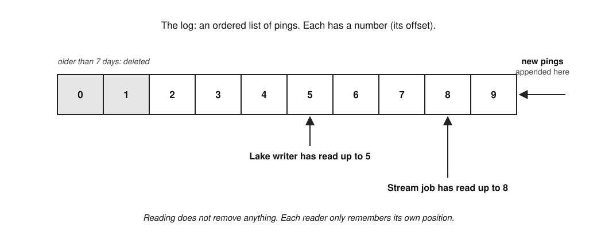
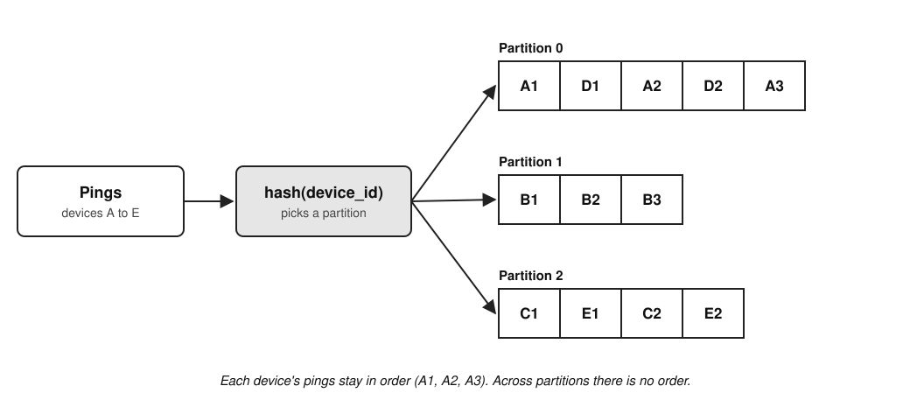
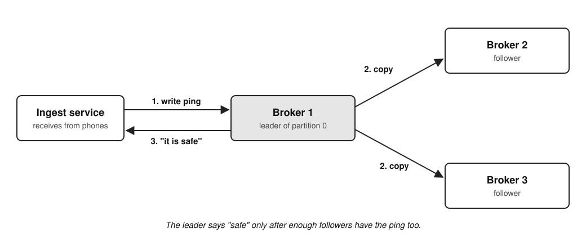
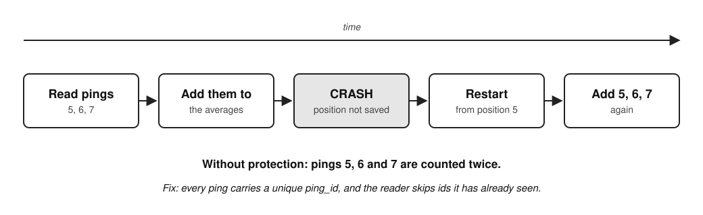
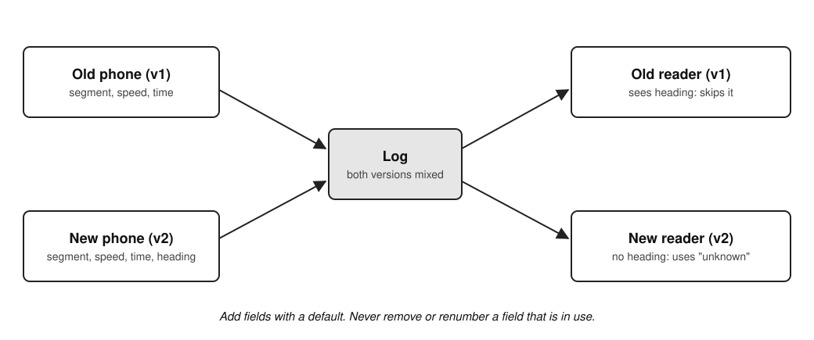

# Chapter 2 — The Log

## The story

400,000 pings arrive every second. Two very different readers want every one of them:

- the **stream job**, which needs each ping within a second or two to keep "speed right now" fresh;
- the **lake writer**, which copies pings into long-term storage in big, efficient batches every few minutes.

Phones do not talk to either of them. A phone sends its pings over the internet to a small **ingest service**, which checks the message, stamps it with the time it was received, and hands it on. The question for this chapter is: hands it on *to what?*

The naive answer is "to both readers directly". That breaks in three ways:

1. **A slow reader blocks everyone.** If long-term storage is slow for five minutes, the ingest service has nowhere to put pings. Either it drops them or phones start failing.
2. **A crashed reader loses data.** While the stream job restarts, the pings it should have received are gone.
3. **A new reader starts with nothing.** Next year a third team wants pings for a fraud detector. They get data only from the day they plug in.

The fix is to put one thing in the middle whose only job is to **remember pings in order for a while** and let every reader take them at its own pace. That thing is a **log**, and the most widely used one is Apache Kafka.

## Idea 1: a log is a list you can only add to

A log is the simplest data structure there is: an ordered list where new items go on the end and nothing is ever changed. Each item gets the next number in sequence, called its **offset**.

Three properties fall out of this simple shape:

- **Reading does not consume.** In an old-style message queue, a message is deleted once a reader confirms it. In a log, the ping stays. A reader is just a bookmark: "I have read up to offset 8." Any number of readers can each keep their own bookmark.
- **A slow or dead reader harms nobody.** The lake writer is at offset 5 while the stream job is at 8. Neither knows the other exists. If the lake writer stops for an hour, it resumes from 5 and catches up.
- **You can go back.** A reader can move its bookmark backwards and read old pings again. That makes it possible to fix a bug and reprocess, or to add the fraud detector next year and feed it last week's data.

The log does not grow forever. Kafka keeps pings for a set **retention** period, say 7 days, then deletes the oldest. So the log is a 7-day buffer, not the long-term home of the data. The long-term home is the subject of Chapter 3.

Why is such a simple thing fast enough for 400,000 writes a second? Because adding to the end of a file is the cheapest thing a disk can do. There is no index to update and nothing to look up.

## Idea 2: partitions, or how to split one list across many machines

One list on one machine has a ceiling. Kafka's answer is to split the log into several independent lists called **partitions**, spread across machines. A topic called `pings` with 64 partitions is really 64 separate logs.

Which partition does a ping go to? The sender picks a **key** from the ping, hashes it, and the hash chooses the partition. The same key always lands in the same partition.

This buys scale and costs you something important: **order is kept only inside a partition.** Device A's pings are in order relative to each other. Whether A2 came before or after B2 is not recorded anywhere.

So the choice of key is really the question "which pings must stay in order relative to each other?" It is the first real design decision of the system, and there are two candidates.

| Key | What you get | What it costs |
|---|---|---|
| `segment_id` | all pings for one road are together and in order | roads are wildly unequal: a motorway produces thousands of times more pings than a lane, so a few partitions get most of the load (**skew**, or a **hot partition**) |
| `device_id` | devices are roughly equal, so load is spread evenly; each trip's pings are in order | pings for one road are scattered across partitions; the stream job has to regroup them by road |

Wayline keys by `device_id`. Even load matters more at the front door, and regrouping by road is something the stream job does well (Chapter 4). Per-device order is also what you need to spot a duplicate or a GPS glitch.

Partitions also set the limit on parallel reading. A group of cooperating readers shares the partitions among its members, one reader per partition at most. With 64 partitions, at most 64 copies of the stream job can work at once.

## Idea 3: copies, or what "safely stored" means

A machine holding a partition will eventually die. So each partition is kept on several machines (**brokers**), typically three. One copy is the **leader**: all writes go to it. The others are **followers**: they copy from the leader continuously.

The interesting part is step 3. When does the leader tell the ingest service "your ping is safe"?

| Setting | Leader replies when... | If the leader dies right after replying |
|---|---|---|
| `acks=1` | it has written the ping itself | the ping may be lost: no follower had it yet |
| `acks=all` | enough followers have it too | the ping survives: a follower takes over as leader with the ping |

Waiting for followers makes each write a little slower and makes loss much less likely. That is a general pattern, not a Kafka detail: **you trade speed for safety by choosing how many copies must exist before you say "done".**

There is one more knob. "Enough followers" is a number you set (`min.insync.replicas`). With three copies and a minimum of two, the system keeps accepting writes with one broker down, and refuses writes with two down. Refusing is deliberate: it is better to tell the ingest service "not now" than to accept a ping that exists on only one machine.

## Idea 4: the same ping twice

Networks fail in an awkward way: you send something and hear nothing back. Did it arrive? You cannot know. The only safe move is to send it again, and so the same ping can be written twice.

The same happens on the reading side.

A reader does two things: process some pings, then save its new position. A crash between those two steps means it restarts from the old position and processes the same pings again.

This gives three possible promises, and it is worth knowing them by name:

| Promise | Meaning | How |
|---|---|---|
| **At most once** | never repeated, sometimes lost | save the position first, then process |
| **At least once** | never lost, sometimes repeated | process first, then save the position |
| **Exactly once** (in effect) | each ping counts once | at least once, plus making repeats harmless |

Nobody can truly deliver a message exactly once over an unreliable network. What you can do is make processing **idempotent**: doing it twice has the same effect as doing it once. For Wayline this is why every ping carries a unique `ping_id` created on the phone. A reader that has seen `ping_id` 9f2c before skips it.

Kafka helps at each end. The **idempotent producer** lets a broker recognise and discard a retried write. **Transactions** let a reader save its output and its new position together, so that either both happen or neither does. Chapter 4 shows how Flink uses this.

## Idea 5: phones that never update

The ping format will change. Next quarter the app starts sending `heading` (the direction of travel). But millions of phones still run last year's app, and the log holds a week of old-format pings. Old and new pings will sit side by side for years.

Two kinds of compatibility are needed at the same time:

- **Backward compatible:** new readers can read old pings. The new field is missing, so the reader fills in a default.
- **Forward compatible:** old readers can read new pings. They meet a field they do not know and skip it.

Plain JSON gives you neither guarantee: nothing stops someone renaming `speed_kmh` to `speed` and silently breaking every reader. Binary formats with a written-down **schema** (Protocol Buffers or Avro) do. They are also far smaller, because field names are not repeated in every message. At 3.5 TB a day that is real money.

The rules that keep both kinds of compatibility are short:

1. Only add fields that are optional or have a default.
2. Never remove a field that is still required somewhere.
3. Never reuse a field's number or name for something else.

A **schema registry** enforces this. It is a small service holding every version of the ping schema, and it rejects a new version that would break the rules before any phone ships with it.

## Decision points

**A log or a queue?**
A traditional queue (RabbitMQ, Amazon SQS) deletes a message once it is handled and is good at handing out *tasks* to workers: resize this image, send this email. A log (Kafka, Amazon Kinesis, Apache Pulsar) keeps messages and is good at *facts* that several systems need, in order, possibly more than once. Pings are facts with two readers today and more tomorrow, so Wayline needs a log.

**Run Kafka yourself or rent it?**
Kafka on your own machines gives full control and a real operational burden. Managed options (Amazon MSK, Confluent Cloud, or Kinesis, which is a different product with the same idea) cost more per gigabyte and remove most of that burden. For a team whose business is maps and not messaging, renting is the usual starting point.

**How many partitions?**
Enough for the parallelism you will need in a couple of years, because changing the number later is painful: the hash sends keys to different partitions than before, and the per-device ordering is broken at the moment of change. Too many is also a cost, since each partition means open files and failover work. Wayline picks 64: about 6,000 pings a second each, with plenty of headroom.

**How safe must a ping be?**
One ping among 400,000 a second is individually unimportant, which argues for `acks=1` and speed. But the raw pings are the system of record, and losses that correlate with broker failures leave holes in particular minutes. Wayline uses three copies, `acks=all`, and a minimum of two in sync. The slowdown is small because pings are sent in batches.

**How long to keep pings in the log?**
Long enough to recover from the worst outage you can imagine in a reader, plus time to notice and fix it. Seven days covers a bug found after a long weekend. At full scale that is 3.5 TB × 7 days × 3 copies, about 74 TB of disk.

## In Kleppmann's book

| Idea in this chapter | Where in *Designing Data-Intensive Applications* (1st ed.) |
|---|---|
| Queues vs logs, offsets, replay, slow consumers | Ch. 11, "Transmitting Event Streams": "Messaging Systems" and "Partitioned Logs" |
| Retention and disk use | Ch. 11, "Partitioned Logs": "Disk space usage", "Replaying old messages" |
| Partitioning by hash of key | Ch. 6, "Partitioning of Key-Value Data" |
| Skew and hot partitions | Ch. 6, "Skewed Workloads and Relieving Hot Spots" |
| Leaders, followers, when to confirm a write | Ch. 5, "Leaders and Followers": "Synchronous Versus Asynchronous Replication" |
| A follower taking over | Ch. 5, "Handling Node Outages" |
| Redelivery and duplicates | Ch. 11, "Messaging Systems": "Acknowledgments and redelivery" |
| Idempotence, exactly-once in effect | Ch. 11, "Fault Tolerance" (in "Stream Processing") |
| Schemas, forward and backward compatibility | Ch. 4, "Formats for Encoding Data" (Protocol Buffers, Avro) |
| Messages as a way for data to flow between services | Ch. 4, "Modes of Dataflow": "Message-Passing Dataflow" |

## Check yourself

1. The lake writer is down for six hours. What happens to the stream job? What happens to the pings the lake writer missed? What if it were down for eight days?
2. Wayline keys pings by `device_id`. A new feature needs "all pings for a road, in order". Why can't the log give that directly, and where does the regrouping happen?
3. A broker dies one millisecond after the leader confirmed a ping. With `acks=1`, what might have happened to the ping? With `acks=all`?
4. A reader saves its position *before* processing and then crashes. Which promise is that, and what does the driver see?
5. Someone proposes renaming `speed_kmh` to `speed` in the ping schema. Which readers break, and what would you do instead?

## In the interview room

*The candidate answers as an engineer who built Wayline's system.*

**Interviewer:** Why Kafka? Why not a queue like SQS or RabbitMQ?

**Candidate:** A queue hands each message to one worker and deletes it once handled. That suits tasks. Our pings are facts that several independent systems need: the stream job, the lake writer, and whoever comes next. With a log, each reader keeps its own position, a slow reader does not affect the others, and a reader can go back and re-read. That last property is what our crash recovery and reprocessing depend on.

**Interviewer:** How did you choose the partition key?

**Candidate:** The key decides two things: how evenly load is spread, and which messages keep their relative order. Keying by road would put each road's pings together, but roads are extremely unequal, so a few partitions would carry most of the traffic. Keying by device spreads load evenly and keeps each trip's pings in order, which is what duplicate detection needs. The cost is that pings for one road are scattered, and the stream job regroups them by road.

**Interviewer:** Can you give me global ordering across all pings?

**Candidate:** Not with more than one partition. Order exists only within a partition. A single partition would give total order, but it caps throughput at one machine and one reader. So I would first ask what order the feature really needs. Almost always it is "per device" or "per road", and the right key gives exactly that.

**Interviewer:** Explain "exactly once" in Kafka. Is it real?

**Candidate:** No system can deliver a message exactly once over an unreliable network. What Kafka provides is that the *effect* happens once, in two parts. The idempotent producer gives each producer an id and each message a sequence number, so the broker discards a retried write it has already stored. Transactions let a program write its output messages and its new read position as one unit: both are committed or neither is. That covers read-process-write inside Kafka. The moment the output goes somewhere else, such as a database, that write has to be idempotent or part of its own transaction.

**Interviewer:** You have three copies, `acks=all`, minimum two in sync. One broker dies. Then a second. What happens at each step?

**Candidate:** With one broker down, each affected partition still has two copies in sync, so writes continue. If the dead broker was a leader, a follower that was in sync takes over, and no confirmed ping is lost. With two down, only one copy remains, which is below the minimum, so the partition rejects writes. Reads still work. That refusal is intentional: the ingest service buffers and retries, which is better than confirming pings that exist on one machine. I would also keep "unclean leader election" off, so that a copy that had fallen behind can never become leader and silently drop data.

**Interviewer:** Consumer lag is growing. How do you investigate?

**Candidate:** First, is more coming in, or is less going out? Then I look at lag per partition. If one partition is behind and the rest are fine, it is a hot key or one stuck reader. If all are behind, the reader is too slow overall: usually whatever it writes to has slowed down, or the group keeps rebalancing. The fixes follow the cause: fix the slow destination, add readers up to the number of partitions, or deal with the hot key. Adding partitions is the last resort.

**Interviewer:** Why last? What is wrong with going from 64 to 128 partitions?

**Candidate:** The key-to-partition mapping changes. A device whose pings went to partition 12 may now go to partition 76, and existing data is not moved. For a while, that device's older pings are in one partition and newer ones in another, so per-device order is broken across the change. If readers depend on that order, the cleaner route is a new topic with the new partition count and a controlled switch-over.
