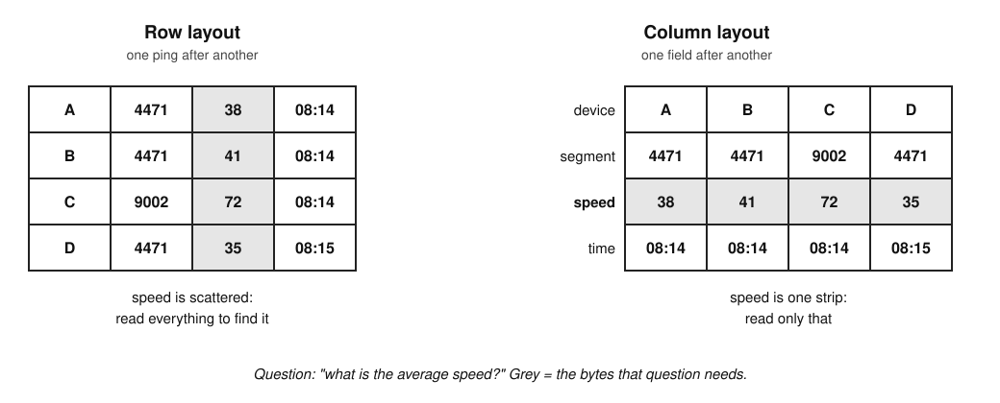
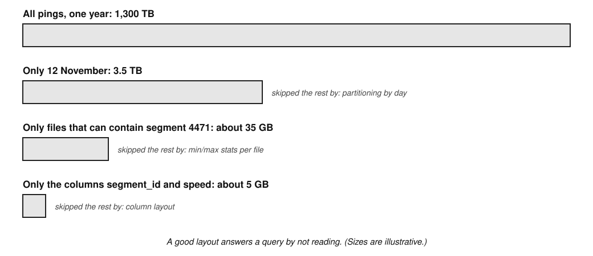
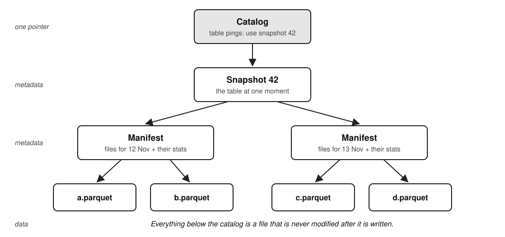
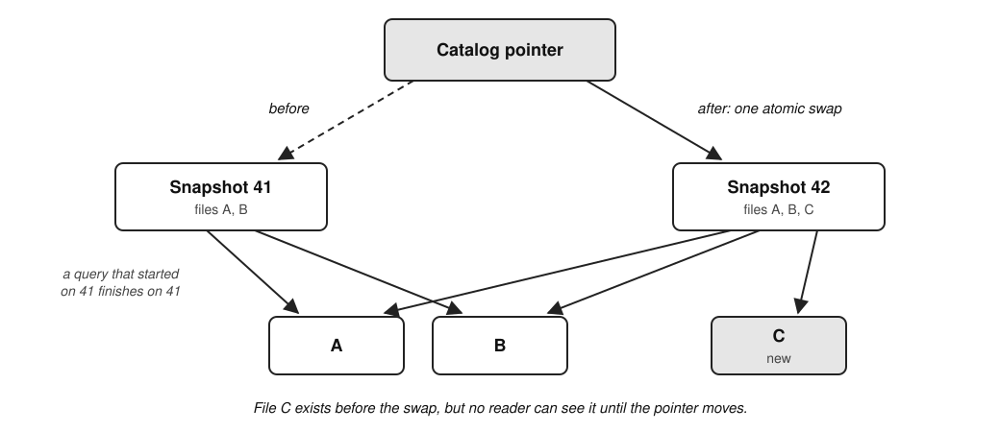
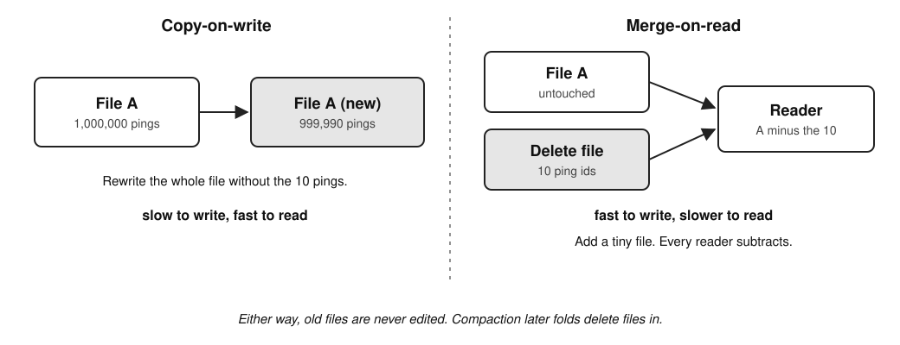

# Chapter 3 — Files That Behave Like a Table

## The story

The log keeps pings for seven days. Wayline wants them for years, because raw pings are the system of record (Chapter 1). That is 3.5 TB a day and about 1.3 PB a year.

Two requirements pull in opposite directions:

- **It must be cheap.** At a petabyte, the price per gigabyte is the whole budget.
- **It must be queryable.** The nightly job reads a full day. An analyst reads a week for one city. Neither can afford to read a petabyte to find it.

A database built for fast lookups fails the first requirement: fast disks and always-on servers cost several times more per gigabyte, and almost none of this data will ever be looked up one ping at a time.

The cheap option is **object storage**, such as Amazon S3. It is a giant key-to-file store: you put a file under a name, you get it back by name. It costs roughly $20–25 per terabyte per month at list price, never fills up, and survives the loss of whole data centres. It also has one rule that shapes everything in this chapter:

> **A file, once written, cannot be changed. You can only add a new file, replace a whole file, or delete one.**

So the plan is to write pings into files on object storage. The rest of the chapter is about making a pile of unchangeable files behave like a database table: quick to query, safe to write to while others read, and possible to correct.

## Idea 1: store by column, not by row

Start inside a single file. There are two ways to lay out the same pings.

A **row layout** keeps each ping's fields together. It is ideal when you want one whole ping. A **column layout** keeps each field's values together. It is ideal when you want one or two fields from millions of pings, and that is what every question at Wayline looks like: *average speed*, per *segment*.

The column layout wins twice more:

- **Compression.** A column holds values of one kind, and they repeat. A strip of segment ids like `4471, 4471, 4471, 4471, 9002, 9002` can be stored as "4471 × 4, 9002 × 2". Sort the file by segment and the strip shrinks to almost nothing. Column files are commonly several times smaller than the same data as JSON.
- **Skipping.** The file keeps a small summary at the end: for each block of rows, the minimum and maximum of each column. A reader looking for segment 4471 checks the summary first and skips every block whose range cannot contain it.

**Parquet** is the standard column file format. A Parquet file is immutable, self-describing (it carries its own schema), and readable by every tool in this book.

The cost: a column file is built in one go from a batch of rows. You cannot cheaply append one ping to it. That fits the lake writer, which collects a few minutes of pings and writes them out as one file.

## Idea 2: arrange files so that most are never opened

Now step back from one file to millions of them. The fastest way to read data is to not read it, and the layout decides how much can be skipped.

Three layers of skipping stack up:

1. **Partitioning.** Group files by a value that nearly every query filters on. For Wayline that is the day. A query for 12 November never opens a file from any other day.
2. **File statistics.** Within a day, sort pings by `segment_id` before writing. Each file then covers a narrow range of segments, and its min/max summary rules it in or out.
3. **Columns.** In the files that survive, read only the columns the query names.

The choice of partition is a real decision, and the trap is going too fine. Partitioning by day *and* city sounds helpful. But the lake writer commits every five minutes, and every commit writes at least one file per partition it touches. With 2,000 cities that is 288 commits × 2,000 cities, more than half a million files a day, each around 6 MB. Opening a file has a fixed cost, so many tiny files are far slower to read than a few large ones. This is the **small files problem**. A good target is files of a few hundred megabytes.

The rule of thumb: partition by the one coarse thing every query filters on, usually time. Use sorting and statistics for everything else.

## Idea 3: a table is a list of files

Here is the problem with a plain folder of Parquet files. Suppose the lake writer is halfway through writing ten new files when an analyst's query lists the folder. The query sees five of them and silently computes a wrong answer. Worse, nobody can tell which files belonged together.

The fix is one of the central ideas in modern data engineering:

> **The table is not "whatever files are in the folder". The table is an explicit list of files, written down in a metadata file.**

Apache **Iceberg** is a specification for that list. (Delta Lake and Apache Hudi are alternatives built on the same idea.)

From the top:

- The **catalog** holds one tiny fact per table: which snapshot is current.
- A **snapshot** is the complete state of the table at one moment. It points to manifests.
- A **manifest** lists data files, with each file's partition and column statistics.
- The **data files** are ordinary Parquet.

A query engine starts at the catalog, follows the pointers, and uses the statistics in the manifests to decide which files to open, before touching any data. A file that sits in the folder but is not in the list does not exist as far as any reader is concerned.

Iceberg also hides partitioning from the people writing queries. The table is declared as "partitioned by the day of `event_time`". An analyst simply filters on `event_time`, and Iceberg works out which partitions that means. The partitioning can later be changed for new data without rewriting old data.

## Idea 4: every change is a new snapshot

How do you add files to a table that others are reading, when no file can be modified? You never modify. You write a new list and switch to it.

The lake writer does this every five minutes:

1. Write the new data file, C. No reader can see it yet.
2. Write a new snapshot, 42, which lists A, B and C. Still invisible.
3. Ask the catalog to switch the pointer from 41 to 42. This is the **commit**.

Step 3 is a single small operation that either happens or does not. It is **atomic**. There is no moment at which a reader can see half of the new files. If the writer crashes at step 1 or 2, the table is exactly as it was, and the stray file is cleaned up later.

Three useful things follow at no extra cost:

- **Readers are never disturbed.** A query that began on snapshot 41 keeps reading 41 until it finishes, even if ten commits happen meanwhile. Databases call this **snapshot isolation**.
- **Time travel.** Old snapshots remain for a while. You can ask "what did this table say last Tuesday?" or roll the table back after a bad write.
- **Two writers cannot corrupt each other.** The swap is conditional: "change the pointer to 42 *only if it is still 41*." If another writer got there first, the swap fails, and the loser re-reads the new state and tries again. This is **compare-and-set**, and the approach is called **optimistic concurrency**: assume no conflict, check at the end.

The schema works the same way. Each column has a permanent id number. Adding `heading` is a metadata change: old files simply have no column with that id, and readers get "unknown" for those rows. No file is rewritten. This is the same rule as in Chapter 2: add with a default, never reuse an id.

## Idea 5: changing what cannot be changed

Pings are facts and mostly never change. But a driver can ask Wayline to delete their data, and the law gives them that right. Their ten pings are inside a file of a million. The file cannot be edited. There are two ways out.

- **Copy-on-write:** write a new copy of the file without those ten pings, and commit a snapshot that lists the new file in place of the old one. Readers pay nothing. The writer rewrote a million pings to remove ten.
- **Merge-on-read:** write a tiny **delete file** naming the ten pings, and commit that. The writer is done in a moment. Every reader of file A must now also read the delete file and subtract.

Merge-on-read is a debt that grows. So a background job, **compaction**, periodically rewrites files: it folds delete files in and merges small files into large ones. Compaction is also just a commit: new files, new snapshot, pointer swap. A second job **expires** old snapshots and deletes files nothing points to any more. Until that runs, the "deleted" pings are still physically there in old snapshots, which matters for the legal request.

## Decision points

**Object storage or a database for raw pings?**
Object storage: cheapest per gigabyte, effectively unlimited, and any engine can read it. The price is that every access is a network request taking tens of milliseconds, so it suits scans, never single-row lookups. Lookups belong in Chapter 7.

**Which file format?**
Parquet for anything analytical. A row format such as Avro suits the log, where each message is written and read whole. Wayline uses a row format on the way in and a column format at rest.

**Partition by what?**
By day of `event_time`. Hourly partitions would multiply the file count by 24 and help few queries. By city would create thousands of tiny partitions. Within a day, sort by `segment_id`.

**Event time or received time?**
A ping sent at 23:59 may arrive at 00:03. Partitioning by `event_time` puts it in the day it describes, which is what every query means by "the 12th". The cost is that yesterday's partition can still receive files today. Chapter 5 deals with what that does to the nightly job.

**Which table format?**
Iceberg, Delta Lake and Hudi all provide atomic commits, snapshots and schema evolution. Iceberg is the most engine-neutral, which matters here because Flink, Spark, Trino and Athena all read and write the same table. Delta is the natural choice if you live in Databricks. Hudi is strongest when most writes are updates.

**Copy-on-write or merge-on-read?**
Rare changes and many readers: copy-on-write. Frequent small changes, such as a constant trickle of deletions: merge-on-read plus regular compaction. For Wayline, deletions are rare and can be batched weekly, so copy-on-write.

**How often to commit?**
Each commit makes pings visible to analysts and creates files and a snapshot. Every five minutes keeps the lake fresh enough for Clock 3 with healthy file sizes. Every five seconds would bury the table in metadata.

## In Kleppmann's book

The first edition predates Iceberg, so the product is not in the book. The ideas it is built from are.

| Idea in this chapter | Where in *Designing Data-Intensive Applications* (1st ed.) |
|---|---|
| Lookups vs analytics as different workloads | Ch. 3, "Transaction Processing or Analytics?" |
| Column layout, compression, sort order | Ch. 3, "Column-Oriented Storage" |
| Writing column files in batches; merging files in the background | Ch. 3, "Writing to Column-Oriented Storage"; compare "SSTables and LSM-Trees" |
| Files on a distributed filesystem as the base layer | Ch. 10, "MapReduce and Distributed Filesystems" |
| Immutable inputs, safe re-runs | Ch. 10, "The Output of Batch Workflows" |
| Atomic commit: all or nothing | Ch. 7, "The Meaning of ACID" (Atomicity) |
| Readers on a consistent snapshot while writers continue | Ch. 7, "Snapshot Isolation and Repeatable Read" |
| Conditional swap, retry on conflict | Ch. 7, "Preventing Lost Updates": "Compare-and-set" |
| Schema changes with old and new data side by side | Ch. 4, "Formats for Encoding Data" |
| Facts as an append-only record | Ch. 11, "State, Streams, and Immutability" |

## Check yourself

1. An analyst asks for the average speed on segment 4471 on 12 November. List, in order, everything the layout lets the query engine avoid reading.
2. Someone proposes partitioning by `segment_id` so each road has its own folder. With 50 million segments, what goes wrong?
3. The lake writer crashes after writing a data file but before the pointer swap. What does an analyst's query see? What happens to the file?
4. Compaction and the lake writer both try to commit at the same moment. Walk through what happens and why the table is not damaged.
5. A driver's pings were deleted with a merge-on-read delete file yesterday. Are they gone from storage? What has to happen before they are?

## In the interview room

*The candidate answers as an engineer who built Wayline's system.*

**Interviewer:** Why keep the data as Parquet files on S3 and not load it into a warehouse?

**Candidate:** Cost and openness. At 1.3 PB a year, object storage is the cheapest durable place there is. And files in an open format can be read by every engine we use: Flink writes them, Spark runs the nightly job, Trino and Athena serve analysts. A warehouse would give faster queries on the subset we load into it, and we might still load a small, aggregated table into one. But the raw record lives in open files.

**Interviewer:** An analyst asks for the average speed on one road on one day. How does that avoid scanning a petabyte?

**Candidate:** Three layers of skipping. The table is partitioned by day, so only that day's files are considered: 3.5 TB out of 1,300. Within the day, files are sorted by road id and the table's metadata holds each file's minimum and maximum, so only the few files whose range includes that road are opened. And because the files are columnar, only the road id and speed columns are read. Most of the deciding happens from metadata, before any data file is touched.

**Interviewer:** S3 has no transactions. How does Iceberg commit atomically?

**Candidate:** By making the commit one small operation outside S3. The writer first uploads all new data files and new metadata files under unique names. None of them is visible, because nothing points to them. Then it asks the catalog to change the table's "current snapshot" pointer from the old value to the new one, on the condition that it still has the old value. That conditional swap is the only step that must be atomic, and the catalog provides it. If the writer dies before the swap, the table is unchanged.

**Interviewer:** Two writers commit at the same time. What happens?

**Candidate:** One swap succeeds. The other fails because the pointer is no longer what it expected. The loser reloads the latest state and checks whether its change still makes sense. For two appends, it always does, so it just re-applies its change on top and retries, without rewriting any data. A real conflict is rarer: for example, compaction rewrote a file that a delete job removed meanwhile. Then the operation fails and has to be redone from the new state.

**Interviewer:** What is the small files problem and how do you handle it?

**Candidate:** Every file has a fixed cost: a network request to open it, a footer to read, an entry in the metadata. Thousands of 5 MB files are far slower than a few 500 MB ones holding the same data. It is caused by committing too often or partitioning too finely. I prevent it by partitioning only by day and committing every few minutes, and I cure it with a scheduled compaction job that rewrites small files into large ones as a normal commit.

**Interviewer:** A driver demands deletion of their data. Walk me through it.

**Candidate:** Device ids in pings change daily (Chapter 9), so I first look up the ids that driver's phone used, then run a delete for those ids. With copy-on-write, the affected files are rewritten without those rows and a new snapshot is committed. From that moment queries no longer see the data. But it is still physically present in the old files that earlier snapshots point to. So the request is only complete after those snapshots are expired and the unreferenced files are removed. I also account for the other copies: the log ages the pings out within seven days, and any derived table keyed by device needs the same treatment.

**Interviewer:** A ping for yesterday arrives today. What happens in the table?

**Candidate:** It is written into yesterday's partition, because we partition by event time. That is just another commit adding a file to an older partition. Queries see it from the next snapshot. The harder question is downstream: the nightly job already processed yesterday. It needs a way to learn that yesterday changed. Iceberg helps, since you can ask what was added between two snapshots, and the job can recompute only the days that were touched.

**Interviewer:** Iceberg, Delta Lake, Hudi. How do you choose?

**Candidate:** They share the core idea: a metadata layer that lists files and commits atomically. I choose on ecosystem. Iceberg is the most engine-neutral, which matters when four different engines touch one table. Delta is the natural fit on Databricks. Hudi was designed around frequent updates and incremental processing. For an append-heavy table read by many engines, Iceberg.
