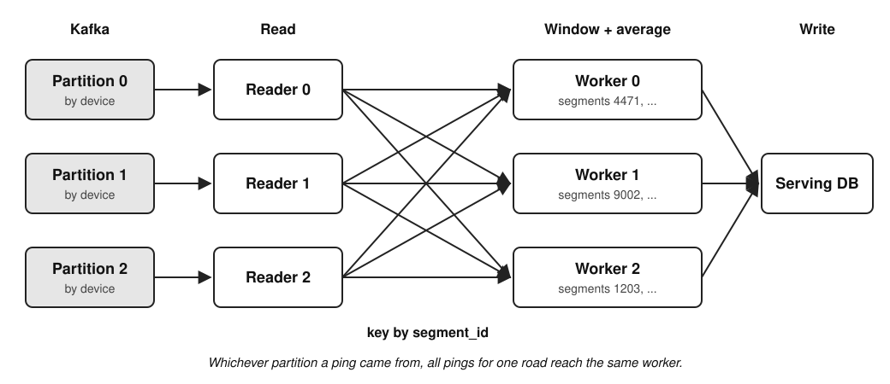
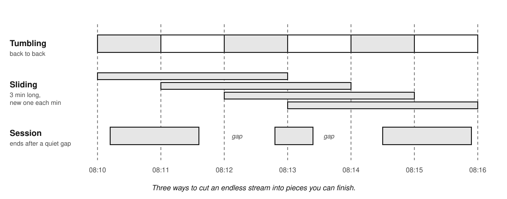
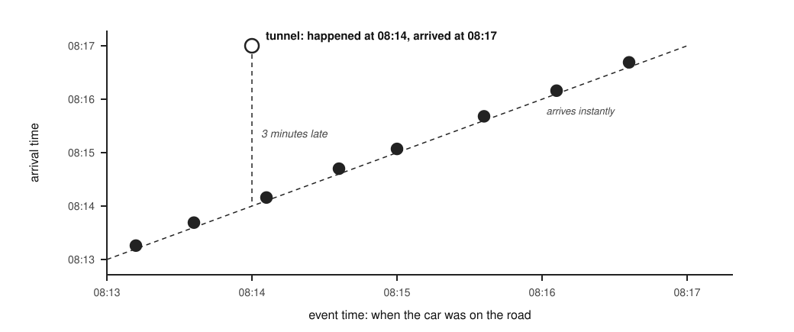
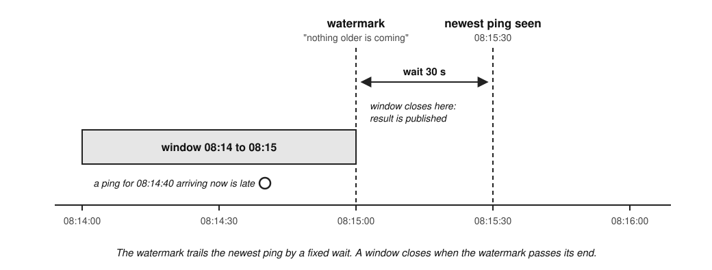
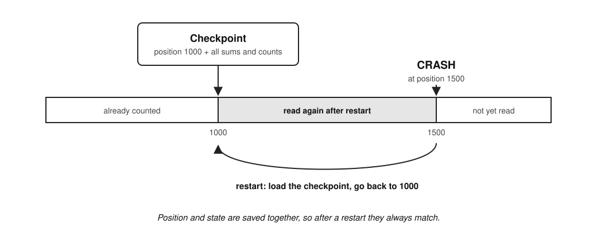

# Chapter 4 — Speed Right Now

## The story

A driver is ten minutes from a junction. The app must decide now whether to send them left or right, and for that it needs the speed on both roads as of this minute.

The pings are already flowing through the log (Chapter 2). What is missing is a program that reads them as they arrive and keeps an up-to-date average speed for every road. That program is a **stream job**, and this chapter uses Apache **Flink** to run it.

The arithmetic is trivial: add up speeds, divide by the count. Everything hard about it comes from one fact:

> **The data never ends.**

A nightly job can wait until the day is over and then compute. A stream job never gets an "over". That raises four questions that a batch job never has to ask:

1. If the input never ends, when is an average finished?
2. What happens to a ping that turns up three minutes late?
3. The job holds millions of running totals in memory. What happens when a machine dies?
4. After it restarts, how do we avoid counting pings twice?

## Idea 1: a stream job is an assembly line

A Flink job is a chain of simple steps, called **operators**. Each step runs as many parallel copies, spread over a cluster of machines.

Wayline's job has four steps:

1. **Read** pings from Kafka. One reader per partition.
2. **Key by `segment_id`.** Regroup the pings so that every ping for one road goes to the same worker.
3. **Window and average.** Each worker keeps a running sum and count for each of its roads.
4. **Write** the result to the serving database that the app reads. (Chapter 7 chooses which database.)

Step 2 is the debt from Chapter 2 being paid. There we partitioned the log by `device_id` to keep the load even, which scattered each road's pings across all partitions. To average a road you need all its pings in one place, so the job hashes `segment_id` and sends each ping across the network to the worker that owns that road. This regrouping is called a **shuffle**.

The running sums and counts are the job's **state**: what it must remember between one ping and the next. Because of the key-by step, the state for segment 4471 lives on exactly one worker, so no two workers ever need to coordinate. That is what lets the job scale by adding workers.

## Idea 2: windows cut the endless stream into pieces

You cannot average a stream that never ends. You can average a slice of it. A **window** is a rule for cutting slices.

- **Tumbling windows** are fixed-size and back to back: 08:14 to 08:15, 08:15 to 08:16. Every ping belongs to exactly one.
- **Sliding windows** are fixed-size and overlapping: "the last 3 minutes, recomputed every minute". Smoother, because each result shares most of its data with the previous one. Every ping belongs to several.
- **Session windows** have no fixed size. A window lasts as long as events keep coming and closes after a quiet gap. Good for "one car's trip", not for road speed.

Wayline uses one-minute tumbling windows, and stores the **sum and count** per road per minute, not the average. The reason is worth remembering: averages cannot be combined, but sums and counts can. Given five one-minute rows, a reader adds the sums, adds the counts, and divides to get the exact five-minute average. Given five averages, it cannot, because a minute with 2 pings would weigh as much as a minute with 200.

A note on names: Flink says "sliding" for fixed-size overlapping windows. Kleppmann calls those "hopping" and uses "sliding" for something slightly different. The idea is the same.

## Idea 3: there are two clocks

Every ping has two times:

- **Event time:** when the car was actually on the road. Stamped by the phone.
- **Processing time:** when the job happens to see the ping.

Usually they are a second or two apart. Sometimes they are not.

A car enters a tunnel at 08:14. The phone has no signal, so it stores its pings and sends them all when it comes out at 08:17. Those pings describe 08:14. Which minute should they count towards?

If the job uses **processing time**, they count towards 08:17. The answer is then wrong twice: the 08:14 average is missing the tunnel traffic, and the 08:17 average is polluted by three-minute-old speeds. Worse, the result depends on when the job ran. Reprocess the same pings tomorrow and you get a different answer.

If the job uses **event time**, they count towards 08:14, where they belong, and the result is the same no matter when or how fast the job runs. This is what Wayline wants. It comes at a price: the job can no longer tell, just by looking at its own clock, whether the 08:14 window is complete.

One more wrinkle: event time comes from the phone's clock, and phone clocks can be wrong. The ingest service compares each ping's event time with the time it was received, and rejects pings that claim to come from the future.

## Idea 4: watermarks, or deciding when to stop waiting

With event time, some ping for 08:14 might always still be on its way. Wait forever and you publish nothing. Publish immediately and you miss the stragglers. The job needs a rule for when to stop waiting.

That rule is the **watermark**. A watermark is a statement the job makes to itself as it reads: *"I believe I have now seen every ping with an event time up to T."*

The simplest way to produce it: take the newest event time seen so far and subtract a fixed wait. With a 30-second wait, when the job sees a ping stamped 08:15:30, the watermark moves to 08:15:00. The window for 08:14 to 08:15 ends at that point, so it closes and its result is published.

The wait is a dial with a clear trade-off:

| Wait | Result is | Result arrives |
|---|---|---|
| short (5 s) | less complete: more pings miss their window | sooner |
| long (5 min) | more complete | much later |

You set it from data. Suppose measurement shows 95% of pings arrive within 5 seconds, 99% within 30 seconds, and 99.9% within 5 minutes. A 30-second wait captures 99%.

A ping that arrives after its window has closed is **late**. There are three things you can do with it, and they combine:

- **Drop it**, and count how many you dropped so that you notice if the number jumps.
- **Reopen the window** for a limited time (Flink calls this *allowed lateness*) and publish a corrected result.
- **Leave it to the batch path.** Every ping still reaches the lake, so the nightly job sees all of them (Chapter 5).

## Idea 5: surviving a crash without counting twice

The job holds a sum and a count for every active road and every open minute. That is perhaps a few gigabytes of state, spread across workers. Machines die, and when one does its memory is gone.

Flink's answer is the **checkpoint**. Every minute or so, it saves a consistent picture of the whole job to durable storage such as S3: every worker's state, *and* the position each reader had reached in the log, taken as of the same moment.

After a crash, the job loads the last checkpoint and rewinds the readers to the saved position. Pings between the checkpoint and the crash are read again. But the state was rewound too, to a moment when those pings had not yet been counted, so each ping is counted exactly once. The log's ability to be re-read (Chapter 2) is what makes this work.

Inside the job, that is the whole story. The trouble is the outside world. Between the checkpoint and the crash, the job may already have written results to the serving database. After the restart it writes them again. Two standard cures:

- **Idempotent writes.** Make the row's identity `(segment_id, minute)` and write with "insert, or overwrite if it exists". Writing the same minute twice leaves one row. This is the simple cure and it is what Wayline uses.
- **Transactional writes.** Hold results back and release them only when the checkpoint that covers them succeeds, so output and checkpoint commit together. This is **two-phase commit**. It works for destinations that support transactions, such as Kafka or an Iceberg table, and it adds a delay of one checkpoint interval.

"Exactly once" in stream processing always means this: at-least-once delivery, plus state that rewinds, plus output that is safe to repeat.

## Decision points

**Flink, Spark Structured Streaming, or Kafka Streams?**
Flink processes one event at a time, with the richest support for event time and large state. Spark Structured Streaming treats a stream as a series of small batches: a little slower to react, and attractive when the team already runs Spark and can share code with batch jobs. Kafka Streams is a library inside your own service with no cluster to run, but it reads and writes Kafka only. Wayline picks Flink for the event-time handling. With looser freshness needs, the other two would be reasonable.

**How fresh, and how complete?**
A one-minute window plus a 30-second wait means a result can be 90 seconds old when it first appears. Chapter 1 promised 60. The way out is to publish early and correct later: emit the running sum and count every 10 seconds while the window is still open, then a final value when it closes. Because writes overwrite by `(segment_id, minute)`, each update simply replaces the last. Readers see a number that starts approximate and firms up.

**What to do about late pings?**
Wayline reopens windows for 5 minutes, drops anything later from the live path, and counts the drops. The batch path picks up everything. Navigation does not need last quarter-hour's average to be perfect.

**What about one very busy road?**
After keying by segment, one motorway can send far more pings to its worker than any other road does. This is the skew from Chapter 2 again, moved downstream. The cure uses the fact that sums and counts combine: first add up small partial totals wherever the pings happen to be, then send only those partial totals to the road's worker. The busy worker receives a few numbers a second in place of thousands of pings.

**How often to checkpoint?**
Each checkpoint costs some work. The gap between checkpoints is how much the job must re-read after a crash. Once a minute is a common middle. State is kept on local disk (the RocksDB state backend), so it can be larger than memory, and only what changed is uploaded.

**What if the job cannot keep up?**
If the serving database slows down, the writer slows, which slows the workers, which slows the readers, which simply read from Kafka more slowly. This is **backpressure**. Nothing is dropped, because the log holds the pings until the job catches up. The symptom to watch is **lag**: how far the job's position is behind the end of the log.

## In Kleppmann's book

| Idea in this chapter | Where in *Designing Data-Intensive Applications* (1st ed.) |
|---|---|
| What stream jobs are used for | Ch. 11, "Processing Streams": "Uses of Stream Processing" |
| Event time vs processing time | Ch. 11, "Reasoning About Time": "Event time versus processing time" |
| When is a window complete; stragglers | Ch. 11, "Reasoning About Time": "Knowing when you're ready" |
| Phone clocks vs server clocks | Ch. 11, "Whose clock are you using, anyway?"; Ch. 8, "Unreliable Clocks" |
| Tumbling, hopping, sliding, session windows | Ch. 11, "Types of windows" |
| Checkpoints | Ch. 11, "Fault Tolerance": "Microbatching and checkpointing" |
| Output and checkpoint committing together | Ch. 11, "Fault Tolerance": "Atomic commit revisited"; Ch. 9, "Atomic Commit and Two-Phase Commit (2PC)" |
| Safe-to-repeat output | Ch. 11, "Fault Tolerance": "Idempotence" |
| Restoring state after a crash | Ch. 11, "Fault Tolerance": "Rebuilding state after a failure" |
| Slow consumers and backpressure | Ch. 11, "Messaging Systems" |
| Skew after regrouping by key | Ch. 6, "Skewed Workloads and Relieving Hot Spots"; Ch. 10, "Handling skew" |

The word "watermark" is Flink's. The book describes the same problem under "Knowing when you're ready".

## Check yourself

1. Pings are partitioned by `device_id` in Kafka, yet the average is per road. Which step fixes this, and what does it cost?
2. Why does Wayline store sum and count per minute and not the average? Show with two minutes of made-up numbers what goes wrong with averages.
3. A phone in a tunnel sends 20 pings three minutes late. Describe what happens to them under processing time, and under event time with a 30-second wait and 5 minutes of allowed lateness.
4. The job crashes 40 seconds after its last checkpoint. Which pings are read twice? Why are they not counted twice? Why might the serving database still receive the same row twice, and why is that harmless here?
5. Product wants the live speed to be 99.9% complete. What does that do to freshness, and what would you offer them?

## In the interview room

*The candidate answers as an engineer who built Wayline's system.*

**Interviewer:** Event time versus processing time. Why does it matter?

**Candidate:** Processing time is when the job sees an event. Event time is when it happened. If I window by processing time, a phone that was offline for three minutes has its old pings counted in the current minute, so one window is missing data and another is polluted. And the result depends on when the job ran, so re-running gives different numbers. With event time, each ping counts towards the minute it describes, and the result is reproducible. The price is that I can never be certain a window is complete.

**Interviewer:** So how does the job decide a window is complete?

**Candidate:** With a watermark: the job's running estimate that it has seen everything up to some event time. The usual version is "newest event time seen, minus a fixed wait". When the watermark passes the end of a window, the window closes. I choose the wait from the measured distribution of lateness. If 99% of pings arrive within 30 seconds, a 30-second wait gives 99% completeness at the cost of 30 seconds of freshness.

**Interviewer:** One Kafka partition stops receiving data. What happens to your watermark?

**Candidate:** It stalls. The job's watermark is the minimum across all its inputs, because it can only claim "nothing older is coming" if that holds for every input. A silent partition never advances, so it holds everything back, windows stop closing, and state builds up. The fix is to mark an input as idle after a timeout so that it is left out of the minimum until it produces data again.

**Interviewer:** How does Flink give exactly-once processing?

**Candidate:** With checkpoints. Periodically it injects a marker into each input stream at the source. The markers flow through the job along with the data. When an operator has received the marker on all its inputs, it saves its state, then passes the marker on. The result is one consistent picture of the whole job: every operator's state, plus the log positions, all as of the same point in the stream, taken without stopping the job. On failure, everything is restored to that picture and the log is re-read from the saved positions. For output, the sink is either idempotent or takes part in a two-phase commit tied to the checkpoint.

**Interviewer:** You store sum and count. Product now wants the median speed. What changes?

**Candidate:** A lot. Sum and count combine: I can merge two partial results by adding them, which is why small state, early aggregation and five-minute rollups all work. A median does not combine. The median of two medians is not the median of the whole. To be exact, I would have to keep every value in the window. The practical answer is a sketch, such as t-digest, which summarises a distribution in a small structure that can be merged, giving an approximate median with a known error.

**Interviewer:** One road gets a huge share of the pings. What do you do?

**Candidate:** After keying by road, that road's worker is overloaded while others idle. Adding workers does not help, since one key always goes to one worker. I split the work into two stages. First, pre-aggregate before the shuffle: each reader builds small sums and counts per road for a second or so. Then send only those partial totals to the road's worker, which merges them. This only works because the aggregate combines, which is one more reason to prefer sum and count.

**Interviewer:** How do you stop state from growing forever?

**Candidate:** For windows, state is released when the window closes and its allowed lateness has passed, so the watermark is also what cleans up. That is another reason a stalled watermark is dangerous. For state that is not tied to a window, such as the set of ping ids already seen for de-duplication, I set a time-to-live so entries expire. And I monitor state size and checkpoint duration, because both creep up long before anything fails.

**Interviewer:** The job is falling behind. What do you look at?

**Candidate:** Lag on the log tells me that it is behind. Backpressure indicators tell me where: the slow operator is the one just after the last operator that reports being blocked. Then I look for the cause. A slow sink, such as the database. A skewed key, which shows as one busy worker among idle ones. Or long checkpoints because state has grown. If it is plain lack of capacity, I stop the job with a savepoint and restart it with more parallel workers.
