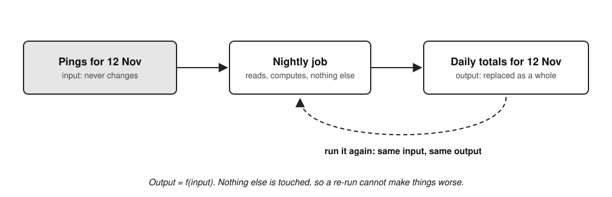
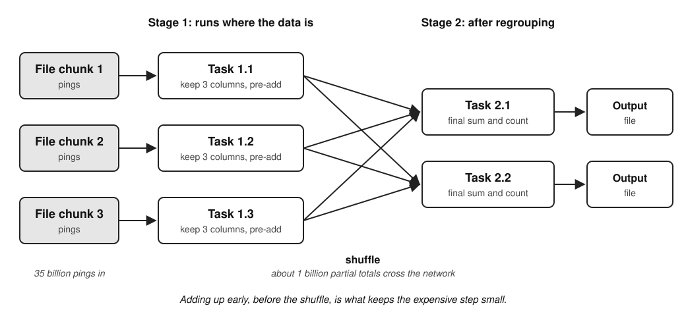
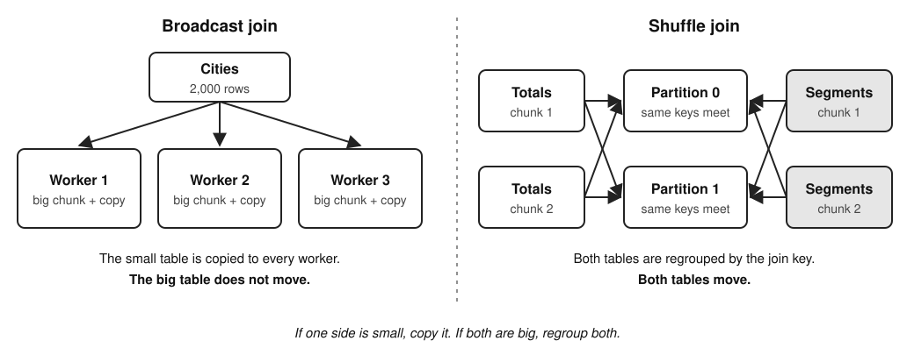
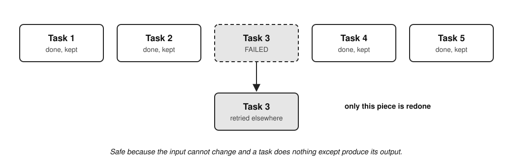
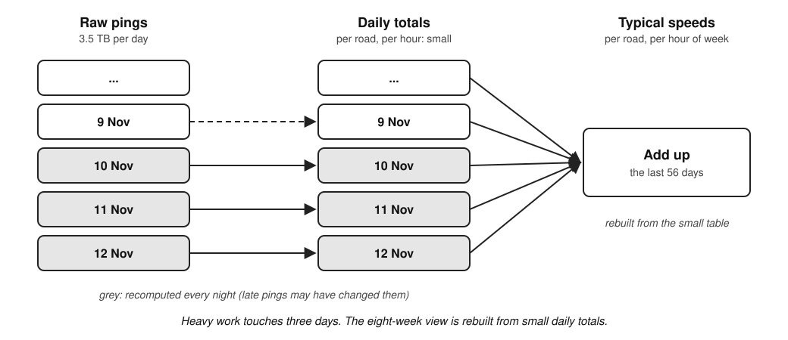

# Chapter 5 — Speed Normally

## The story

It is Sunday evening. A driver asks the app: "If I leave at 08:00 tomorrow, how long will it take?" Nobody has pings from tomorrow. What Wayline does have is every Monday 08:00 of the past two months.

So the second half of the product's question, "how does that compare with normal?", needs a table of **typical speeds**: for each road, for each of the 168 hours of the week, the average speed over the last eight weeks.

This is the opposite of Chapter 4 in every way:

| | Speed right now | Speed normally |
|---|---|---|
| Input | never ends | a finished day |
| Must answer within | seconds | hours |
| Sees late pings | only if it waits | all of them |
| Priority | fresh | correct and cheap |

Work on a finished, fixed input is called **batch processing**. The tool here is Apache **Spark**, run once a night. One day of input is about 35 billion pings. The interesting questions are how to spread that over many machines, how to survive failures halfway through, and how to make the whole thing safe to run again.

## Idea 1: a batch job is a function

The single most useful property of a batch job is also the simplest.

The nightly job reads the pings for one day and writes the totals for that day. It changes nothing else: it sends no emails, updates no counters, and never modifies its input. Its output is a pure function of its input.

Three things follow:

- **It is safe to run again.** If the job fails at 03:00, run it again. If it succeeded with a bug, fix the bug and run it again. The second run replaces the first run's output completely, so there is nothing to clean up. This property is called **idempotence**, the same idea as in Chapter 2, now applied to a whole job.
- **It is easy to test.** Give it a small known input and compare the output.
- **Mistakes are recoverable.** Because the raw pings are never altered, a wrong output is a nuisance, never a loss.

The rule that makes this work: **replace, never append.** A job that appends its results to a table doubles them when run twice. A job that overwrites the partition for 12 November leaves exactly one copy however many times it runs. With Iceberg (Chapter 3) the overwrite is a single atomic commit, so readers see the old day or the new day and never a mixture.

## Idea 2: split the work, then regroup once

No single machine can read 35 billion pings in reasonable time. Spark cuts the input into chunks and runs the same small program on each chunk in parallel. Each run of that program on one chunk is a **task**.

Some operations can be done on a chunk in isolation: keep only three columns, drop bad pings, convert the timestamp into an hour. Spark chains these together and runs them in one pass.

"Sum per road" is different. Pings for road 4471 are spread over every chunk, so they must be brought together. That is a **shuffle**, the same regrouping as in Chapter 4: each row is sent across the network to a worker chosen by the hash of its key. A shuffle is where a job's work is divided into **stages**. Everything before it is stage 1, and everything after is stage 2.

The shuffle is the expensive part. Rows are written to disk, sent over the network, and read again. So the main skill in batch processing is to **shuffle as little as possible**, and there is a neat trick for that here. Because sums and counts combine, each stage-1 task first adds up its own chunk: one partial total per road per hour. Only those partial totals are shuffled. 35 billion pings go in, and about a billion small rows cross the network.

This is why "can the result be combined from partial results?" keeps coming up in this book. Sum, count, minimum and maximum can. Average can if you carry sum and count. Median and "count of distinct devices" cannot, and jobs that need them are far more expensive.

## Idea 3: joining two tables

The daily totals know a road only as a number. Analysts want results by city, and the congestion measure is "speed as a fraction of the speed limit". Both live in another table, `segments`. Combining two tables on a shared key is a **join**, and in a distributed system there are two ways to do it.

- **Broadcast join.** If one table is small, send a full copy of it to every worker. Each worker then looks up matches locally. The big table never moves. This is fast and immune to skew.
- **Shuffle join.** If both tables are big, regroup both by the join key so that matching rows land on the same worker, then match them there. It always works, and it costs two shuffles.

"Small" means it fits comfortably in every worker's memory. A table of 2,000 cities is clearly small. Wayline's 50 million segments, at a couple of gigabytes, is borderline: possible to broadcast, risky if it grows.

The order of operations matters more than the join type. **Add up first, join second.** Joining 35 billion pings to the segments table and then summing means joining about 35 times as many rows as summing to a billion rows first and then joining. The result is identical.

## Idea 4: failure is routine

A job running for an hour on a hundred machines will regularly lose one. Spark's answer is modest and effective.

If a task fails, Spark runs that task again, usually on another machine. The other tasks' results are kept. This is safe for the reasons in Idea 1, applied in miniature: the task's input cannot change, and the task does nothing but produce output. Run it twice and you get the same thing.

Two refinements:

- **Slow tasks.** One sluggish machine can hold up a whole stage. Spark can start a second copy of a slow task elsewhere and use whichever finishes first.
- **Unfinished output is invisible.** Tasks write to files nobody is looking at yet. Only when the whole job succeeds are those files committed to the table, in one step. A job that dies leaves no half-written day behind.

This has a pleasant effect on cost. Cloud providers sell spare machines at a large discount on the condition that they can be taken back at short notice. A system that treats losing a machine as routine can use them. Wayline's nightly cluster is started for the job, runs mostly on these discounted machines, and is shut down afterwards.

The property can be broken. A task that uses the current time or a random number produces different output when retried, and the result quietly mixes two versions. Tasks must be **deterministic**.

## Idea 5: late pings and the two-level design

Chapter 3 chose to file each ping under the day it describes. So a ping from 23:58 on the 11th that arrives on the 12th lands in the partition for the 11th, after the nightly job has processed that day. The totals for the 11th are now slightly wrong.

The cure uses Idea 1. Since re-running is safe, **re-run recent days every night.**

The job is built in two levels:

1. **Daily totals.** For each day: sum and count per road per hour. Every night the job recomputes the last three days and overwrites those three partitions. Almost all late pings arrive within three days, so they are picked up without any special handling.
2. **Typical speeds.** Add up the last 56 days of daily totals per road and hour of week. This reads only the small daily table, so it is rebuilt from scratch each night.

The heavy step touches three days of raw pings, never eight weeks. And if the definition of "typical" changes, say from eight weeks to twelve, only the cheap second level is re-run.

The stream job and the batch job now each have a clear role. The stream job is fast and slightly incomplete. The batch job is a day behind and complete. Chapter 9 returns to how to check that they agree.

## Decision points

**Spark, or just SQL on a query engine?**
This job is essentially one `GROUP BY`, and a query engine such as Trino could run it. Spark earns its place on large, long jobs: it copes with shuffles bigger than memory by using disk, and it recovers from a lost machine by redoing a few tasks. Query engines are built for speed on interactive queries and have traditionally restarted the whole query on failure. For a nightly job over terabytes, Spark is the safer default. For a small table, plain SQL on the query engine is simpler.

**Recompute everything, or only what changed?**
Recomputing all history nightly is simplest and wasteful. Processing only new pings is cheapest and fragile: one missed day is wrong forever. Wayline's middle path is to recompute a short, fixed window of recent days in full. It stays idempotent and costs three days of work per night.

**How many days to recompute?**
Set it from the lateness you measure, as with the watermark in Chapter 4. If 99.99% of pings have arrived within three days, three days is enough. Anything later is ignored, and counted.

**How many weeks is "typical"?**
A long window is stable and slow to notice a new bypass or a closed bridge. A short window reacts quickly and is thrown off by one public holiday. Eight weeks gives each hour-of-week bucket eight samples. Holidays are best excluded with a calendar.

**How many pieces after the shuffle?**
Too few and each piece is too big for a worker's memory. Too many and the job drowns in tiny tasks and tiny output files, which is the small files problem from Chapter 3. Aim for pieces of a few hundred megabytes. Recent Spark versions adjust this while the job runs.

**What about skew?**
For the sum, the busy motorway is harmless: pre-adding in stage 1 reduces it to one row per chunk before the shuffle. For joins, a key with a huge number of rows overloads one worker. The cures are to broadcast the other side when it is small, or to let Spark split the oversized piece into several.

**Where does the result go?**
Into an Iceberg table for analysts, and into the serving database for the app. That second copy is large: 50 million roads × 168 hours is up to 8.4 billion rows. How to serve that is the subject of Chapter 7.

## In Kleppmann's book

| Idea in this chapter | Where in *Designing Data-Intensive Applications* (1st ed.) |
|---|---|
| Batch as a function of immutable input; safe re-runs | Ch. 10, "The Output of Batch Workflows": "Philosophy of batch process outputs" |
| Splitting work into tasks over chunks of files | Ch. 10, "MapReduce and Distributed Filesystems": "MapReduce Job Execution" |
| Regrouping by key; grouping and aggregation | Ch. 10, "Reduce-Side Joins and Grouping": "GROUP BY" |
| Shuffle join | Ch. 10, "Reduce-Side Joins and Grouping": "Sort-merge joins" |
| Broadcast join | Ch. 10, "Map-Side Joins": "Broadcast hash joins" |
| Skew in grouping and joins | Ch. 10, "Reduce-Side Joins and Grouping": "Handling skew" |
| Stages chained without writing every step to storage | Ch. 10, "Beyond MapReduce": "Materialization of Intermediate State", "Dataflow engines" |
| Retrying tasks; why tasks must be deterministic | Ch. 10, "Beyond MapReduce": "Fault tolerance" |
| Re-running over history when logic changes | Ch. 12, "Batch and Stream Processing": "Reprocessing data for application evolution" |
| Batch engines compared with parallel databases | Ch. 10, "Comparing Hadoop to Distributed Databases" |

The book explains these ideas mostly through MapReduce, Spark's predecessor. The concepts carry over directly. Spark is covered under "Dataflow engines".

## Check yourself

1. The nightly job is accidentally started twice for the same day. What happens to the daily totals? What would have happened if the job appended its output?
2. Why do only about a billion rows cross the network when 35 billion pings are read? Which property of the calculation makes that possible?
3. Someone writes the job as "join pings to segments, then sum by city". The result is right. What is wrong with it?
4. A machine is taken away 40 minutes into a one-hour job. Roughly how much work is lost, and why is the final output still correct?
5. A ping for 11 November arrives on 13 November. Follow it through the lake, the daily totals and the typical speeds. When is it reflected in each?

## In the interview room

*The candidate answers as an engineer who built Wayline's system.*

**Interviewer:** You already have a stream job. Why run a batch job as well?

**Candidate:** They answer different questions with different constraints. The stream job must publish within seconds, so it closes each minute before every ping has arrived. The typical-speed table has no urgency, so the batch job can wait until the day is complete and be exact. Batch is also the simpler and more forgiving model: fixed input, output that is replaced as a whole, and a failed run is fixed by running it again. I use the stream only where freshness demands it.

**Interviewer:** Walk me through what Spark actually does for "sum of speed per road per hour".

**Candidate:** It reads the day's Parquet files as chunks, one task per chunk. Each task reads only the three columns it needs, derives the hour, and builds partial sums and counts for the roads in its chunk. That is stage 1. The partial rows are then shuffled: hashed by road and hour and sent to the worker that owns that hash range. Stage 2 merges the partial totals per key and writes the output files. When all tasks have succeeded, the files are committed to the table as one snapshot.

**Interviewer:** What exactly makes your job safe to re-run?

**Candidate:** Four things together. The input is immutable: I read a specific snapshot of the pings table. The logic is deterministic: no current time, no random numbers, no dependence on row order. The output replaces a whole partition, never appends. And the replacement is atomic, so readers never see half of it. If any one of those is missing, a re-run can produce duplicates or a mixture.

**Interviewer:** The job normally takes 40 minutes. Tonight it has been running for three hours. How do you investigate?

**Candidate:** I find the slow stage, then look at how task durations are spread within it. If most tasks took a minute and a few took an hour, that is skew: some key has far more rows than the rest. If all tasks are slow, I look at what changed: input volume, a flood of small input files, memory pressure causing data to spill to disk, or too few machines because discounted ones were reclaimed. The spread of task times is the fastest way to tell those apart.

**Interviewer:** Say it is skew, in a join. How do you fix it?

**Candidate:** In order of preference. If the other table is small enough, broadcast it. Then there is no shuffle of the big table and skew stops mattering. If not, let the engine split the oversized partition into several and join each against a copy of the matching rows from the other side. Recent Spark versions do this automatically. The manual version is "salting": add a random suffix to the hot key on the big side, and replicate the matching rows on the other side once per suffix. And sometimes the right fix is to ask why the key is hot. A null or default id that matches millions of rows is a data problem.

**Interviewer:** You run on discounted machines that can be taken away. What happens when one disappears mid-job?

**Candidate:** Its running tasks fail and are rescheduled elsewhere. There is a second, less obvious loss: the shuffle output that the machine had already produced and was holding for the next stage. Tasks that need it fail to fetch it, and Spark re-runs the earlier tasks that created it. So one lost machine can cost more than its current tasks. I limit the damage by keeping the coordinating process on a regular machine, and by using the cloud's advance warning to move shuffle data off a machine before it goes.

**Interviewer:** Why store daily totals at all? Why not compute typical speeds straight from eight weeks of pings?

**Candidate:** Cost and flexibility. Straight from raw would read 200 TB every night to produce a table in which only the newest day's contribution changed. With daily totals as a middle layer, the heavy step reads three days, and the eight-week table is rebuilt from a table that is far smaller. If the definition changes, to twelve weeks or to excluding holidays, I re-run only the cheap step. It works because sums and counts can be added across days.

**Interviewer:** And if product asks for the median instead of the average?

**Candidate:** Then the middle layer no longer works as it stands, because daily medians cannot be combined into an eight-week median. I would store a mergeable sketch of each day's speed distribution in place of the sum and count, and merge the sketches. That gives an approximate median with a known error bound and keeps the two-level design. An exact median would mean going back to raw pings for the full window.
