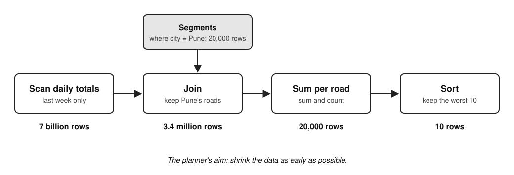
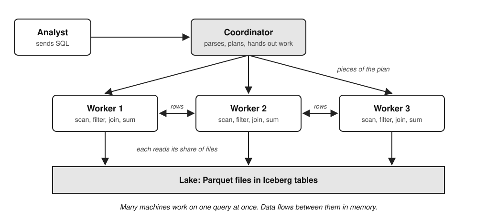
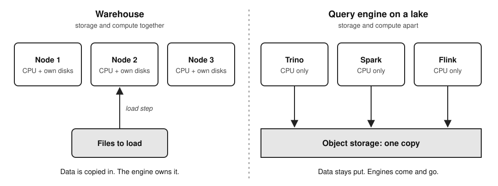
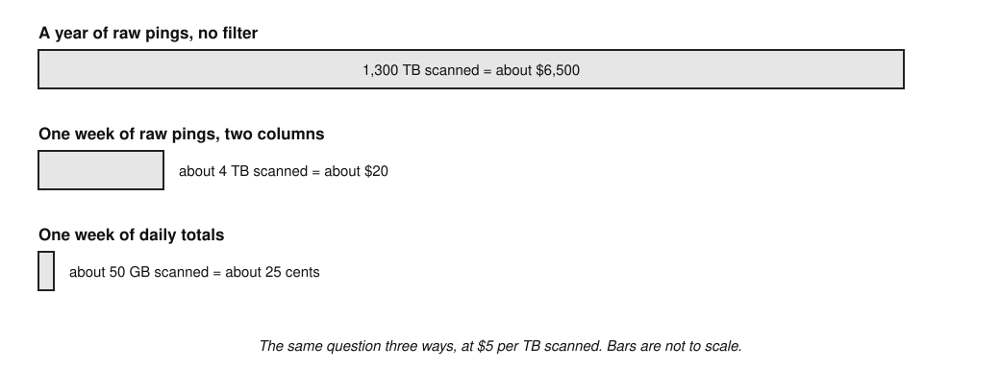
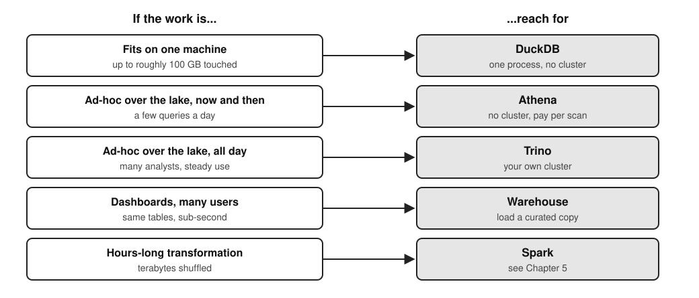

# Chapter 6 — Asking Questions

## The story

Monday morning, a city planner calls Wayline's analyst: "Which ten roads in Pune were worst last week?"

Nobody built anything for that question. There is no table of "worst roads in Pune". Tomorrow the question will be about Nagpur, or about Friday evenings, or about roads near schools. This is the third clock from Chapter 1: **ad-hoc questions**, where the person will wait seconds or a minute, the data is hours old, and each answer may need to look at billions of rows.

The analyst writes one SQL statement:

```sql
SELECT s.name,
       SUM(t.speed_sum) / SUM(t.ping_count) / s.speed_limit_kmh AS ratio
FROM   daily_totals t
JOIN   segments s ON s.segment_id = t.segment_id
WHERE  s.city = 'Pune'
  AND  t.day BETWEEN DATE '2026-11-09' AND DATE '2026-11-15'
GROUP  BY s.name, s.speed_limit_kmh
ORDER  BY ratio
LIMIT  10;
```

A road moving at 20% of its speed limit is more congested than one at 80%, so the lowest ratios are the worst roads.

The tables are files in the lake (Chapter 3). Something has to turn that SQL into work on those files. That something is a **query engine**. This chapter covers four of them: **Trino**, **Athena**, **Redshift** (standing in for warehouses in general) and **DuckDB**. They share most of their ideas and differ mainly in where the data lives and how you pay.

## Idea 1: you say what, the engine decides how

SQL is **declarative**: it states the result wanted and says nothing about how to get it. The analyst did not say which table to read first, how to join, or how many machines to use. The engine's **planner** decides.



The same answer can be reached by plans that differ a thousandfold in cost, and the planner's guiding rule is to **shrink the data as early as possible**:

- **Skip by partition.** The filter on `day` means seven days of files are considered and the rest are never opened.
- **Read few columns.** Only `segment_id`, `speed_sum` and `ping_count` are read.
- **Filter the small table first.** Of 50 million segments, only about 20,000 are in Pune. The engine finds those first, then uses them to discard non-Pune rows from the big table. Good engines push that list of ids into the scan of the big table, so whole files that contain no Pune road are skipped.
- **Aggregate, then sort.** Summing reduces millions of rows to 20,000. Sorting 20,000 rows is trivial.

To choose well, the planner needs **statistics**: how many rows each table has, and how many distinct values each column holds. Iceberg's metadata supplies much of this. With poor statistics a planner may, for example, pick the wrong table to copy to every worker, and a two-second query becomes a two-minute one.

In data warehouse vocabulary, `daily_totals` is a **fact table** (many rows, each one a measurement) and `segments` is a **dimension table** (fewer rows, describing the things measured). A big fact table surrounded by small dimension tables is a **star schema**, and almost every analytical query is this shape: filter by dimensions, add up facts.

## Idea 2: many machines, one query

Seven billion rows is too much for one machine to scan quickly. Trino spreads a single query across a cluster. This design is called **MPP**, massively parallel processing.



- The **coordinator** receives the SQL, plans it, cuts the plan into pieces, and hands them out.
- **Workers** each read their share of the files, filter and partly add up, then pass rows to one another for the join and the final sum.
- Workers share nothing: no memory and no disks. They cooperate only by sending rows over the network.

This is the same shape as Spark in Chapter 5: split, do local work, shuffle, finish. The difference is in what each is tuned for.

| | Spark (Chapter 5) | Trino |
|---|---|---|
| Built for | long transformations | interactive questions |
| Data between steps | written to disk when large | streamed in memory |
| A machine fails | redo a few tasks | traditionally, the query fails and is re-run |
| Start-up cost | noticeable | small |
| Typical run | minutes to hours | seconds to minutes |

Streaming in memory with no checkpoints is what makes Trino quick, and it is also why a failure usually costs the whole query. For a ten-second query that is a fine trade. For a three-hour job it is not.

Speed also comes from how rows are handled inside a worker. Because data arrives as columns, the engine processes a few thousand values of one column at a time in a tight loop, which modern processors execute very efficiently. This is **vectorised execution**, and it is a large part of why column engines outrun row-at-a-time databases on analytics even on one machine.

Trino can also query several systems in one statement, for example joining lake tables with a table in Postgres. Each system is reached through a connector. This is called **federation**.

## Idea 3: where the data lives

There are two families of analytical system, and the difference is whether the engine owns the data.



A classic **warehouse**, such as Redshift, is an MPP database in which each node has its own disks. Data is **loaded** into it, in a format the engine controls. Because the engine owns the data, it can lay it out exactly as it likes, keep detailed statistics, and cache aggressively. The result is very fast, predictable queries for many simultaneous users. The costs: the data is a second copy that has to be kept up to date, it is locked in that system's format, and storage and compute traditionally grow together.

A **query engine on a lake**, such as Trino or Athena, owns no data. Workers are pure compute. The data sits once in object storage in open formats, and any engine can read it. Compute can be resized, or switched off, without touching the data. The cost is that every read is a network request to object storage, and the engine only knows what the table metadata tells it.

The line has blurred. Modern warehouses such as Snowflake and BigQuery separate storage from compute internally, and Redshift can query lake files too. The useful question is no longer "lake or warehouse?" but "who owns this table's files, and which engines need to read them?"

## Idea 4: how you pay changes how you design

Trino and Athena are close relatives: Athena is Amazon's managed service built on the same engine. The practical difference is the bill.

- With **your own Trino cluster**, or a provisioned warehouse, you pay for machines by the hour, whether queries run or not.
- With **Athena**, there is no cluster. You pay per query, by the amount of data scanned: $5 per terabyte at list price at the time of writing.

Paying per byte scanned turns the layout decisions of Chapter 3 directly into money.



The same question costs thousands of dollars, twenty dollars, or a quarter, depending on whether the query filters by partition, reads only the columns it needs, and uses a pre-aggregated table. Nothing about the engine changed. This is the strongest argument for the daily totals table of Chapter 5: it was built for the nightly job, and it also makes analyst queries like this one far cheaper.

Tables like `daily_totals`, computed in advance because many questions need them, are the modern form of what warehouse people call **materialised views** or **data cubes**: trade storage and a nightly job for fast, cheap reads.

## Idea 5: one machine is often enough

A week of daily totals for one city is a few gigabytes. Starting a cluster for that is like hiring a lorry to carry a letter.

**DuckDB** is an analytical database that runs inside a single process, on a laptop or one server. It has no cluster and nothing to install or operate. It reads Parquet files and Iceberg tables directly, and it uses the same techniques as the big engines: column storage, vectorised execution and all the processor's cores. For data that fits on one machine it is frequently faster than a cluster, because it never pays for coordination or network transfer.

The lesson is general: **distribution is a cost you pay for scale, not a feature.** A single modern server has dozens of cores and hundreds of gigabytes of memory. Ask how much data one query actually touches, after partition pruning and column selection, before reaching for a cluster.



## Decision points

**Raw pings or daily totals?**
Always the most aggregated table that can answer the question. Raw pings are for questions the totals cannot answer, such as anything about individual trips.

**Athena or your own Trino?**
Athena for occasional or unpredictable use: no machines to run and no cost when idle. Your own cluster when queries run all day, since at some volume of scanning a fixed cluster is cheaper, and when you need control over tuning and concurrency. Many teams start on Athena and move the heavy users to Trino later. The SQL is the same.

**Add a warehouse?**
When there are dashboards used by many people at once that must respond in under a second, on a stable set of tables. Load a curated, aggregated copy of the data into the warehouse for those, and leave raw data and exploration on the lake. Wayline has a handful of analysts and no such dashboards yet, so it has no warehouse.

**Trino or Spark for a given query?**
If a person is waiting, Trino. If it runs on a schedule, takes more than a few minutes, or shuffles more than fits in memory, Spark.

**Exact or approximate?**
"How many distinct devices drove in Pune last month?" is expensive to answer exactly, because distinct counts cannot be added up from partial results. Engines offer approximate versions that are accurate to within a couple of percent, use a small fixed amount of memory, and can be combined. For a planning question, approximate is the right answer.

**How do you stop one query hurting everyone?**
On a shared cluster, one careless query can take all the memory. Set limits per query and per group of users, and queue what exceeds them. On Athena, cap the data a single query may scan, so a missing `WHERE` clause costs an error message and not $6,500.

## In Kleppmann's book

| Idea in this chapter | Where in *Designing Data-Intensive Applications* (1st ed.) |
|---|---|
| Lookups vs analytics as two workloads | Ch. 3, "Transaction Processing or Analytics?" |
| Warehouses; loading data into them | Ch. 3, "Data Warehousing" |
| Fact and dimension tables, star schema | Ch. 3, "Stars and Snowflakes: Schemas for Analytics" |
| Column storage and vectorised processing | Ch. 3, "Column-Oriented Storage" (see "Memory bandwidth and vectorized processing") |
| Pre-computed aggregates | Ch. 3, "Aggregation: Data Cubes and Materialized Views" |
| Declarative queries and the planner | Ch. 2, "Query Languages for Data" |
| One query run across many nodes | Ch. 6, "Parallel Query Execution" |
| MPP databases compared with batch engines | Ch. 10, "Comparing Hadoop to Distributed Databases" |
| Query engines moving towards declarative, optimised plans | Ch. 10, "High-Level APIs and Languages" |
| One query over several storage systems | Ch. 12, "Unbundling Databases": "Composing Data Storage Technologies" |

The products in this chapter are newer than the book. The ideas they are built on are all there.

## Check yourself

1. In the Pune query, list three things the planner does to avoid reading data, and which earlier chapter's design choice makes each possible.
2. A Trino worker dies eight seconds into a ten-second query. What happens? Why is that acceptable here and not for the nightly job?
3. The same query costs $20 on raw pings and 25 cents on daily totals in Athena. Where did the difference come from?
4. Wayline adds a public dashboard that 5,000 city officials open every morning. Which engine would you put behind it, and what data would you give it?
5. An analyst wants to explore one city's daily totals for a month on a laptop. What would you suggest, and why not the cluster?

## In the interview room

*The candidate answers as an engineer who built Wayline's system.*

**Interviewer:** An analyst complains a query takes 20 minutes. How do you make it fast?

**Candidate:** I look at what it reads before I look at the engine. Does it filter on the partition column, so that most days are skipped? Does it select only the columns it needs? Is it hitting raw pings when the daily totals table would answer it? Those three usually account for most of it. Then I read the query plan: which table is being copied to every worker, whether the filter on the small table is being used to prune the big one, and whether the row estimates are far off, which points to missing statistics. Only after that would I add machines.

**Interviewer:** How does Trino execute a query?

**Candidate:** The coordinator parses the SQL, produces a plan, and cuts it into stages at the points where data must be regrouped. Each stage runs as tasks on many workers. Table scans are divided into splits, which are chunks of files, and handed out to workers. Rows flow from stage to stage over the network as they are produced, with nothing written to disk in between, and the final stage streams results back through the coordinator. It is a pipeline that runs all at once, not step by step.

**Interviewer:** Trino and Spark both run SQL over the lake. When do you use which?

**Candidate:** Trino when someone is waiting for the answer. It starts quickly and streams everything in memory, so short queries are fast. But a worker failure traditionally fails the query, and a shuffle larger than memory is a problem. Spark when the job is long or large: it spills to disk, and it recovers from a lost machine by redoing a few tasks. Trino now has an optional fault-tolerant mode, which narrows the gap, but my default split is still interactive on Trino and scheduled heavy work on Spark.

**Interviewer:** Athena or your own Trino cluster?

**Candidate:** It is a cost-shape decision. Athena charges per terabyte scanned and nothing when idle, with no operations. A cluster costs the same every hour regardless of use. With a few analysts running occasional queries, Athena is cheaper and simpler. With steady, heavy use the per-scan charges overtake the cost of a cluster, and I'd also want control over memory limits and concurrency. Because both speak nearly the same SQL over the same Iceberg tables, moving between them is not a rewrite.

**Interviewer:** Why would anyone still buy a warehouse like Redshift?

**Candidate:** For predictable speed under many simultaneous users. A warehouse owns its storage, so it controls layout, statistics and caching end to end, and it handles hundreds of concurrent dashboard queries with consistent sub-second times. A lake engine reading open files over the network is harder to make that consistent. So the common pattern is both: raw and exploratory data on the lake, and small curated tables loaded into a warehouse for dashboards.

**Interviewer:** How does the engine choose a join strategy, and what goes wrong?

**Candidate:** It estimates the size of each side from statistics. If one side is small after filtering, it copies that side to every worker. Otherwise it regroups both sides by the join key. It also picks the order of joins to keep intermediate results small. What goes wrong is bad estimates. If the engine thinks a table has a thousand rows and it has a billion, it tries to copy a billion rows to every worker and runs out of memory. The cure is to keep table statistics current and to check the estimated row counts in the plan against reality.

**Interviewer:** "Number of distinct devices per city yesterday." Why is that expensive, and what would you do?

**Candidate:** Because distinct counts do not add up. A device seen at 08:00 and again at 09:00 must be counted once, so I cannot sum hourly counts. The exact method has to bring every device id for a city together, which is a huge shuffle. I would use an approximate distinct count based on a sketch such as HyperLogLog: a small fixed-size summary, accurate to a couple of percent. Sketches can be merged, so I can store one per city per hour in the daily totals and combine them cheaply for the day. Device ids change daily (Chapter 9), so across several days the honest figure is device-days, not devices.

**Interviewer:** One analyst's query takes down the shared cluster. How do you prevent a repeat?

**Candidate:** Limits and separation. Per-query limits on memory and run time, so a runaway query is killed and the cluster survives. Resource groups, so that each team gets a share and excess queries wait in a queue. Separate clusters for scheduled jobs and for interactive use, so that neither starves the other. And on Athena, a cap on bytes scanned per query. I would also look at why the query was so heavy. Usually it is a missing partition filter, and a rule that rejects such queries on the big tables stops it at the source.
