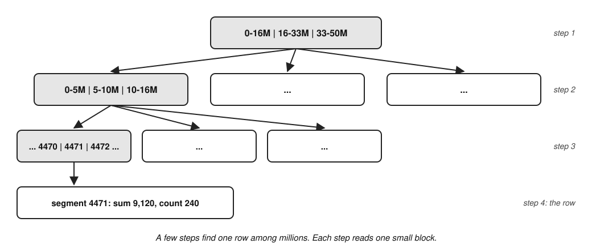
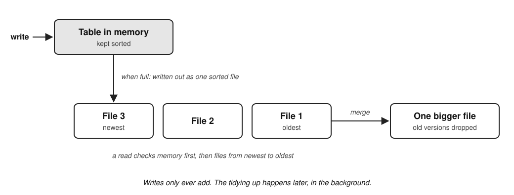
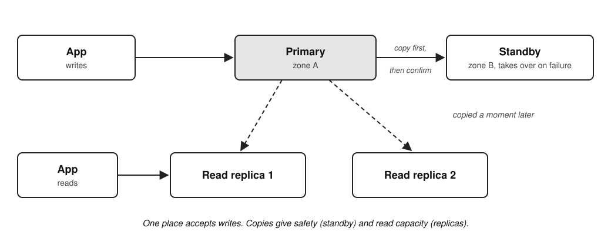
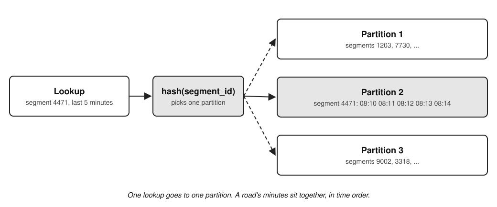
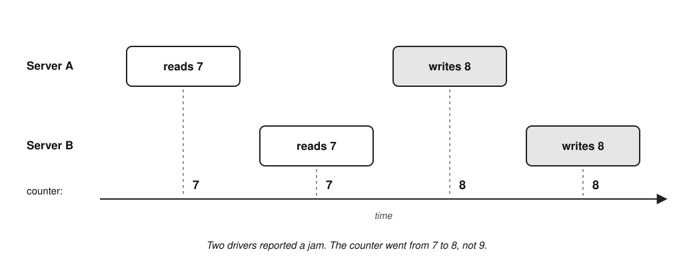

# Chapter 7 — Serving the Answer

## The story

Everything so far has been preparation. The stream job produces a speed for each road each minute. The nightly job produces typical speeds. None of it matters until a phone can ask a question and get an answer before the driver reaches the junction.

The app asks two things:

- "What is the speed on segment 4471 **right now**?"
- "What is the speed on 4471 on a **normal** Monday at 08:00?"

It asks them 50,000 times a second, and each answer must come back in under 50 milliseconds, 99 times out of 100.

This is the opposite workload to Chapter 6. An analyst's query reads billions of rows and returns ten. A lookup reads one row and returns one. Systems built for this are often called **OLTP** databases (online transaction processing), as opposed to the **analytical** systems of the last chapter.

| | Lookup (this chapter) | Analytics (Chapter 6) |
|---|---|---|
| One request touches | a few rows, by key | millions of rows |
| Requests per second | tens of thousands | a handful |
| Each must take | milliseconds | seconds to minutes |
| Storage layout | by row, with an index | by column, in big files |

The earlier diagrams simply said "Postgres". That is where Wayline starts, on Amazon **RDS**, a service that runs Postgres for you: backups, patches, and replacing failed machines. This chapter is about what a database like that does to be fast, and what happens when one of them is no longer enough.

## Idea 1: an index finds one row without looking at the others

A lookup that scans the table is hopeless: millions of rows read to return one. An **index** is a separate structure that answers "where is the row for key X?" in a few steps.

The standard index is the **B-tree**.

A B-tree is a sorted tree of small blocks. The top block says which range of keys lives under which child. You follow one pointer per level, and each level narrows the range by a factor of several hundred. Three or four levels are enough for billions of rows, and the top levels are almost always already in memory. So a lookup costs a handful of memory reads and perhaps one disk read.

Because the tree is sorted, it also answers range questions cheaply: "segment 4471, minutes 08:10 to 08:14" is one walk down the tree and a short stroll sideways.

An index is not free. Every insert or update must also update every index on the table. Each extra index makes reads of one kind faster and all writes slower. The rule is to create exactly the indexes your lookups need.

## Idea 2: two ways to build a storage engine

A B-tree keeps data sorted by **changing blocks in place**: find the right block, modify it, write it back. That makes reads quick and writes comparatively costly, since each write touches a block somewhere at random.

There is a second design, built for heavy writing: the **LSM-tree** (log-structured merge-tree).

1. A write goes into a sorted table **in memory**, and that is all. It is as fast as a write can be.
2. When the memory table fills, it is written out as one sorted, unchangeable file.
3. Files accumulate. A background process **merges** them into bigger sorted files and discards overwritten values.
4. A read checks memory, then the files from newest to oldest, until it finds the key.

You have met this before. It is the same pattern as the lake in Chapter 3: write small immutable files, tidy up later with compaction. It is also how Flink keeps its state on disk in Chapter 4.

| | B-tree | LSM-tree |
|---|---|---|
| A write | changes a block in place | appends, merged later |
| Best at | reads, range scans, steady latency | high write rates |
| Weak spot | many random writes | a read may check several files; merging competes for disk |
| Used by | Postgres, MySQL, most relational databases | Cassandra, HBase, RocksDB |

Neither is better in general. The question is whether your workload is mostly reads or mostly writes.

## Idea 3: copies, for safety and for reads

One database machine is one failure away from an outage. As with the log in Chapter 2, the answer is copies, with one copy in charge.

The **primary** accepts all writes. Two kinds of copy follow it, for two purposes:

- A **standby** in another data centre receives every write *before* the primary confirms it. If the primary dies, the standby takes over within a minute or two and no confirmed write is lost. On RDS this is called Multi-AZ. It buys safety and slows each write slightly.
- **Read replicas** receive writes a moment *after* the primary confirms. They can serve lookups, so adding replicas adds read capacity. They buy scale and cost a little staleness.

That staleness is called **replication lag**, and it produces a specific bug. Suppose Wayline lets a driver report a jam. The report is written to the primary. The app immediately reloads the screen, the read goes to a replica that is 200 milliseconds behind, and the driver's own report is missing. They tap again.

The guarantee the driver expected has a name: **read-your-writes**. Ways to provide it:

- after a user writes, send that user's reads to the primary for a few seconds;
- or have the app show what it just wrote without asking the database.

A second anomaly is going back in time: two successive reads hit two replicas, the second further behind than the first, and data appears and then vanishes. Sending each user consistently to the same replica prevents it.

Most of Wayline's reads do not care. A speed that is 200 ms stale is as good as fresh. The skill is knowing which reads tolerate lag and which do not.

## Idea 4: when one primary is not enough, split by key

Replicas multiply reads. They do nothing for writes, because every write still goes through the one primary.

Count Wayline's writes. Suppose two million roads have traffic in a given minute, and the stream job refreshes each every ten seconds. That is 200,000 writes a second. A single Postgres primary handles thousands of small writes a second comfortably, and tens of thousands with care. 200,000 is beyond it.

The answer is the one from Chapter 2: **partition**. Split the data across many machines by a hash of the key, so that each machine takes a share of the writes.

Amazon **DynamoDB** is a database built around this from the start. You declare a **partition key** (here `segment_id`) and optionally a **sort key** (here the minute). The partition key decides which machine holds the item. Within one partition key, items are kept in sort-key order. So "segment 4471, last five minutes" goes to exactly one partition and reads five neighbouring items. Each partition keeps its own copies across data centres, and the service splits partitions further as data grows.

The price of this scaling is flexibility:

| | Postgres | DynamoDB |
|---|---|---|
| Scales writes by | a bigger machine | adding partitions, automatically |
| Queries | anything SQL can express, joins included | by key, or key plus range |
| Design order | model the data, then write queries | list the lookups first, then design keys to fit |
| Changes spanning many rows | ordinary transactions | limited, and cost more |
| Operations | you choose sizes, replicas, upgrades | no servers to manage: pay for throughput |

A partitioned key-value store is extremely good at the exact lookups it was designed for and poor at anything else. That suits live speeds: there is one lookup, by road, and it will not change.

So Wayline splits its serving layer by workload:

- **Live speeds** go to DynamoDB: a huge write rate and one simple lookup. Old minutes expire automatically.
- **Typical speeds** are written once a night and then only read. Either store would work. Wayline keeps them in Postgres, where the nightly load can be swapped in with one transaction.
- **Everything relational** stays in Postgres: roads and their attributes, user accounts, jam reports, anything that needs joins or transactions.

## Idea 5: transactions keep concurrent changes from colliding

Back to jam reports. Each road has a counter of reports in the last ten minutes. Two drivers report the same jam at the same moment, and two app servers each run "read the counter, add one, write it back".

Both read 7, and both write 8. One report has vanished. This is a **lost update**, the classic bug of concurrent access. Nothing crashed, and no error was raised.

A **transaction** groups several steps into one unit with guarantees. Two matter here:

- **Atomicity:** all of the steps happen, or none. A transfer never debits without crediting.
- **Isolation:** concurrent transactions do not interfere, as if each ran alone.

Isolation comes in strengths, and the default in most databases is not the strongest, so the lost update above can happen inside transactions too. The cures, from simplest:

1. **Let the database do the arithmetic.** `UPDATE ... SET reports = reports + 1` is a single atomic operation. Always prefer this.
2. **Lock the row** while you read and change it, so the second server waits.
3. **Compare-and-set.** Write only if the value is still what you read. If not, re-read and retry. This is the same trick as Iceberg's commit in Chapter 3.

Transactions also solve the nightly publish. Loading 50 million new typical speeds takes minutes, and a route computed halfway through would mix yesterday's and today's numbers. The fix is the snapshot idea once more: load the new version alongside the old, then switch one pointer in one atomic step. Readers see all of yesterday or all of today.

## Decision points

**One database or several?**
Start with one Postgres. It is simple and does everything. Know its three limits: the write rate of one primary, the data that fits on one machine, and the read rate, which is the easy one, solved with replicas and caching. Split when you hit a limit, and split by workload.

**Live speeds: Postgres, DynamoDB, or an in-memory store?**
Postgres until the write rate outgrows one primary. Then a partitioned store. An in-memory store such as Redis is faster still and a reasonable choice here for an unusual reason: live speeds are derived data. If the store is wiped, the stream job refills it within minutes. Derived data needs less durability than the system of record.

**How to shape the typical-speed rows?**
One row per road per hour is up to 8.4 billion rows. One row per road, holding all 168 hourly values together, is 50 million rows, and a single lookup returns the whole week. Shape the row around the lookup. The app always wants a road's profile, never one hour across all roads.

**Which reads may use replicas?**
Speeds: yes, always. A user's own jam report just after submitting it: no.

**Cache?**
Yes. A live speed changes every ten seconds, so an app server can remember each answer for a few seconds and skip most database calls. Popular roads are requested constantly, so the hit rate is high. The usual price of caching is stale data, and here the data is designed to be seconds old anyway.

**How many copies of the truth?**
Keep it clear which store owns what. Jam reports exist only in Postgres: that is a system of record and needs the standby and backups. Speeds in DynamoDB and typical speeds in Postgres are derived and can be rebuilt.

## In Kleppmann's book

| Idea in this chapter | Where in *Designing Data-Intensive Applications* (1st ed.) |
|---|---|
| Lookups vs analytics | Ch. 3, "Transaction Processing or Analytics?" |
| B-tree indexes | Ch. 3, "Data Structures That Power Your Database": "B-Trees" |
| LSM-trees, merging | Ch. 3, "SSTables and LSM-Trees" |
| Choosing between them | Ch. 3, "Comparing B-Trees and LSM-Trees" |
| Primary and copies | Ch. 5, "Leaders and Followers" |
| Standby vs read replica | Ch. 5, "Synchronous Versus Asynchronous Replication" |
| Failover | Ch. 5, "Handling Node Outages" |
| Lag, read-your-writes, going back in time | Ch. 5, "Problems with Replication Lag" |
| Splitting data by key | Ch. 6, "Partitioning of Key-Value Data" |
| Routing a request to its partition | Ch. 6, "Request Routing" |
| What transactions guarantee | Ch. 7, "The Meaning of ACID" |
| Lost updates and their cures | Ch. 7, "Weak Isolation Levels": "Preventing Lost Updates" |
| Readers seeing one consistent version | Ch. 7, "Snapshot Isolation and Repeatable Read" |
| Shaping a record around how it is read | Ch. 2, "Relational Model Versus Document Model" |

A caution on names: the book's "Dynamo-style" databases (Ch. 5, "Leaderless Replication") refers to an earlier Amazon design described in a research paper. The DynamoDB service is a different system that shares the name.

## Check yourself

1. Why can a B-tree find one row among a billion in three or four steps? What does each extra index cost?
2. Wayline adds three read replicas. Which number in the load table improves, and which does not change at all?
3. A driver reports a jam and does not see their report. Explain exactly what happened, and give two fixes.
4. Why does live speed data move to a partitioned key-value store while jam reports stay in Postgres?
5. Two servers each read a counter at 7 and write 8. Name the bug and give the one-line fix.

## In the interview room

*The candidate answers as an engineer who built Wayline's system.*

**Interviewer:** B-tree or LSM-tree: how do you choose?

**Candidate:** By the mix of reads and writes. A B-tree updates blocks in place, so a key lives in exactly one spot and reads are fast and predictable. An LSM-tree turns every write into an append and sorts things out later, so it sustains much higher write rates, but a read may have to check several files, and background merging can cause latency spikes if it falls behind. For a read-mostly relational workload I use a B-tree database. For a write-heavy stream of small records, LSM.

**Interviewer:** Why did you move live speeds out of Postgres?

**Candidate:** The write rate. Around 200,000 small upserts a second all have to go through one primary, and read replicas do not help with writes. The data has a single access pattern, by road and recent minute, with no joins and no cross-row transactions, so I lose nothing by moving it to a store that partitions by key and scales writes by adding partitions. It is also derived data, so I do not need the strongest durability. Anything with relationships or transactions stayed in Postgres.

**Interviewer:** How did you design the keys in DynamoDB?

**Candidate:** Starting from the lookup: "speed on this road for the last few minutes". The partition key is the road id, so one request goes to one partition. The sort key is the minute, so the last five minutes are adjacent items read in one call. Each item holds a sum and a count. I set a time-to-live so old minutes delete themselves. The risk in any such design is a hot key. Here writes are bounded, since one road gets one write per ten seconds, and heavy reads on popular roads are absorbed by a short cache in the app servers.

**Interviewer:** A user reports a jam and does not see it. What is going on?

**Candidate:** Replication lag. The write went to the primary, and the following read went to a replica that had not received it yet. The fix depends on how much I want to pay. Cheapest: the app displays what it just submitted, without re-reading. More general: for a few seconds after a user writes, route that user's reads to the primary. I would also keep each user on the same replica, so they never see data appear and then disappear.

**Interviewer:** The primary fails. Walk me through what happens.

**Candidate:** The service detects it and promotes the standby, which has every confirmed write because it receives them before the primary confirms. The database address is repointed to the new primary. For a minute or two writes fail. Connections are dropped and transactions that were in flight are lost, so the application must reconnect and retry, and the retries must be safe to repeat. Read replicas then follow the new primary. The dangerous case in any failover is two machines both believing they are primary. A managed service handles that for me, and it is the first thing I would worry about if I ran it myself.

**Interviewer:** How do you load 50 million rows every night without readers seeing a half-updated table?

**Candidate:** I never update the live table in place. I bulk-load the new data into a fresh table, which is also much faster than row-by-row updates, build its index, check row counts and a few sample values, and then switch readers to it in one atomic step, by a rename inside a transaction or by flipping a version pointer. Readers see the old table until that instant and the new one after. If the new data looks wrong, I do not switch, and yesterday's table is still there to fall back to.

**Interviewer:** Explain the lost update and how you prevent it.

**Candidate:** Two clients read the same value, each computes a new value from it, and each writes back. The second write overwrites the first. The simplest prevention is to avoid the read-modify-write cycle and let the database apply the change atomically, such as "set count = count + 1". When the new value needs logic in the application, I either lock the row while reading, or use compare-and-set: write only if a version number is unchanged, and retry otherwise. Some databases detect lost updates automatically at stronger isolation levels and abort one transaction, so the application must be ready to retry.

**Interviewer:** 50,000 lookups a second at p99 under 50 ms. How do you get there?

**Candidate:** Mostly by not doing 50,000 database calls. A route needs speeds for a hundred roads. Sent as a hundred separate lookups, the route waits for the slowest, and the tail dominates. Sent as one batched request, it is one round trip. Then a short cache in the app servers, since answers stay valid for several seconds and popular roads repeat. Then small rows and key-only lookups, so that each call is cheap, and enough replicas or partitions for the rest. If the tail is still too long, I send a second copy of a request that has not answered within a few milliseconds and take whichever returns first.
