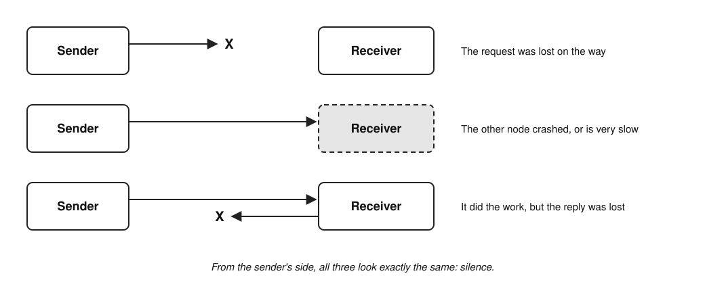
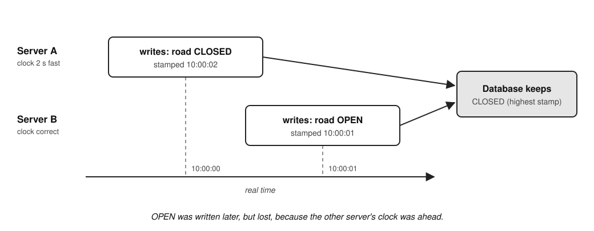
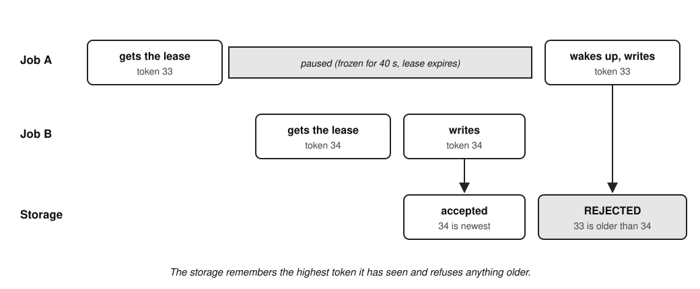
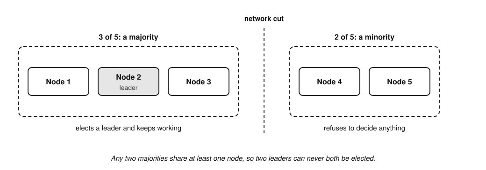
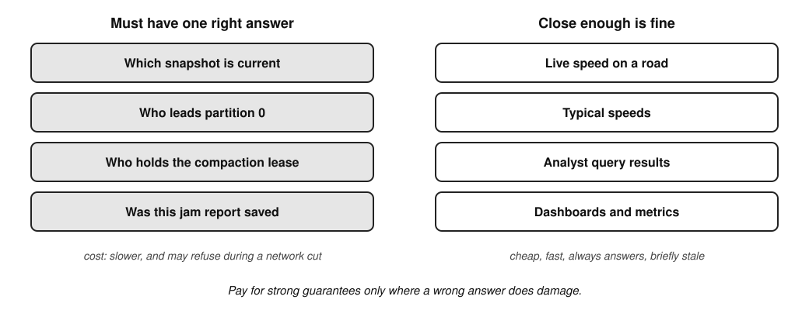

# Chapter 8 — When Things Go Wrong

## The story

Until now each chapter has had a tidy answer to "what if a machine dies?": the log keeps copies, the stream job restores a checkpoint, the batch job re-runs a task, the database promotes its standby.

All of those answers quietly assumed something: that the system *knows* a machine has died. This chapter is about why that knowledge is much harder to come by than it sounds, and what Wayline builds on once it accepts that.

A single computer is all-or-nothing: it works, or it has crashed. A system of many computers joined by a network has a third state, **partial failure**: some parts work, some do not, and the working parts cannot tell which is which. Messages are delayed by an unknown amount. Clocks disagree. A program can stop for half a minute and resume without noticing.

Here is one bad night at Wayline, in five incidents.

## Idea 1: silence tells you nothing

**02:10.** A worker in the stream job stops responding to the coordinator.

The coordinator sent a message and got no answer. What happened?

The request may never have arrived. The worker may have crashed. The worker may have done the work and the reply was lost. Or the worker is simply slow and the reply is still on its way. From the sender's side these are indistinguishable. All it has is silence.

The only tool available is a **timeout**: wait a while, then assume the worst. The length of that wait is a real dilemma.

| Timeout | Risk |
|---|---|
| Too short | A node that is only slow is declared dead. Its work moves elsewhere, adding load to the others, which makes them slow too, and they are declared dead in turn. |
| Too long | A node that is truly dead goes unnoticed, and users wait. |

There is no correct value. There is only a value chosen from measurements, and a design that stays **safe when the guess is wrong**.

Notice the third case in the diagram. The work was done, but the sender does not know. If it retries, the work happens twice. This is why idempotence has appeared in every chapter: the ping id, the upsert keyed by road and minute, the batch job that overwrites. In a distributed system, retries are unavoidable, so anything that may be retried must be safe to repeat.

## Idea 2: clocks disagree

**02:25.** Two control-room operators update the same road within a second of each other. One marks it closed. The other, a moment later, reopens it. The map still shows it closed.

Each server stamped its write with its own clock, and the database kept the write with the latest timestamp. This rule is called **last write wins**.

Server A's clock was two seconds fast. Its earlier write carried a later timestamp, so it won. The operator's reopening was thrown away without an error or any trace.

Every computer has its own clock, a cheap crystal that drifts. Clocks are corrected over the network, which is imprecise for the reasons in Idea 1. The correction can even make a clock jump backwards. So:

- **Never use timestamps from different machines to decide which event came first.** Differences of milliseconds are within the error, and occasionally the error is seconds.
- To **order** things, use a counter issued by one authority: an offset in a log partition, a snapshot number in a table, a version number on a row. These go up by one and never disagree.
- To **measure a duration** on one machine, such as a timeout, use the machine's *monotonic* clock, which only moves forward. The ordinary time-of-day clock is for showing dates to people.

Wayline already met this in Chapter 4, where each ping carries the time on a phone's clock. That is why the ingest service checks every ping's event time against its own receive time and rejects those from the future.

## Idea 3: the zombie

**02:40.** The nightly compaction job must be the only one of its kind running. To ensure that, it takes a **lease**: a lock that expires by itself after 30 seconds unless renewed, so that a crashed job cannot hold it forever.

Job A takes the lease. Then its machine freezes for 40 seconds. This happens: memory management pauses, a virtual machine is moved between hosts, a disk stalls. Job A is not dead. It is simply not running, and it has no idea.

The lease expires. Job B takes it and starts work. Then Job A wakes, exactly where it left off, still believing it holds the lease, and writes.

No timeout can prevent this, because the paused job cannot check anything while it is paused. The protection has to sit with the thing being written to.

Every time the lease is granted, it comes with a number that only goes up: a **fencing token**. Every write must present its token. The storage remembers the highest token it has seen and rejects anything lower. Job A wakes with token 33, Job B has already written with 34, and A's write is refused.

Once you know the pattern, you see it throughout this book:

- An **Iceberg commit** (Chapter 3) says "move the pointer to my snapshot only if it still points at the one I started from". A writer working from stale state is rejected.
- **Kafka** gives each leader of a partition an epoch number, raised at every change of leader. Messages from a former leader carry an old epoch and are ignored.
- A **database failover** (Chapter 7) must make sure the old primary can no longer accept writes before the new one starts.

The general rule: a node cannot trust its own belief that it is the leader, the lock-holder or the primary. Somebody else has to check.

## Idea 4: deciding by majority

**03:05.** A network fault separates Wayline's five coordination nodes into a group of three and a group of two. Which group is in charge?

If each group decided it was in charge, there would be two leaders, each accepting writes the other knows nothing about. This is **split brain**, and it is how data gets corrupted.

The rule that prevents it: **a decision counts only when more than half of all the nodes agree to it.** The group of three is a majority, so it can elect a leader and carry on. The group of two knows it is a minority, so it refuses to decide anything, even though its machines are perfectly healthy.

This works because any two majorities must overlap in at least one node. Two different leaders would each need a majority, and the node in the overlap would have had to vote for both, which it will not do.

Getting a group of nodes to agree on one value, despite crashes and lost messages, is called **consensus**. The algorithms (Raft and Paxos are the best known) are subtle. The practical lesson is short:

- **Do not write your own.** Use a system that has it built in.
- Run an **odd number** of nodes. Three tolerate one failure, and five tolerate two. Four tolerate only one, the same as three.
- Spread them over **three data centres**, so that losing any one still leaves a majority.

Consensus is underneath many of the tools in this book. Kafka uses it to decide which broker leads each partition. Flink uses a coordination service to decide which coordinator is active. A replicated log is consensus in disguise: agreeing on the order of messages is the same problem as agreeing on a sequence of values.

## Idea 5: how consistent does it need to be?

**03:30.** With the network repaired, the team asks the obvious question: should everything in the system be this careful?

No. Being careful costs something.

The strongest guarantee is **linearizability**: the system behaves as if there were exactly one copy of the data. Once any reader has seen a new value, no later reader sees the old one. Providing it requires coordination on every operation, which makes operations slower. And when the network is cut, a linearizable system must refuse requests on the minority side, as in Idea 4. During a network fault you can have consistency or availability, not both. This is the useful core of what is called the CAP theorem.

The weaker alternative is **eventual consistency**: copies may disagree briefly and converge once writes stop. It is fast, it always answers, and it is sometimes stale.

The engineering task is to sort your data into the two groups.

On the left are a few small facts on which everything else depends. Two answers would be a disaster. They are stored in systems built on consensus. On the right is nearly all the data by volume: speeds, totals, query results. A value that is a few seconds stale is still a good answer.

This is why the design can be both fast and safe. A tiny amount of data is coordinated strictly, and the petabytes are not.

## Decision points

**How long should a timeout be?**
Measure how long healthy responses take, and set the timeout comfortably beyond the slow end of normal. Then check the other half: what happens when the timeout fires wrongly? If a false alarm causes damage, add fencing before you shorten the timeout.

**How should retries behave?**
Immediate, unlimited retries turn a brief slowdown into an outage: every client hammers a struggling service at once. Wait longer after each failed attempt, add randomness so that clients do not retry in step, cap the number of attempts, and stop calling a service that keeps failing for a while. And make the operation safe to repeat.

**Timestamps or version numbers?**
Version numbers for anything that decides which write wins. Timestamps for display, for approximate measurements, and for event-time windows where a tolerance is designed in.

**Where is strong consistency worth its cost?**
Wherever two answers cause harm that cannot be repaired afterwards: leadership, locks, the current table snapshot, uniqueness, money. Everywhere else, prefer the cheaper guarantee and design the product to tolerate brief staleness.

**What should the driver see when a part is down?**
Decide in advance. If live speeds are unavailable, the app falls back to typical speeds and labels the estimate as such. A slightly worse answer shown at once beats a spinner. Designing how to degrade is part of designing for failure.

**Three coordination nodes or five?**
Three tolerate one failure, which is enough for most. Five tolerate two, which matters if you want to survive a failure during maintenance. More nodes make each decision slower, so there is rarely a reason to go beyond five.

## In Kleppmann's book

| Idea in this chapter | Where in *Designing Data-Intensive Applications* (1st ed.) |
|---|---|
| Partial failure | Ch. 8, "Faults and Partial Failures" |
| Lost messages, timeouts, detecting a dead node | Ch. 8, "Unreliable Networks" |
| Clock drift, two kinds of clock | Ch. 8, "Unreliable Clocks": "Monotonic Versus Time-of-Day Clocks" |
| Last write wins losing data | Ch. 8, "Relying on Synchronized Clocks": "Timestamps for ordering events" |
| A program frozen without knowing it | Ch. 8, "Process Pauses" |
| Majority decides; zombies; fencing tokens | Ch. 8, "Knowledge, Truth, and Lies" |
| Split brain | Ch. 5, "Handling Node Outages" |
| Linearizability and where it is needed | Ch. 9, "Linearizability" |
| Consistency vs availability during a network fault | Ch. 9, "The Cost of Linearizability" |
| A log as agreement on order | Ch. 9, "Ordering Guarantees": "Total Order Broadcast" |
| Consensus | Ch. 9, "Distributed Transactions and Consensus": "Fault-Tolerant Consensus" |
| Coordination services | Ch. 9, "Membership and Coordination Services" |

## Check yourself

1. A service call times out. List the things that might have happened. Why does this make idempotence necessary?
2. Two servers write to the same row and the database keeps the one with the later timestamp. Describe how a later write can be lost, and what to use in place of the timestamp.
3. A job holds a lease, freezes for longer than the lease, and resumes. Why can't a better timeout fix this? What does?
4. Five coordination nodes are split three and two. What does each side do, and why can there never be two leaders?
5. Name two pieces of Wayline's data that need one right answer and two that do not. What does each group cost?

## In the interview room

*The candidate answers as an engineer who built Wayline's system.*

**Interviewer:** How do you know a node is dead?

**Candidate:** I don't, with certainty. All I can observe is that it has not answered within some time, and that looks the same whether it crashed, is slow, or the network dropped a message. So "dead" is always a suspicion based on a timeout. I pick the timeout from the measured spread of normal response times, and I design so that a wrong suspicion is safe: if I replace a node that was only slow, the old one must not be able to do damage when it comes back.

**Interviewer:** You use a lock with an expiry so only one job runs. Is that safe?

**Candidate:** Not by itself. The holder can be paused for longer than the expiry, for example by a long memory-management pause or a virtual machine being frozen. The lock expires, another job takes it, and then the first one resumes, still convinced it holds the lock. The fix is a fencing token: the lock service hands out an increasing number with each grant, every write carries it, and the storage rejects a write whose token is lower than one it has already seen. The lock reduces duplicate work. The token is what guarantees correctness.

**Interviewer:** Why not order writes by timestamp? Clocks are synchronised.

**Candidate:** Only approximately. Network time correction has errors of milliseconds on a good day and much more on a bad one, and a misconfigured machine can be off by seconds or jump backwards. With "last write wins", a write from a machine with a slow clock is silently discarded, even though it really happened later. Nothing fails, and data simply disappears. For ordering I use numbers from a single source: log offsets, row versions, snapshot ids. If a system really needs ordering by physical time across machines, it has to know the clock error and wait it out, which only a few specialised databases do.

**Interviewer:** Explain the CAP theorem in a way that is actually useful.

**Candidate:** When the network splits a system in two, each side must choose: answer anyway and risk the two sides disagreeing, or refuse to answer until it can be sure. The first keeps availability and gives up consistency. The second does the opposite. It is not "pick two of three", because you cannot opt out of network faults. And it only describes behaviour during a fault. The trade-off I face every day is a different one: stronger consistency costs latency even when everything is healthy, because it requires coordination.

**Interviewer:** What is split brain, and how do your systems avoid it?

**Candidate:** Two nodes both acting as leader, each accepting writes the other does not see. It usually follows a network fault or a false timeout. The first defence is that leadership requires a majority vote, so only one side of a split can elect a leader. The second is epoch numbers: each election increases a counter, every message from a leader carries it, and followers and storage reject anything from an older epoch. So even if a former leader keeps running for a while, nobody listens to it.

**Interviewer:** Retries once turned a small incident into a big one for you. How should retries work?

**Candidate:** The failure mode is that every client retries immediately, which multiplies the load on a service that is already struggling. So: wait longer after each attempt, and add randomness to the wait so that clients spread out instead of arriving in waves. Cap the attempts and the total time. Stop calling a service that keeps failing and test it occasionally, so that it gets room to recover. Let an overloaded service reject requests early and cheaply. And every retried operation must be idempotent, because a timed-out request may have succeeded.

**Interviewer:** Where does Wayline actually need strong consistency?

**Candidate:** In very few places, and all of them are small. Which broker leads a partition. Which snapshot of a table is current. Who holds the lease for a job that must run alone. Whether a user's report was committed. Each is a tiny fact where two answers would corrupt something. The bulk of the data, such as speeds and aggregates, is derived, constantly refreshed, and fine if a few seconds stale. Coordinating the small facts strictly and leaving the rest loose is what lets the system be both correct and fast.

**Interviewer:** The live-speed store is down. What does the driver see?

**Candidate:** A route, without delay. The app falls back to typical speeds for that hour, which are in a separate store, and marks the arrival time as an estimate. If the app has recent live values cached, it uses them while they are still fresh enough. What it must not do is block or show an error, because a slightly less accurate route is far more useful than none. I decide that behaviour when designing the feature, and I test it by switching the store off on purpose.
