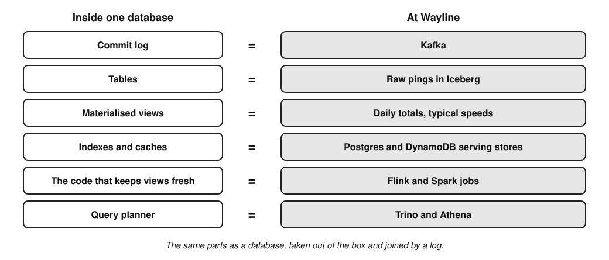
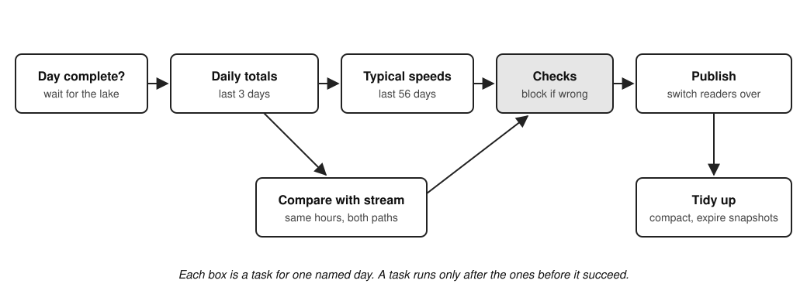
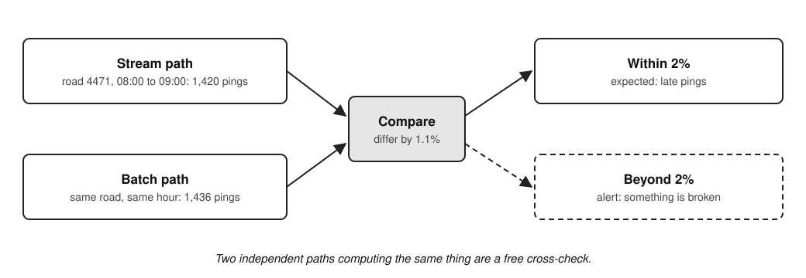
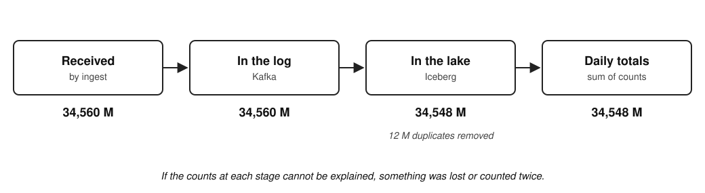
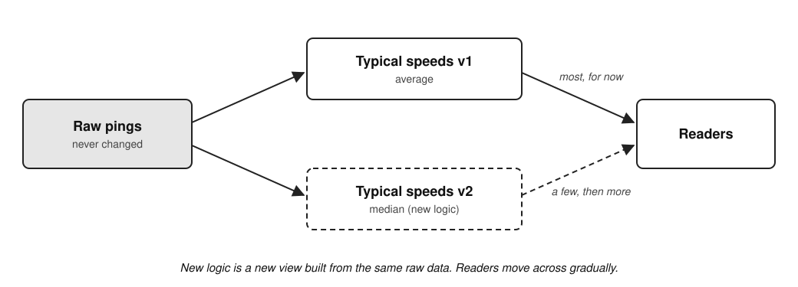

# Chapter 9 — Keeping It Honest

## The story

The system is built. Pings flow into the log, the stream job publishes live speeds, the lake keeps every ping, the nightly job computes typical speeds, analysts query, and the app gets its answers in milliseconds.

Now it has to run every day for years. That raises a different kind of question from "how do I build it?":

- Who starts the nightly work, in the right order, and notices when it fails?
- There are two paths computing speeds. How do we know they agree?
- How do we know the numbers are right at all?
- What happens when the definition of "typical" changes next year?

Kleppmann opens his book with three goals: reliable, scalable, maintainable. Chapters 2 to 8 were mostly about the first two. This last chapter is about the third: a system people can operate, trust and change.

## Idea 1: the whole system is one database, taken apart

Step back and look at what has been built.

A traditional database does all of these jobs inside one program. It writes changes to a log. It stores tables. It maintains indexes and precomputed views, and keeps them in step with the tables automatically. It plans queries.

Wayline has the same parts, each as a separate system, joined by a log. Kleppmann calls this **unbundling the database**.

Why take it apart? Because no single database does every job well at this scale: 400,000 writes a second, a petabyte of history, millisecond lookups and week-long scans. Each specialised tool does one job far better than a general one could.

What is lost is the automatic part. Inside a database, when a row changes, its indexes change in the same transaction. In Wayline's system, keeping the derived data in step with the truth is now *your* job: the stream job, the nightly job, and the checks in this chapter. The rest of the chapter is about doing that job properly.

The mental model is worth keeping: **one ordered log of facts, and everything else is a view derived from it.** If you can say which data is the truth and how every other dataset is derived from it, you understand the system.

## Idea 2: the nightly work is a graph of tasks

The nightly job of Chapter 5 is really several steps that depend on one another.

Typical speeds cannot be built before daily totals. Nothing should be published before the checks pass. Tidying up should happen after publishing. A set of tasks with "this before that" arrows and no loops is a **DAG**, a directed acyclic graph.

Apache **Airflow** is a tool for running such graphs. You describe the tasks and their dependencies. Airflow then:

- starts each task when the tasks before it have succeeded;
- retries a task that fails, and alerts a person if it keeps failing;
- shows which runs succeeded, failed or are late;
- re-runs chosen days on request.

Airflow does not process data itself. Its tasks say things like "start this Spark job for this day and wait for it". It is the conductor, not the orchestra.

One idea makes this work well: **every run is for a named day.** The task is not "process yesterday", which means something different each time it is said. It is "process 12 November". Run it today, next week, or twice, and it does the same thing. This is the idempotence of Chapter 5, raised to the level of the schedule. It makes a **backfill** trivial: to recompute last month with fixed logic, ask for the same tasks for thirty named days.

The first task in the graph deserves a note. "Is the day complete?" is the watermark question from Chapter 4 in another form. The nightly job should start when the lake writer has committed everything up to midnight, not when the clock says 02:00.

## Idea 3: two paths should agree

Wayline computes speed twice: the stream job, fast and slightly incomplete, and the batch job, a day behind and complete. This pairing is called the **lambda architecture**, and its well-known weakness is that two separate programs calculating the same thing will drift apart.

That weakness can be turned into a strength. Two independent calculations of the same number are a cross-check that costs almost nothing.

Each night, for a sample of roads and hours, compare the stream path's sum and count with the batch path's. They will not match exactly, because the batch job sees the late pings that the stream job closed its windows on. But the gap should be small and steady. A check that says "within 2% is normal, beyond that is an alert" catches a remarkable range of faults: a stream job dropping data, a bug in either program, a broken clock on the ingest service, duplicates creeping in.

When they disagree, the rule is fixed in advance: **the batch result is the correct one.** It had complete input and simpler logic.

The alternative design is the **kappa architecture**: keep only the stream job, and when logic changes, replay history through it. That gives one program and no drift. The costs are that replaying months of data through a stream job is slow, and that you lose the independent cross-check. Modern engines narrow the gap by running the same logic in batch and streaming modes.

## Idea 4: trust, but verify

How does anyone know the numbers are right? Hoping is not a method. The answer is to check, continuously, things that must be true.

The most powerful check is the simplest: **counting.**

Pings do not appear from nowhere or vanish. So the number received by the ingest service, the number in the log, the number in the lake, and the sum of the counts in the daily totals must all be explainable in terms of one another. If the lake has fewer pings than the log, the difference should equal the number of duplicates removed. If it does not, something lost data or counted twice, and you know between which two stages.

This ties together a thread that has run through the book. Every stage has its own protection: acknowledgements in the log, checkpoints in the stream job, atomic commits in the lake. None of those proves that the *whole* chain is correct. Only a check from one end to the other does. The same reasoning is why the `ping_id` is created on the phone: an identifier made at the very start lets any later stage recognise a repeat, whatever happened in between. Kleppmann calls this the **end-to-end argument**.

Other checks worth having on each table:

- **Freshness:** is the newest data as recent as promised?
- **Volume:** is today's row count close to the same weekday last week?
- **Validity:** speeds between 0 and 200 km/h, no missing road ids.
- **Uniqueness:** exactly one row per road per hour.

Where the checks sit matters as much as what they are. Wayline uses **write, audit, publish**: the nightly job writes its results where readers cannot see them, runs the checks, and only then switches readers over, using the atomic pointer swap of Chapters 3 and 7. A failed check means that today's data is not published and yesterday's stays in place. Stale but correct is better than fresh but wrong.

## Idea 5: changing the system while it runs

Next year, product decides that "typical speed" should be the median, not the average, because a few very slow vehicles drag the average down.

In a system where data is edited in place, this is a frightening migration. Here it is routine, because of one decision made in Chapter 1: the raw pings are kept, and nothing ever changes them.

1. Write the new logic as a new job that produces a **new table**, beside the old one.
2. Backfill it: run it over the last eight weeks of raw pings.
3. Compare old and new. Do the differences make sense?
4. Move readers over gradually: one city first, then the rest.
5. When nobody reads the old table, delete it.

At every step the old view is intact, and going back means pointing readers at it again. Nothing is modified in place and there is no moment of no return.

This is the deepest benefit of the design, and Kleppmann's word for it is **evolvability**. Keeping immutable facts and deriving everything else means that today's decisions about what to compute are not permanent. You can change your mind.

## The book in nine sentences

| Chapter | The one idea |
|---|---|
| 1 | Keep one source of truth, derive everything else, and describe load and speed with numbers. |
| 2 | A log lets many readers take the same facts at their own pace, and replay them. |
| 3 | A table can be a list of unchangeable files, with every change a new snapshot. |
| 4 | On endless data, you must decide when to stop waiting, and make repeats harmless. |
| 5 | A batch job is a function: fixed input, replaced output, safe to run again. |
| 6 | A query engine answers fast mainly by not reading, and the layout decides how much it can skip. |
| 7 | Lookups need an index, copies and sometimes partitions, and each buys speed at a price. |
| 8 | You cannot know that a node is dead, so design to be safe when you guess wrong. |
| 9 | A system stays correct only if it is checked from end to end and can be changed without fear. |

Certain ideas appeared in almost every chapter in a different form: append and never edit; make it safe to repeat; choose the key and you choose what stays together; things that add up are cheap, and things that do not are expensive; one pointer moved atomically. When you meet a data tool that is not in this book, look for those ideas first. They will be there.

## Decision points

**Airflow, or just a timer?**
A timer (cron) can start a job at 02:00. It cannot wait for another job, retry, show history, or re-run last Tuesday. As soon as there are two dependent steps, use an orchestrator. Airflow is the most widely used. Dagster and Prefect are newer alternatives with the same core idea.

**Start by the clock or by the data?**
By the data. Starting at a fixed time works until the day the lake writer is late, and then the job silently processes an incomplete day. Wait for a signal that the day's data is complete.

**Two paths or one?**
Two (lambda) when the fast path is allowed to be approximate and you value the cross-check. One (kappa) when the logic changes often and maintaining it twice costs more than replaying. Wayline keeps two and keeps the shared logic trivially simple: a sum and a count.

**Which checks stop the pipeline?**
Checks on things that would mislead users, such as counts that do not reconcile or impossible speeds, block publishing. Softer signals, such as volume being 10% below last week, raise a warning for a person to look at. If every check blocks, people learn to override them.

**What to watch day to day?**
Three numbers cover most trouble: **lag** on the log, which shows whether the stream job is keeping up; **freshness** of each table against its promise; and the **stream-versus-batch difference**. Alert on being late, not only on failing. A job that is stuck produces no error.

**How long to keep pings tied to a device?**
Location history is among the most sensitive data there is. A list of where a phone went every five seconds reveals a home, a workplace and much more. The product needs speeds per road, not journeys per person. So: replace device ids with ones that change daily, keep the link from an account to its daily ids in a separate, restricted store used only for deletion requests and kept no longer than the raw pings, aggregate early, delete raw pings after the period needed for recomputation, and suppress results for roads with so few cars that one driver could be identified. Keeping everything forever is the easy default, and it is also a liability.

## In Kleppmann's book

| Idea in this chapter | Where in *Designing Data-Intensive Applications* (1st ed.) |
|---|---|
| Many specialised tools tied together by derived data | Ch. 12, "Data Integration": "Combining Specialized Tools by Deriving Data" |
| The database taken apart | Ch. 12, "Unbundling Databases" |
| Workflow schedulers for dependent batch jobs | Ch. 10, "MapReduce and Distributed Filesystems": "MapReduce workflows" |
| Two paths; one path | Ch. 12, "Batch and Stream Processing": "The lambda architecture", "Unifying batch and stream processing" |
| Rebuilding views when logic changes; old and new side by side | Ch. 12, "Batch and Stream Processing": "Reprocessing data for application evolution" |
| Checking from one end to the other; identifiers created at the source | Ch. 12, "Aiming for Correctness": "The End-to-End Argument for Databases" |
| Late but correct vs fresh but wrong | Ch. 12, "Aiming for Correctness": "Timeliness and Integrity" |
| Continuous checking | Ch. 12, "Aiming for Correctness": "Trust, but Verify" |
| Location data and responsibility | Ch. 12, "Doing the Right Thing": "Privacy and Tracking" |
| Operable, simple, changeable | Ch. 1, "Maintainability" |

## Check yourself

1. Match each part of a traditional database to the Wayline system that does its job. What did Wayline gain by separating them, and what did it take on?
2. Why is "process 12 November" a better task than "process yesterday"?
3. The stream and batch totals for an hour differ by 1%. Is that a problem? What about 15%? Which do you trust?
4. The lake holds 12 million fewer pings than the log for a day. What would make that acceptable, and what would make it an incident?
5. Product wants typical speed to be a median. List the steps, and say at which point you could still go back.

## In the interview room

*The candidate answers as an engineer who built Wayline's system.*

**Interviewer:** How do you know your data is correct?

**Candidate:** By checking things that must be true, automatically, every day. Counts must reconcile from stage to stage: what the ingest service received, what is in the log, what reached the lake, and the sum of counts in the aggregates, with every difference accounted for by duplicates removed or late arrivals. The stream and batch paths must agree within a tolerance. And each table has checks for freshness, volume against last week, and valid ranges. None of that proves correctness in a mathematical sense. It does mean that the common ways of being wrong are detected within a day.

**Interviewer:** Why Airflow and not cron?

**Candidate:** Cron starts things at a time. My nightly work is a graph: daily totals, then typical speeds, then checks, then publish. I need each step to wait for the previous one, retry on failure, alert when it gives up, and keep a history I can look at. I also need to re-run a specific day, or thirty days, after fixing a bug. An orchestrator gives me all of that. Airflow does not do the processing itself. It starts Spark jobs and tracks them.

**Interviewer:** What makes a task safe to backfill?

**Candidate:** Three properties. It takes the day it is processing as a parameter and never asks the clock, so running it next week for last Tuesday does last Tuesday's work. It replaces its output for that day and never appends, so a second run leaves one copy. And it reads a fixed, immutable input. With those in place, a backfill is the normal task run for older dates, possibly several at once, with a limit so that it does not starve the regular nightly run.

**Interviewer:** Lambda or kappa? Defend your choice.

**Candidate:** I run two paths. The live path has to be approximate, because it publishes before late pings arrive. The batch path is exact and cheap to reason about. The usual objection is duplicated logic. I keep it small: both paths compute a sum and a count, and the difference between them is the window logic and nothing else. In return I get a daily cross-check between two independent implementations, which has caught real faults. If our logic were complex and changed monthly, I would move to a single stream implementation and replay from the lake to rebuild.

**Interviewer:** At 03:00 the nightly job produces wrong data. What happens next?

**Candidate:** Ideally, nothing visible. The job writes to a place readers cannot see, the checks fail, the publish step does not run, and the app keeps using yesterday's typical speeds, which are almost as good. Someone is alerted. If bad data does get through the checks, recovery is quick because every publish is a pointer switch: I point readers back to the previous version, which still exists. Then I fix the cause, re-run for that day, and add a check that would have caught it.

**Interviewer:** The typical-speed table is promised by 06:00 and the pipeline is running late. What do you do?

**Candidate:** I should hear about it before 06:00, because I alert on tasks that have not started or finished by the expected time, not only on failures. The fallback is already safe: readers keep yesterday's table. Then I look at where the time is going. Is the pipeline waiting for the day to be marked complete, which means the lake writer is behind? Is one Spark stage slow, which may be skew or lost machines? Did volume jump? Afterwards I look at whether the promise is still realistic with current volumes or needs more capacity.

**Interviewer:** How do you change the logic of a table that many teams read?

**Candidate:** I never change it in place. I build the new version as a separate table, derived from the same raw data, and backfill it. I compare old and new and share the differences with the teams that read it, so that nobody is surprised. Readers move over gradually, and the old table stays until the last one has gone. Going back at any point means reading the old table again. It costs some duplicate storage for a few weeks, which is cheap next to a migration that cannot be undone.

**Interviewer:** You hold the movements of two million phones. What did you do about privacy?

**Candidate:** I started from what the product needs, which is speed per road, not trips per person. So the device id in a ping is a rotating pseudonym, not a stable identity. It is enough to order one trip's pings and remove duplicates, and it cannot link Monday's trips to Tuesday's. Aggregation happens early, and the aggregates carry no device ids at all. Raw pings are deleted after the window needed for recomputation. Results for roads with only a few vehicles in a period are suppressed, since one car on a quiet lane at night is effectively a person. Access to raw pings is restricted and logged. Deletion requests have a tested path through every store that holds a copy: a separate, restricted mapping from an account to its daily ids exists only for that purpose, and is deleted along with the raw pings it refers to.
