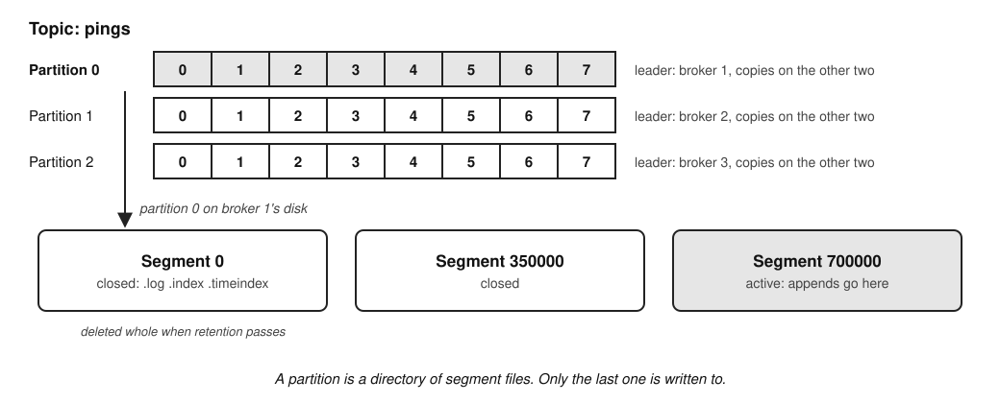
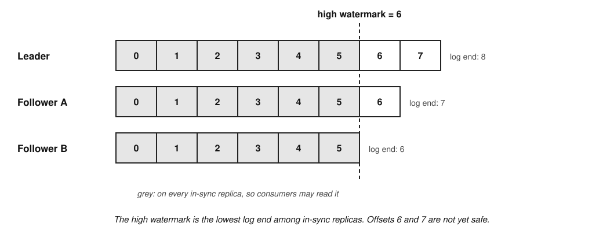
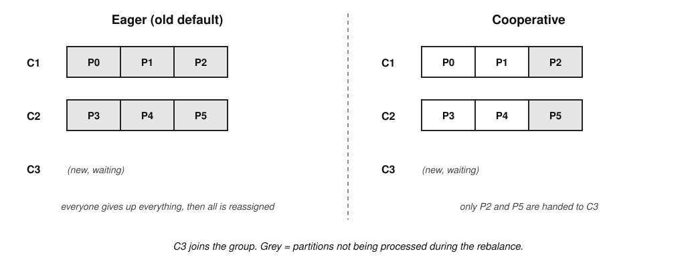
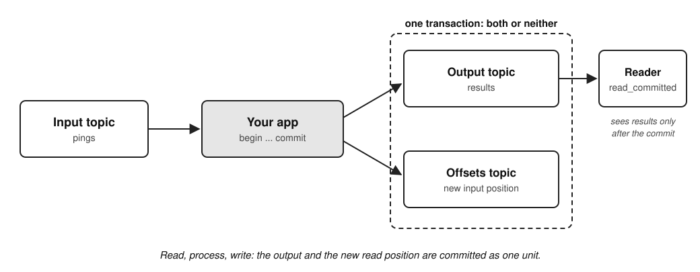
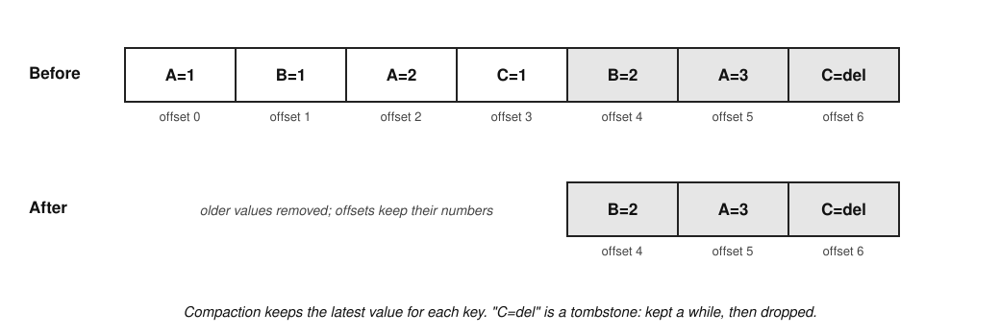

# Chapter 10 — Deep Dive: Kafka

*Part II of this book goes back over each technology at interview depth. Part I explained why Wayline uses a log. This chapter explains how Kafka works inside and what interviewers ask about it.*

## Kafka in one page

- A **topic** is a named stream. It is split into **partitions**. Each partition is an append-only log, and each record in it has an **offset**.
- **Brokers** are the servers. Each partition has one **leader** broker and several **follower** copies on other brokers.
- **Producers** write to the leader of a partition, chosen by a hash of the record's key.
- **Consumers** read from partitions and remember their own position. Consumers in the same **group** share the partitions among themselves.
- A small quorum of **controllers** keeps the cluster's metadata: which brokers are alive, who leads each partition. Since Kafka 4.0 this is done by Kafka itself (KRaft), and ZooKeeper is gone.

The promises: records in one partition are read in the order they were written; a record acknowledged with `acks=all` survives the loss of a broker; consumers can re-read anything still retained.

What Kafka does not promise: order across partitions, exactly-once delivery to systems outside Kafka, or lookups by key.

## Topic 1: how a partition is stored



On disk, a partition is a directory of **segment** files. Appends go to the last, *active* segment. When it reaches a size (1 GB by default) or age, it is closed and a new one starts. Each segment has two small index files: offset to file position, and timestamp to offset.

This layout explains most of Kafka's performance:

- **Sequential writes.** Appending to the end of a file is the fastest thing a disk does.
- **The operating system's page cache.** Kafka does not keep its own cache of records. It writes to the file and lets the OS keep recent data in memory. Consumers that are keeping up read straight from memory.
- **Zero-copy.** To send records to a consumer, the broker asks the OS to copy bytes from the file to the network socket directly, without passing through the Kafka process. Records are stored in the same binary format they are sent in, so there is nothing to convert.
- **Batching.** Records are written, stored and sent in batches, and compressed per batch.

Retention works on whole segments. When every record in a closed segment is older than the retention time (7 days by default), the file is deleted. Nothing is ever removed from the middle of a file.

**What interviewers probe**

- *Why is Kafka fast?* Sequential I/O, page cache, zero-copy, batching. Name all four.
- *Does zero-copy always apply?* No. With TLS the broker must encrypt in its own memory, so the direct file-to-socket path is lost.
- *How does a consumer find offset 5,000,000 quickly?* Binary search on segment file names to find the segment, then the sparse offset index to find a nearby position, then a short scan.
- *What does "retention 7 days" really mean?* A record lives at least 7 days, and until its whole segment has expired. The active segment is never deleted.

## Topic 2: replication, in-sync replicas and the high watermark

Each partition has a **replication factor**, typically 3: one leader and two followers. Followers fetch from the leader continuously, exactly as a consumer would.

The **in-sync replica set (ISR)** is the set of replicas that are caught up with the leader. A follower that has not caught up within `replica.lag.time.max.ms` (30 seconds by default) is removed from the ISR, and added back when it catches up.



Two positions matter on each replica:

- **Log end offset (LEO):** where the next record will go.
- **High watermark (HW):** the offset up to which every in-sync replica has the data. Records below it are **committed**.

Consumers can only read below the high watermark. This is what makes failover safe: any in-sync replica that becomes leader already has everything a consumer could have seen.

The durability settings fit together like this:

```properties
# topic / broker
default.replication.factor=3
min.insync.replicas=2
unclean.leader.election.enable=false

# producer
acks=all
```

- `acks=all`: the leader replies only once all in-sync replicas have the record.
- `min.insync.replicas=2`: if the ISR shrinks below 2, the leader rejects `acks=all` writes with `NotEnoughReplicas`.
- `unclean.leader.election.enable=false`: a replica that was out of sync can never become leader.

With these three, one broker can fail with no loss and no downtime. Two failures stop writes to affected partitions but lose nothing.

Each leader has a **leader epoch**, a number that goes up at every leader change. After a failover, replicas use it to work out exactly where their logs diverged and truncate to that point. It is also how a former leader that is still running is recognised and ignored (the fencing idea from Chapter 8).

**What interviewers probe**

- *`acks=all` with `min.insync.replicas=1`. Is that safe?* No. If the ISR has shrunk to the leader alone, "all" means one. The leader acknowledges, dies, and the record is gone. `acks=all` is only meaningful with `min.insync.replicas` ≥ 2.
- *Why can't consumers read up to the log end?* Records above the high watermark may exist on the leader only. If the leader dies they vanish, and a consumer would have seen something that no longer exists.
- *Availability or durability?* That is the real question behind unclean leader election. Enabling it keeps the partition writable when all in-sync replicas are gone, at the price of silently losing records.
- *RF=3, min ISR=2. How many failures?* One, for both reads and writes. Two for no data loss.

## Topic 3: the producer

A producer does more than send. For each record it serialises the key and value, picks a partition, appends the record to an in-memory batch for that partition, and a background thread sends batches to leaders.

```properties
acks=all
enable.idempotence=true          # default in recent versions
compression.type=lz4
linger.ms=10                     # wait up to 10 ms to fill a batch
batch.size=65536
delivery.timeout.ms=120000       # total time to keep trying
max.in.flight.requests.per.connection=5
```

**Partitioning.** With a key, the partition is `hash(key) mod number_of_partitions`, so one key always goes to one partition. With no key, the producer fills a batch for one partition, then moves to another ("sticky" partitioning), which gives bigger batches than strict round-robin.

**Batching and compression.** `linger.ms` trades a few milliseconds of delay for larger batches. Larger batches mean fewer requests and much better compression. This is the main throughput knob.

**Idempotence.** A retry after a lost acknowledgement would write the same batch twice. With idempotence on, the broker gives each producer an id, and each batch carries a sequence number per partition. The broker drops a batch whose sequence it has already written. This also keeps retried batches in order, with up to 5 requests in flight.

**What interviewers probe**

- *How can retries reorder messages?* Batch 1 fails and batch 2 succeeds, then batch 1 is retried and lands after batch 2. Without idempotence you must set in-flight requests to 1. With idempotence, order is preserved with up to 5.
- *Does the idempotent producer give exactly-once?* Only against duplicates caused by the producer's own retries, within one producer session and one partition. It does nothing if your application sends the same record twice, or restarts and resends.
- *Throughput is low. What do you tune?* `linger.ms`, `batch.size`, compression. Then partition count and whether the key is skewed.
- *You added partitions and ordering broke. Why?* `hash mod N` changed for existing keys.

## Topic 4: consumers, groups and rebalancing

A consumer **polls** in a loop. Consumers with the same `group.id` form a group, and Kafka assigns each partition to exactly one member. So the number of partitions is the ceiling on parallelism within a group. Different groups are independent and each sees every record.

A consumer's position is stored by **committing offsets** to an internal topic, `__consumer_offsets`. Where you commit relative to processing decides your delivery guarantee:

```java
consumer.subscribe(List.of("pings"));
while (true) {
    ConsumerRecords<String, Ping> records = consumer.poll(Duration.ofMillis(500));
    for (ConsumerRecord<String, Ping> r : records) {
        process(r.value());            // must be safe to repeat
    }
    consumer.commitSync();             // after processing: at-least-once
}
```

Commit after processing and a crash in between means the batch is processed again: at-least-once. Commit before processing and a crash means the batch is skipped: at-most-once. The default auto-commit commits on a timer during `poll`, which is at-least-once only if every record from the previous poll has been fully processed by the next call.

A **rebalance** redistributes partitions when a member joins, leaves or is judged dead.



- **Eager** rebalancing: every member gives up all its partitions, and then everything is reassigned. Processing stops for the whole group.
- **Cooperative** (incremental) rebalancing: only the partitions that need to move are taken away. The rest keep being processed.
- Newer Kafka versions have a redesigned protocol in which the broker computes the assignment and members adjust without a group-wide pause.

A consumer is considered dead in two ways: its background heartbeat stops for `session.timeout.ms`, or it fails to call `poll` again within `max.poll.interval.ms` (5 minutes by default). The second catches a consumer that is alive but stuck in processing.

**What interviewers probe**

- *Rebalances keep happening. Why?* Usually processing a batch takes longer than `max.poll.interval.ms`, so the consumer is evicted, rejoins, and the cycle repeats. Fix: smaller `max.poll.records`, faster processing, or a longer interval. Other causes are deployments that restart members one by one and unstable networks.
- *How do you reduce rebalance pain during deployments?* Cooperative assignment, and **static membership**: give each instance a fixed `group.instance.id` so that a quick restart is not treated as leave-then-join.
- *What changed in Kafka 4.0?* A new consumer group protocol became generally available. The broker's group coordinator computes the assignment, not a client, and rebalances are incremental by design. Clients opt in with `group.protocol=consumer`.
- *What is consumer lag and how do you see it?* Log end offset minus committed offset, per partition.

```bash
kafka-consumer-groups.sh --bootstrap-server broker:9092 \
  --describe --group live-speed-job
# columns: TOPIC PARTITION CURRENT-OFFSET LOG-END-OFFSET LAG
```

- *One bad record crashes the consumer forever. What do you do?* That is a **poison pill**. Catch the failure, send the record to a **dead-letter topic** with the error, commit past it, and alert. Never let one record block a partition indefinitely.
- *More consumers than partitions?* The extra ones sit idle.
- *What does `auto.offset.reset` do?* It applies only when the group has no committed offset, or the offset has expired: `earliest` starts from the oldest record, `latest` from new ones.

## Topic 5: transactions and "exactly once"

Idempotence covers one producer writing to one partition. **Transactions** extend that to: write to several partitions, and commit consumer offsets, as one atomic unit.



The pattern is **consume, transform, produce**:

```java
producer.initTransactions();                 // registers transactional.id
while (true) {
    var records = consumer.poll(Duration.ofMillis(500));
    producer.beginTransaction();
    try {
        for (var r : records) producer.send(transform(r));
        producer.sendOffsetsToTransaction(offsetsOf(records), consumer.groupMetadata());
        producer.commitTransaction();        // outputs + offsets, atomically
    } catch (Exception e) {
        producer.abortTransaction();         // neither becomes visible
    }
}
```

How it works:

- The producer has a stable `transactional.id`. A **transaction coordinator** on the brokers records each transaction's state in an internal topic.
- Records are written to the output partitions straight away, but are marked as part of an open transaction.
- On commit, the coordinator writes a **commit marker** into every partition involved. On abort, an abort marker.
- A consumer with `isolation.level=read_committed` only returns records whose transaction has committed, and never reads past the first still-open transaction.
- If the application restarts with the same `transactional.id`, the coordinator raises its **epoch** and rejects the old instance. That fences off zombies.

The limits matter more than the mechanism:

- It is exactly-once for **Kafka to Kafka**. The input position and the output are both in Kafka, so they can be committed together.
- A side effect outside Kafka, such as a database write or an email, is not covered. That needs an idempotent write or a transactional sink (Chapter 4).
- Downstream consumers must use `read_committed`. With the default, they see aborted records too.
- Transactions add latency, because readers wait for the commit marker.

**What interviewers probe**

- *"Is exactly-once real?"* Say: delivery is at-least-once; the *effect* is exactly-once, through idempotence and atomic commits, and only inside Kafka's boundary.
- *What is fenced, and how?* A second instance with the same `transactional.id` bumps the epoch, and writes from the older epoch are rejected.
- *Kafka Streams?* `processing.guarantee=exactly_once_v2` uses exactly this, plus changelog topics for state.

## Topic 6: log compaction

Retention by time suits events. For "the current value of each key", Kafka has a second policy, **compaction**: keep at least the latest record for every key, forever.



```bash
kafka-configs.sh --bootstrap-server broker:9092 --alter \
  --entity-type topics --entity-name segments \
  --add-config cleanup.policy=compact
```

A background cleaner rewrites closed segments, dropping records that have a newer record with the same key. Offsets do not change, so the log has gaps. A record with a null value is a **tombstone**: it marks the key as deleted, and is itself removed after a delay so that consumers have time to see it.

Compaction turns a topic into a table. A new consumer reads the topic from the start and ends up with the current state of every key. It is used for consumer offsets, for Kafka Streams state changelogs, for change-data-capture streams from databases, and for reference data such as Wayline's `segments`.

**What interviewers probe**

- *Compaction vs retention?* Retention removes old data by time or size. Compaction removes superseded data by key. A topic can use both.
- *Is compaction immediate?* No. The active segment is never compacted, and the cleaner runs when enough of the log is "dirty". Consumers can see several values for one key.
- *How do you delete a key?* Write a tombstone, which is a record with that key and a null value.

## Topic 7: sizing, keys and hot partitions

**How many partitions?** Take the larger of two numbers: target throughput divided by what one partition can sustain, and the highest consumer parallelism you will need. Then add headroom, because raising the count later remaps keys. Do not go to thousands without reason: each partition costs file handles, memory and failover time.

**Choosing a key.** The key decides which records are ordered relative to each other and how evenly load spreads. Ask: what is the smallest unit that must stay in order? Use that.

**Hot partitions.** If a few keys carry most of the traffic, their partitions lag while others idle. Options:

- pick a finer-grained key;
- append a small random suffix to the hot key ("salting") and merge downstream, which gives up strict order for that key;
- route known heavy keys to dedicated partitions with a custom partitioner.

**Getting data out of a database.** Writing to a database and then to Kafka is two writes that can fail separately. Two standard cures:

- the **outbox pattern**: write the event into an "outbox" table in the same database transaction as the business change, and have a separate process publish from that table;
- **change data capture**: read the database's own commit log and publish each change (Debezium is the common tool).

## Rapid-fire questions

**What is the difference between a topic, a partition and a segment?**
A topic is the name. A partition is one ordered log within it. A segment is one file of a partition on disk.

**Can two consumers in the same group read the same partition?**
No. One partition is assigned to one member of a group at a time.

**How does Kafka guarantee ordering?**
Within one partition only, by offset. Use the key to put records that must stay in order into the same partition.

**What happens when a broker dies?**
For each partition it led, the controller picks a new leader from the in-sync replicas. Clients refresh metadata and carry on. Committed records are not lost.

**What is the ISR?**
The replicas that are fully caught up with the leader. Only they count for `acks=all` and only they may become leader.

**Where are consumer offsets stored?**
In the internal compacted topic `__consumer_offsets`, keyed by group, topic and partition.

**At-least-once or at-most-once by default?**
At-least-once in practice, so consumers must tolerate duplicates.

**What replaced ZooKeeper?**
KRaft: a quorum of controller nodes running a Raft-based protocol, storing metadata in an internal log.

**How do you replay data?**
Reset the group's offsets to an earlier offset or timestamp, or start a new group with `auto.offset.reset=earliest`.

**What is tiered storage?**
Older closed segments are moved to object storage while recent ones stay on broker disks. Retention can be long without large disks, and brokers recover faster.

**Kafka or a message queue?**
Kafka when several consumers need the same events, in order, replayable. A queue when each message is a task for one worker and should disappear when done. Recent Kafka versions add queue-style "share groups" as well.

**Kafka or Kinesis?**
The same model. Kinesis is fully managed, with shards in place of partitions and stricter per-shard limits. Kafka has the larger ecosystem and more control.

**How do you copy topics between clusters or regions?**
MirrorMaker 2 or a vendor's replication feature. It is asynchronous, so a regional failover can lose the last few seconds, and offsets differ between clusters and need translating.

## At Wayline

| Decision | Setting | Why |
|---|---|---|
| Topic `pings` | 64 partitions, RF 3, retention 7 days | headroom for parallelism; a week to recover from a consumer bug |
| Key | `device_id` | even load; per-trip ordering for de-duplication |
| Producer | `acks=all`, idempotent, `lz4`, `linger.ms=10` | no loss on broker failure; good batching at 400,000 pings/s |
| Brokers | `min.insync.replicas=2`, unclean election off | refuse writes sooner than lose them |
| Stream job | reads with checkpointed offsets (Chapter 4) | position saved together with state |
| Topic `segments` | compacted | latest attributes of every road, readable as a table |

## In Kleppmann's book

| Topic | Where in *Designing Data-Intensive Applications* (1st ed.) |
|---|---|
| Logs, offsets, replay | Ch. 11, "Partitioned Logs" |
| Leaders, followers, in-sync copies | Ch. 5, "Leaders and Followers" |
| Failover and its dangers | Ch. 5, "Handling Node Outages" |
| Partitioning by key, hot spots | Ch. 6, "Partitioning of Key-Value Data" |
| Redelivery, idempotence | Ch. 11, "Acknowledgments and redelivery"; "Fault Tolerance" |
| Atomic commit across partitions | Ch. 9, "Atomic Commit and Two-Phase Commit (2PC)" |
| Log compaction | Ch. 11, "Databases and Streams": "Log compaction" |
| Change data capture, outbox | Ch. 11, "Databases and Streams": "Change Data Capture" |
| Epochs and fencing | Ch. 8, "Knowledge, Truth, and Lies" |
| Consensus for cluster metadata | Ch. 9, "Fault-Tolerant Consensus" |
