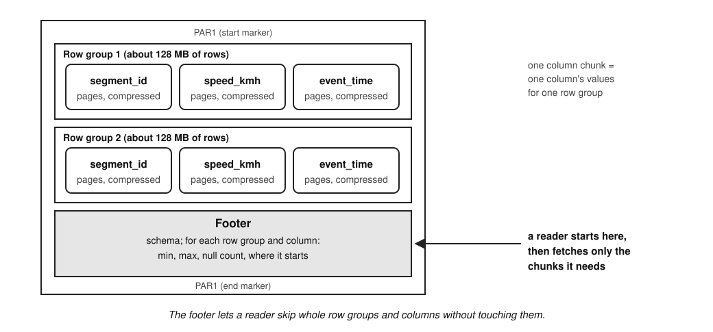
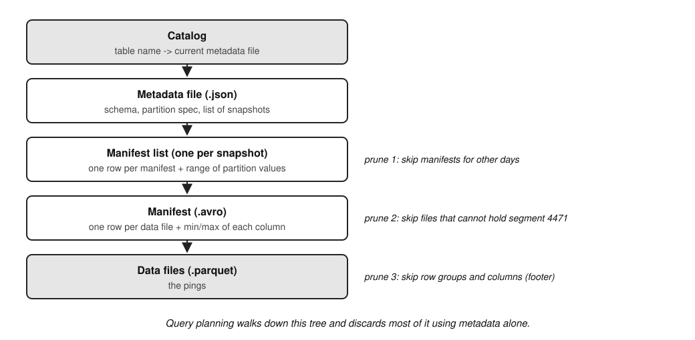
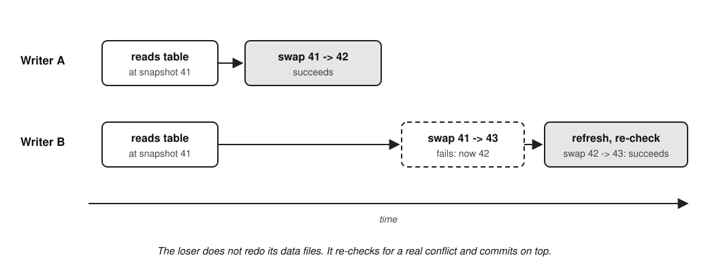
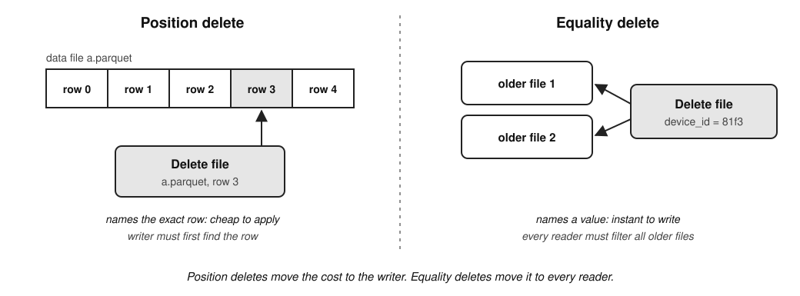
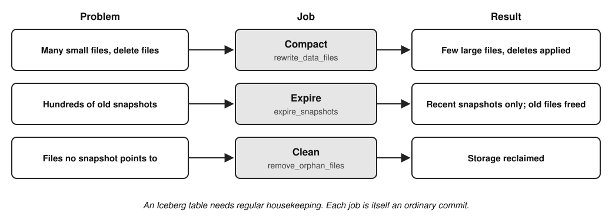

# Chapter 11 — Deep Dive: Parquet and Iceberg

*Part I, Chapter 3 explained why Wayline keeps its pings as files that behave like a table. This chapter goes inside the file format and the table format, at the depth an interview goes.*

## Parquet and Iceberg in one page

Two layers, often confused:

- **Parquet** is a **file format**. One file holds rows, stored column by column, compressed, with statistics. A Parquet file knows nothing about other files.
- **Iceberg** is a **table format**. It is a set of metadata files that say which data files make up a table right now, and it defines how to change that set atomically. The data files are usually Parquet.

What Iceberg adds on top of a folder of Parquet files:

- **atomic commits** and **snapshot isolation**, on storage that has neither;
- **planning from metadata**: finding the files a query needs without listing folders;
- **schema and partition evolution** without rewriting data;
- **time travel** and rollback;
- **row-level updates and deletes**.

What it does not give you: fast single-row lookups, high-frequency small writes, or any housekeeping you did not schedule yourself.

Iceberg is a specification, not a server. Engines (Spark, Flink, Trino, Athena) each implement it, and a **catalog** stores the one pointer per table that makes commits atomic.

## Topic 1: inside a Parquet file



A file is divided into **row groups**, each a horizontal slice of rows, 128 MB by default in the Java writer that Spark uses. Inside a row group, each column is stored separately as a **column chunk**, itself a sequence of **pages** of about 1 MB. Pages are encoded and then compressed.

The **footer**, at the end of the file, holds the schema and, for every row group and column, the minimum, maximum, null count and byte position.

A reader works backwards:

1. Read the footer.
2. Use the statistics to discard row groups that cannot match the filter. This is **predicate pushdown**.
3. Fetch only the column chunks the query names. This is **projection pushdown**.

Encoding does most of the size reduction, before any compression:

- **Dictionary encoding:** store each distinct value once and replace values with small integers. Ideal for repetitive columns such as `segment_id` or `city`.
- **Run-length encoding:** "4471 × 300" for 300 repeats. Very effective on sorted data.
- **Delta encoding:** store differences between neighbours. Ideal for timestamps.

A general compressor (Snappy for speed, Zstandard for size) is then applied to each page.

**What interviewers probe**

- *Why does sort order matter so much?* Sorted data gives narrow min/max ranges per row group, so far more are skipped, and long runs, so encoding works better. An unsorted file has min/max that span everything, and the statistics filter nothing.
- *Statistics are useless for a high-cardinality column like `device_id` unless sorted. What else is there?* **Bloom filters**, stored per column chunk: a compact structure that answers "definitely not here" or "possibly here" for an exact value.
- *Why can't you append to a Parquet file?* The footer is at the end and describes everything before it. Adding rows means writing a new file.
- *Row group size trade-off?* Larger groups compress better and mean less metadata. Smaller groups allow finer skipping and need less memory to read and write.
- *Parquet or ORC or Avro?* Parquet and ORC are both columnar and comparable. Parquet has the wider ecosystem. Avro is row-oriented: good for records written and read whole, such as messages on a log.

## Topic 2: the Iceberg metadata tree



From the top:

- The **catalog** maps a table name to the location of its current **metadata file**.
- The **metadata file** (JSON) holds the schema, the partition spec, table properties, and the list of **snapshots**, with one marked current. Every commit writes a new metadata file.
- Each snapshot points to one **manifest list**: one row per manifest, including the range of partition values that manifest covers.
- Each **manifest** (Avro) has one row per data file: its path, partition values, row count, and per-column lower and upper bounds and null counts.
- The **data files**.

Planning a query is a walk down this tree. For "segment 4471 on 12 November":

1. Manifest list: skip manifests whose partition range does not include the 12th.
2. Manifests: skip data files whose `segment_id` bounds exclude 4471.
3. Parquet footers: skip row groups and unneeded columns.

No folder is ever listed. That matters on object storage, where listing millions of objects is slow.

You can query the metadata itself, which is the first thing to reach for when debugging:

```sql
-- Spark SQL
SELECT snapshot_id, committed_at, operation, summary['added-data-files']
FROM   lake.wayline.pings.snapshots;

SELECT partition, file_path, record_count, file_size_in_bytes
FROM   lake.wayline.pings.files;
```

**What interviewers probe**

- *What is in a manifest, and why does it matter?* File paths plus per-file column statistics. It is what makes file-level pruning possible without opening the files.
- *How is this different from a Hive table?* A Hive table is "the files in these folders", found by listing. It has no atomic multi-file commit and no file-level statistics, and readers can see half-written data.
- *The metadata itself gets large. Then what?* Many small commits create many small manifests, and planning slows down. Rewrite manifests periodically, and commit less often.

## Topic 3: partitioning, hidden and evolvable

In older table layouts the partition is an extra column that users must filter on explicitly. Filter on the timestamp and forget the partition column, and the whole table is scanned.

Iceberg defines a partition as a **transform of a real column**:

```sql
CREATE TABLE lake.wayline.pings (
    ping_id     string,
    device_id   string,
    segment_id  bigint,
    speed_kmh   int,
    event_time  timestamp
)
USING iceberg
PARTITIONED BY (days(event_time));
```

The table records that it is partitioned by `days(event_time)`. A query filtering on `event_time` is pruned automatically. This is **hidden partitioning**: users write natural filters and cannot get it wrong.

The transforms: `identity`, `year`, `month`, `day`, `hour`, `bucket(N, col)` (a hash into N buckets) and `truncate(W, col)`.

Because the partition spec is metadata, it can change:

```sql
ALTER TABLE lake.wayline.pings ADD PARTITION FIELD bucket(16, segment_id);
```

Old files keep their old layout and new files use the new one. Each manifest records which spec its files were written with, and the planner handles both. No data is rewritten. This is **partition evolution**.

Within a partition, a declared **sort order** tells writers how to order rows, which is what makes the statistics in Topics 1 and 2 selective.

**What interviewers probe**

- *How do you choose a partition?* The coarsest column that nearly every query filters on, usually time. Aim for partitions of at least a few hundred megabytes. Use sorting or bucketing for everything else.
- *When is `bucket` useful?* For a high-cardinality column you join or look up by. It spreads writes and lets engines prune to one bucket on an equality filter.
- *What goes wrong with over-partitioning?* Thousands of tiny files per commit, bloated manifests, slow planning. This is the most common way an Iceberg table gets slow.

## Topic 4: commits, conflicts and isolation

A commit is: write new data files, write new manifests and a manifest list, write a new metadata file, then ask the catalog to swap the pointer from the old metadata file to the new one, **only if it is still the old one**.



When two writers race, one swap succeeds. The other fails, and that writer:

1. reloads the current metadata;
2. checks whether its change still applies to the new state;
3. if so, writes new metadata on top and tries the swap again. Its data files are reused.

Whether "it still applies" depends on the operation:

- Two **appends** never conflict. The loser simply re-commits.
- A **compaction** that rewrote file F conflicts with a **delete** that touched F. One of them must be redone.
- An **overwrite** of a partition conflicts with an append into that partition, depending on the isolation level configured.

Readers are never blocked and never see a partial commit. A query uses the snapshot that was current when it was planned.

The **catalog** is the component that must provide an atomic compare-and-swap. Common choices are AWS Glue, a REST catalog service, a relational database, and the Hive Metastore. The choice of catalog also decides which engines can share the table.

**What interviewers probe**

- *Object storage has no atomic rename. How is a commit atomic?* Nothing is renamed. All files are written under unique names, and the only atomic step is the pointer swap in the catalog.
- *Many writers commit to one table every few seconds. What happens?* Retries pile up, since each failed attempt must reload and re-validate. Iceberg suits a few writers committing every few minutes. For many concurrent writers, funnel them through one committer or batch the writes.
- *A streaming writer and a compaction job keep conflicting.* Compact only partitions that are no longer being written to, such as yesterday and older.
- *What isolation do readers get?* Snapshot isolation. Writers can choose between snapshot and serializable validation for overwrites and deletes.

## Topic 5: row-level updates and deletes

Files are immutable, so a change to a few rows is handled in one of two ways (Chapter 3):

- **Copy-on-write:** rewrite every affected data file. Reads stay fast and writes are heavy.
- **Merge-on-read:** leave data files alone and write a **delete file**. Writes are light and reads must apply the deletes.

Merge-on-read has two kinds of delete file, and the difference is a favourite interview question.



- A **position delete** says "row 3 of file a.parquet is deleted". A reader applies it only to that file, cheaply. The writer has to locate the row first.
- An **equality delete** says "any row where `device_id` = 81f3 is deleted". The writer does no reading at all. Every reader must check all older data files against it.

Batch engines produce position deletes. Streaming upserts from Flink produce equality deletes, because a stream job cannot afford to look up where each old row lives. A table receiving streaming upserts therefore gets slower to read until it is compacted.

Newer format versions replace position delete files with **deletion vectors**: one compact bitmap per data file, which is cheaper to read and maintain.

Upserts in SQL use `MERGE`:

```sql
MERGE INTO lake.wayline.typical_speeds t
USING staged_updates s
   ON t.segment_id = s.segment_id AND t.hour_of_week = s.hour_of_week
WHEN MATCHED THEN UPDATE SET t.speed_sum = s.speed_sum, t.ping_count = s.ping_count
WHEN NOT MATCHED THEN INSERT *;
```

**What interviewers probe**

- *Copy-on-write or merge-on-read?* Infrequent changes and many readers: copy-on-write. Frequent small changes: merge-on-read with scheduled compaction.
- *Why is a `MERGE` slow?* It joins the incoming rows against the table to find matches. If the match condition does not include the partition column, it scans everything. Always include the partition in the condition.
- *Reads on an upsert table are getting slower.* Delete files are accumulating. Compact.

## Topic 6: maintenance

An Iceberg table that is written to and never maintained degrades steadily.



```sql
-- 1. merge small files (and apply delete files)
CALL lake.system.rewrite_data_files(
  table => 'wayline.pings',
  where => 'event_time < current_date()');

-- 2. drop old snapshots and the files only they reference
CALL lake.system.expire_snapshots(
  table => 'wayline.pings',
  older_than => TIMESTAMP '2026-11-09 00:00:00',
  retain_last => 20);

-- 3. delete files that no snapshot references
CALL lake.system.remove_orphan_files(table => 'wayline.pings');
```

- **Compaction** rewrites many small files into fewer files of the target size (512 MB by default) and folds in delete files. It can also re-sort the data.
- **Expiring snapshots** removes old snapshots from the metadata and deletes data files that only those snapshots referenced. Until this runs, deleted data is still physically present, and time travel to those snapshots still works.
- **Removing orphan files** deletes files in the table's location that no snapshot references: the leftovers of failed writes.

**What interviewers probe**

- *Why is the table's storage far larger than its data?* Old snapshots keep superseded files alive. Expire them.
- *What is the risk in removing orphan files?* A file being written by a job that has not committed yet looks like an orphan. Only remove files older than a safe margin of several days, never recent ones.
- *How long should snapshots be kept?* Long enough for your slowest reader, your rollback needs and any incremental consumers. Days, typically.
- *What does compaction do to streaming readers?* It replaces files without changing data. Incremental readers must skip "replace" snapshots, or they would re-read rewritten rows.

## Topic 7: time travel, rollback and branches

Every commit leaves the previous snapshot intact until it is expired.

```sql
-- read the table as it was
SELECT count(*) FROM lake.wayline.pings TIMESTAMP AS OF '2026-11-12 06:00:00';
SELECT count(*) FROM lake.wayline.pings VERSION AS OF 8744736658442914487;

-- undo a bad write
CALL lake.system.rollback_to_snapshot('wayline.pings', 8744736658442914487);
```

A rollback is a metadata operation: the current-snapshot pointer moves back. No data is copied.

Snapshots can be named. A **tag** is a fixed name for one snapshot, such as "end of quarter". A **branch** is a movable name with its own line of commits. Branches give a clean way to do the write-audit-publish of Chapter 9:

```sql
ALTER TABLE lake.wayline.typical_speeds CREATE BRANCH audit;
-- the nightly job writes to the audit branch; checks run against it
CALL lake.system.fast_forward('wayline.typical_speeds', 'main', 'audit');
```

Readers of `main` see nothing until the fast-forward, which is one atomic pointer move.

Snapshots also allow **incremental reads**: "give me the rows added between snapshot A and snapshot B". That is how a downstream job processes only what is new.

**What interviewers probe**

- *How far back can you travel?* Only as far as snapshots have not been expired.
- *Is time travel a backup?* No. Expiring snapshots or deleting the files removes it. It protects against bad writes, not against losing the storage.
- *What happens to a long-running query when a snapshot it uses is expired?* It can fail when it tries to read a file that has been deleted. Keep snapshots longer than your longest query.

## Topic 8: schema evolution

Each column has a permanent numeric **id**, assigned when it is created. Data files record ids, not names. The table schema maps current names to ids.

```sql
ALTER TABLE lake.wayline.pings ADD COLUMN heading int;
ALTER TABLE lake.wayline.pings RENAME COLUMN speed_kmh TO speed;
ALTER TABLE lake.wayline.pings DROP COLUMN received_time;
```

All three are metadata-only and instant:

- **Add:** old files have no column with the new id, and readers return null for those rows.
- **Rename:** only the name-to-id mapping changes. Old files are read correctly.
- **Drop:** the id is retired and never reused. If a column with the same name is added later, it gets a new id, so old data does not reappear in it.
- **Widen a type**, such as `int` to `bigint`: allowed. Narrowing is not.

**What interviewers probe**

- *Why ids and not names?* With name-based matching, renaming a column makes old data unreadable, and dropping then re-adding a name resurrects old values. Ids make both safe.
- *Can you change a column's type freely?* Only safe widenings. Anything else needs a new column and a backfill.

## Rapid-fire questions

**Is Iceberg a database?**
No. It is a specification for table metadata. Engines do the reading and writing.

**What does a snapshot contain?**
A pointer to a manifest list, which describes the full set of data files at that moment. It does not contain data.

**Does every commit copy the whole table?**
No. A new snapshot reuses existing manifests and data files and adds only what changed.

**What makes a commit atomic?**
A single compare-and-swap of the table's metadata pointer in the catalog.

**Why are many small commits a problem?**
Each one adds a snapshot, a metadata file, manifests and small data files. Planning slows and storage bloats.

**What is hidden partitioning?**
Partitions defined as transforms of real columns, so that filters on the column prune automatically.

**Position delete or equality delete?**
A position delete names a row in a file. An equality delete names a value and applies to all older files.

**How do you find out why a query scans too much?**
Look at the engine's plan for files and bytes scanned, then at the `files` and `partitions` metadata tables: file count, file sizes, and whether the bounds of the filtered column overlap heavily.

**Iceberg, Delta Lake or Hudi?**
The same core idea. Iceberg is the most engine-neutral. Delta is strongest within Databricks. Hudi targets frequent upserts and incremental pipelines.

**Can you query Iceberg without a cluster?**
Yes: Athena, or DuckDB on one machine.

**What is the target file size?**
A few hundred megabytes: 512 MB is the default target for writes.

**What is a catalog for?**
Name-to-table mapping and the atomic pointer swap. It is also where access control usually lives.

## At Wayline

| Decision | Setting | Why |
|---|---|---|
| File format | Parquet, Zstandard | columnar scans; small files on a petabyte |
| Partition of `pings` | `days(event_time)` | every query filters on time; about 3.5 TB per partition |
| Sort within partition | `segment_id` | narrow min/max per file for road lookups |
| Commit interval of the lake writer | 5 minutes | fresh enough for analysts; healthy file sizes |
| Row-level changes | copy-on-write | deletions are rare and batched weekly |
| Compaction | daily, on yesterday and older | never competes with the live writer |
| Snapshot expiry | keep 7 days | covers rollback and the nightly job's incremental read |
| Nightly publish | write to a branch, check, fast-forward | readers never see unchecked data |
| Catalog | one shared catalog for Flink, Spark, Trino, Athena | all engines see the same commits |

## In Kleppmann's book

| Topic | Where in *Designing Data-Intensive Applications* (1st ed.) |
|---|---|
| Column storage, compression, sort order | Ch. 3, "Column-Oriented Storage" |
| Immutable files merged in the background | Ch. 3, "SSTables and LSM-Trees" |
| Atomic commit | Ch. 7, "The Meaning of ACID" |
| Readers on a snapshot | Ch. 7, "Snapshot Isolation and Repeatable Read" |
| Compare-and-set, retry on conflict | Ch. 7, "Preventing Lost Updates" |
| Schema evolution with field identifiers | Ch. 4, "Formats for Encoding Data" |
| Partitioning | Ch. 6, "Partitioning of Key-Value Data" |
| Rebuilding views from immutable data | Ch. 12, "Reprocessing data for application evolution" |

The book predates Iceberg. Each mechanism in this chapter is an application of an idea the book covers.
