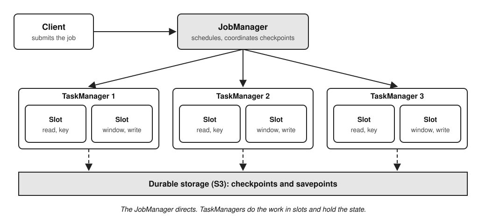
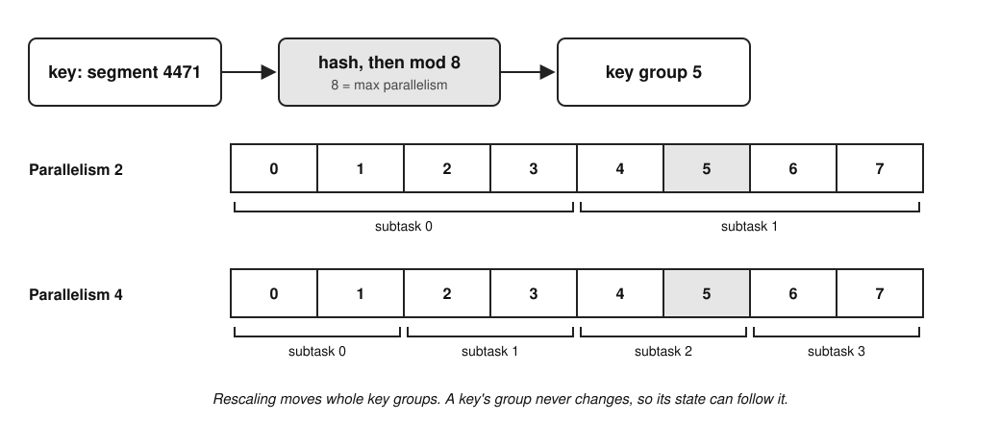
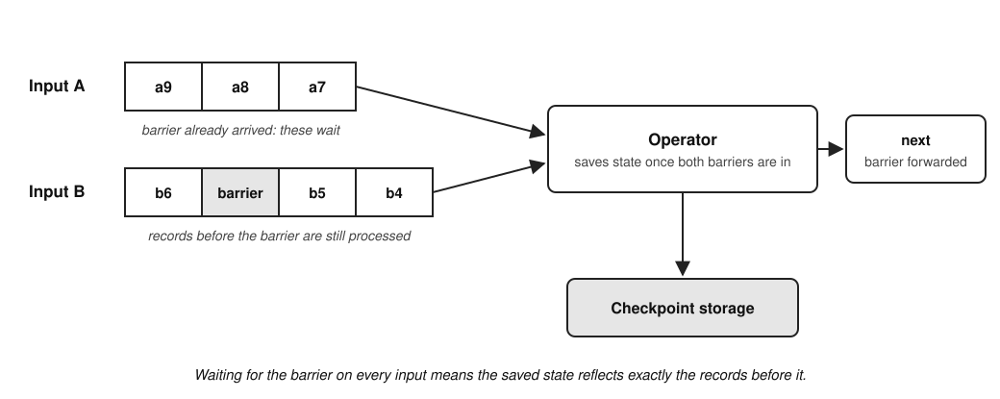
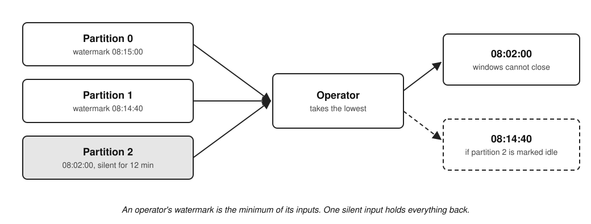
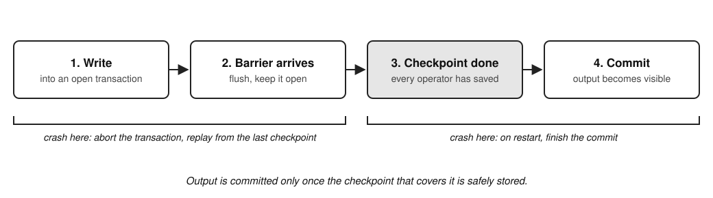

# Chapter 12 — Deep Dive: Flink

*Part I, Chapter 4 explained the ideas behind Wayline's stream job: windows, event time, watermarks, checkpoints. This chapter goes inside Flink itself, at interview depth.*

## Flink in one page

- Flink runs **stateful computations over streams**. A job is a graph of **operators** (source, map, key-by, window, sink). Each operator runs as several parallel **subtasks**.
- Records flow between subtasks one at a time, not in micro-batches.
- Operators can keep **state**, and Flink manages that state: it stores it, snapshots it and restores it.
- **Event time** and **watermarks** are first-class. Results depend on the timestamps in the data, not on when the job happened to run.
- **Checkpoints** give exactly-once state: after a failure the job resumes as if each record had been processed once.

What Flink promises: with a replayable source and a suitable sink, results are exactly-once from end to end. What it does not promise: low latency while a sink is slow, small state unless you clean it up, or exactly-once side effects in systems that cannot join its checkpoints.

Flink also runs bounded (batch) jobs with the same APIs, and offers SQL on top of the same runtime.

## Topic 1: runtime architecture



- The **JobManager** is the coordinator. It turns the job into an execution plan, decides which subtask runs where, triggers checkpoints, and handles failures. For high availability a standby JobManager takes over, with leadership decided through ZooKeeper or Kubernetes.
- **TaskManagers** are the workers. Each offers a number of **task slots**. A slot is a fixed share of the TaskManager's memory.
- **Parallelism** is the number of subtasks per operator. A job with parallelism 64 runs 64 copies of each operator.
- **Operator chaining:** consecutive operators with the same parallelism and no regrouping between them are fused into a single task. Records pass between them as plain method calls, with no serialisation and no network.
- **Slot sharing:** one slot can hold one subtask of every operator in the job. So a job needs as many slots as its highest parallelism, not the sum.

A `keyBy` breaks a chain, because records must be routed to the subtask that owns their key. That is a network shuffle, and it is where serialisation cost shows up.

**What interviewers probe**

- *What happens when a TaskManager dies?* Its subtasks are lost. The JobManager restarts the affected part of the job from the last completed checkpoint and the sources rewind.
- *What happens when the JobManager dies?* Without high availability, the job is gone. With it, a standby recovers the job from the latest checkpoint metadata.
- *How many slots does a job need?* The maximum parallelism of any operator, thanks to slot sharing.
- *Why is one job per cluster common?* Isolation. In "application mode" each job has its own JobManager and TaskManagers, so that one bad job cannot take others down.

## Topic 2: state, state backends and rescaling

**Keyed state** is state scoped to the current key. After `keyBy(segment_id)`, when a subtask processes a ping for segment 4471, it sees only 4471's state. The main kinds are `ValueState` (one value), `ListState`, `MapState`, and the aggregating variants that windows use.

**Operator state** is scoped to a subtask, not a key. The usual example is a Kafka source remembering its offsets.

Where state lives is the **state backend**:

| | Heap (HashMap) | RocksDB (embedded) |
|---|---|---|
| State kept as | objects in memory | serialised bytes on local disk |
| Size limit | memory | local disk |
| Access speed | fastest | slower: every access serialises |
| Checkpoints | full each time | **incremental**: only changed files |
| Use when | state is small | state is large, the usual production choice |

Rescaling a job means moving state between subtasks. Flink does this with **key groups**.



Every key hashes to one of a fixed number of key groups. That number is the job's **maximum parallelism**. Each subtask owns a contiguous range of key groups. Changing parallelism reassigns ranges, and state moves in whole groups.

The consequence: maximum parallelism is fixed when the job first starts with state. You can rescale up to it and no further without discarding state. Set it explicitly and generously.

State does not clean itself up, except in windows. For anything else, set a time-to-live:

```java
StateTtlConfig ttl = StateTtlConfig.newBuilder(Duration.ofHours(1))
    .setUpdateType(StateTtlConfig.UpdateType.OnCreateAndWrite)
    .build();
ValueStateDescriptor<Boolean> seen = new ValueStateDescriptor<>("seen", Boolean.class);
seen.enableTimeToLive(ttl);          // e.g. ping ids already seen
```

**What interviewers probe**

- *Heap or RocksDB?* RocksDB once state exceeds a few gigabytes, or when checkpoints must be incremental. Heap for small state where latency matters most.
- *State keeps growing. Why?* Keys that are never seen again and have no TTL, windows that never close because the watermark stalled, or a join that buffers both sides without a time bound.
- *Can you change the maximum parallelism later?* Not while keeping state.
- *How do you change the type of a state value?* Use a serialiser that supports evolution, such as Avro or Flink's POJO serialiser, and follow its rules: add fields with defaults.

## Topic 3: checkpoints and savepoints

A checkpoint must capture a **consistent** picture: every operator's state as of the same point in the input, while the job keeps running.

Flink does it with **barriers**. The JobManager tells the sources to start checkpoint *n*. Each source records its position and emits a barrier into its output. Barriers travel with the records. When an operator receives barrier *n*, it snapshots its state and forwards the barrier.



An operator with several inputs must wait until the barrier has arrived on **all** of them. Records that arrive on an input after its barrier are held back until then. This **alignment** ensures the snapshot contains the effect of exactly the records before the barrier on every input. The snapshot itself is written in the background while processing continues. When every operator has acknowledged, the checkpoint is complete.

```java
env.enableCheckpointing(60_000);                                   // every minute
env.getCheckpointConfig().setMinPauseBetweenCheckpoints(30_000);
env.getCheckpointConfig().setCheckpointTimeout(600_000);
env.getCheckpointConfig().setTolerableCheckpointFailureNumber(3);
```

Alignment has a weakness. Under backpressure, barriers queue up behind data and checkpoints take longer and longer, or time out. **Unaligned checkpoints** let the barrier jump the queue. The records it overtakes are saved as part of the checkpoint. Checkpoints stay fast, at the cost of being larger.

A **savepoint** uses the same mechanism for a different purpose.

| | Checkpoint | Savepoint |
|---|---|---|
| Triggered by | Flink, periodically | a person or deployment tool |
| Purpose | recover from failure | upgrade, rescale, migrate, fork a job |
| Lifetime | replaced by newer ones | kept until you delete it |
| Format | optimised, may be incremental | portable |

To upgrade a job: stop it with a savepoint, deploy the new version, start from the savepoint. For Flink to match saved state to operators in the new code, each stateful operator needs a stable id:

```java
stream.keyBy(p -> p.segmentId)
      .window(...)
      .aggregate(new SumCount()).uid("segment-minute-agg");
```

**What interviewers probe**

- *Why is this exactly-once and not at-least-once?* Alignment. Without it, an operator might include a record from one input that arrived after that input's barrier, and after a restore that record would be processed again.
- *Checkpoints keep timing out. Why?* Backpressure delaying barriers, very large state with full snapshots, or slow checkpoint storage. Fixes: remove the bottleneck, incremental checkpoints, unaligned checkpoints.
- *How do you choose the interval?* Shorter means less to replay after a failure and more overhead. One minute is a common start. Transactional sinks also publish only at checkpoints, so the interval sets their latency.
- *You forgot operator ids and changed the job. What happens?* Auto-generated ids change with the job's structure, so state cannot be matched and the restore fails or state is dropped.

## Topic 4: watermarks in detail

A watermark is a record in the stream that says: "no more events with a timestamp at or below T are expected". Sources generate them, and they flow downstream like barriers.

```java
WatermarkStrategy<Ping> strategy = WatermarkStrategy
    .<Ping>forBoundedOutOfOrderness(Duration.ofSeconds(30))    // the wait
    .withTimestampAssigner((ping, ts) -> ping.eventTimeMillis)
    .withIdleness(Duration.ofMinutes(1));                      // see below

DataStream<Ping> pings = env.fromSource(kafkaSource, strategy, "pings");
```

Three rules explain most watermark behaviour:

1. **Per partition at the source.** The Kafka source tracks a watermark for each partition separately, since each partition is ordered and they progress at different rates.
2. **Minimum across inputs.** An operator with several inputs takes the lowest watermark among them.
3. **Windows and timers fire on the watermark.** A window closes when the watermark passes its end.



Rule 2 has a sharp edge. If one partition receives no data, its watermark stops. The minimum stops with it. Windows stop closing and state piles up, even though the other partitions are flowing. Marking a quiet input as **idle** after a timeout removes it from the minimum until it produces data again.

Late records, those behind the watermark, have three possible fates, which you configure on the window:

```java
OutputTag<Ping> late = new OutputTag<>("late") {};
pings.keyBy(p -> p.segmentId)
     .window(TumblingEventTimeWindows.of(Duration.ofMinutes(1)))
     .allowedLateness(Duration.ofMinutes(5))     // reopen and re-emit
     .sideOutputLateData(late)                   // anything later goes here
     .aggregate(new SumCount());
```

**What interviewers probe**

- *The job produces no output, but lag is zero. Why?* The watermark is not advancing: an idle partition, or timestamps that are wrong, so that nothing is ever "complete".
- *How do you pick the out-of-orderness bound?* From the measured distribution of lateness, as a trade between completeness and delay.
- *One device sends a timestamp far in the future. What happens?* The watermark jumps forward and everything after it is treated as late. Validate timestamps before they reach watermark generation.
- *Processing time or event time for a timeout?* An event-time timer fires when the watermark passes it, which is reproducible on replay. A processing-time timer fires by the wall clock, which is right for "nothing has arrived for 30 real seconds".

## Topic 5: windows, aggregation and state size

A window operator has three parts: an **assigner** that puts each record into one or more windows, a **trigger** that decides when to emit, and a **function** that computes the result.

The choice of function decides how much state is kept:

- An **incremental aggregate** keeps one small accumulator per key and window, here a sum and a count, and updates it for each record.
- A **process window function** receives all the window's records at once, so Flink must buffer every record until the window fires.

For anything that can be computed incrementally, use the first. You can combine them: aggregate incrementally, then pass the single result to a process function to attach the window's start time.

```java
public class SumCount implements AggregateFunction<Ping, long[], long[]> {
    public long[] createAccumulator()             { return new long[]{0, 0}; }
    public long[] add(Ping p, long[] acc)         { acc[0] += p.speedKmh; acc[1]++; return acc; }
    public long[] getResult(long[] acc)           { return acc; }
    public long[] merge(long[] a, long[] b)       { return new long[]{a[0]+b[0], a[1]+b[1]}; }
}
```

The same job in Flink SQL:

```sql
CREATE TABLE pings (
  segment_id BIGINT, speed_kmh INT, event_time TIMESTAMP(3),
  WATERMARK FOR event_time AS event_time - INTERVAL '30' SECOND
) WITH ('connector' = 'kafka', ...);

SELECT segment_id, window_start, SUM(speed_kmh) AS speed_sum, COUNT(*) AS ping_count
FROM   TABLE(TUMBLE(TABLE pings, DESCRIPTOR(event_time), INTERVAL '1' MINUTE))
GROUP  BY segment_id, window_start, window_end;
```

For logic that windows cannot express, a **keyed process function** gives direct access to state and **timers**: "when a ping arrives, store it and set a timer; when the timer fires, emit and clear".

**What interviewers probe**

- *Sliding window of 1 hour, sliding every second, over millions of keys. Problem?* Each record belongs to 3,600 windows. State and work explode. Keep small tumbling buckets and combine them, or use a process function.
- *Why is a window's state so large?* A process window function buffering every record, or a very long allowed lateness keeping windows alive.
- *Early results?* A custom trigger can fire periodically while the window is open, emitting the running value before the final one.

## Topic 6: exactly-once to the outside world

Checkpoints make Flink's own state exactly-once. Output is another matter: results emitted between the last checkpoint and a crash will be emitted again after recovery.

Three ingredients are needed from end to end:

1. a **replayable source**, such as Kafka, that can rewind to a saved position;
2. **checkpointed state**;
3. a sink that is either **idempotent** or **transactional**.

An idempotent sink overwrites by key, so repeats are harmless. That is Wayline's upsert by `(segment_id, minute)`.

A transactional sink ties its commit to the checkpoint, using **two-phase commit**.



1. Between checkpoints, the sink writes into an open transaction. Nothing is visible to readers.
2. When the barrier arrives, the sink **pre-commits**: it flushes and records the transaction's identity in its own checkpointed state.
3. The checkpoint completes once all operators have acknowledged.
4. The JobManager notifies the sink, which **commits**.

If the job fails before step 3, the transaction is aborted and the input is replayed. If it fails between 3 and 4, the restored state names the pending transaction, and the sink commits it on restart.

This is how the Kafka sink and the Iceberg sink work. Two consequences are worth stating:

- **Latency.** Output becomes visible only at checkpoints. A one-minute interval means results up to a minute old.
- **Timeouts.** For Kafka, the transaction timeout must be longer than the checkpoint interval plus the longest plausible recovery. If the broker aborts a transaction that Flink considers pre-committed, that data is lost.

**What interviewers probe**

- *Exactly-once to a database without transactions?* Make the write idempotent: a deterministic key and upsert.
- *Exactly-once to an HTTP API?* Not possible in general. Send an idempotency key, if the API supports one. Otherwise accept at-least-once.
- *Why do downstream Kafka consumers need `read_committed`?* Otherwise they read records from transactions that are later aborted.

## Topic 7: backpressure and performance

When an operator cannot keep up, its input buffers fill. The upstream operator then cannot send, its own buffers fill, and the slowdown travels back to the source, which reads from Kafka more slowly. Nothing is dropped. This is **backpressure**, and in Flink it is automatic: a sender may transmit only as much as the receiver has announced room for.

Finding the bottleneck: the Flink UI shows, for each operator, how much of the time it is *busy* and how much it is *backpressured*. Operators upstream of the bottleneck are backpressured. The bottleneck itself is busy and not backpressured.

Common causes and cures:

| Cause | Sign | Cure |
|---|---|---|
| Slow sink | last operator busy | batch writes, scale the sink |
| Key skew | one subtask busy, siblings idle | pre-aggregate before `keyBy`, or salt the key |
| Blocking calls to an external service | operator busy, CPU low | asynchronous I/O |
| Serialisation | high CPU everywhere after `keyBy` | efficient types; avoid generic fallbacks |
| Large state access | RocksDB operators busy | more memory for RocksDB, faster local disks |
| Too little capacity | everything busy | raise parallelism from a savepoint |

Calling an external service for each record, one at a time, limits a subtask to a few hundred records a second. Asynchronous I/O lets many requests be in flight at once:

```java
AsyncDataStream.unorderedWait(
    pings, new SegmentLookup(), 500, TimeUnit.MILLISECONDS, 100);   // 100 in flight
```

**What interviewers probe**

- *Lag is growing. Walk me through it.* Confirm with consumer lag. Find the busy, non-backpressured operator. Look for skew among its subtasks. Check checkpoint duration and size. Then decide whether to fix or scale.
- *Backpressure and checkpoints?* Barriers are stuck behind data, so checkpoints slow down or fail. That is what unaligned checkpoints are for.
- *Does adding parallelism fix skew?* No. One key still goes to one subtask.

## Topic 8: joins and enrichment

Joining streams means deciding how long to remember each side.

- **Window join:** join records from two streams that fall in the same window.
- **Interval join:** join each record of A with records of B whose timestamps are within a range, such as "a jam report and pings on the same road within two minutes". State is bounded by the interval.
- **Temporal join:** join a stream with a table that changes over time, using the version of the row that was valid at the record's event time. "The speed limit of the segment *as it was* when the ping was sent."
- **Lookup join:** call an external database for each record, usually with a cache and asynchronous I/O. Simple, but the result depends on when the lookup happens, so a replay may give different answers.
- **Broadcast state:** a small, slowly changing stream, such as configuration or rules, is sent to every subtask and kept in state, where the main stream reads it locally.

A regular join in streaming SQL with no time bound keeps both inputs in state forever. Always bound it by time or set a state TTL.

**What interviewers probe**

- *How do you enrich a stream with reference data?* A small, slowly changing table: broadcast state. A large or versioned one: temporal join against a changelog. An external system you do not control: asynchronous lookup with a cache.
- *Why does a stream-stream join need state on both sides?* A match can arrive later on either side, so each side must be kept until no match is possible.

## Rapid-fire questions

**Flink or Spark Structured Streaming?**
Flink processes record by record, with richer event-time and state features. Spark processes small batches and shares code with batch jobs. Choose by latency needs and what the team already runs.

**Flink or Kafka Streams?**
Kafka Streams is a library inside your service, with no cluster, and it reads and writes Kafka only. Flink is a separate cluster that connects to many systems and handles larger state.

**What is a watermark?**
A marker in the stream asserting that events up to a given event time have all arrived.

**What does `keyBy` do?**
Routes records with the same key to the same subtask, and scopes state to that key.

**Checkpoint or savepoint?**
A checkpoint is automatic, for failure recovery. A savepoint is manual, for planned changes.

**What is operator chaining?**
Fusing adjacent operators into one task to avoid serialisation and network hops.

**Where is state stored?**
Working state is on the TaskManagers, in memory or local RocksDB. Snapshots go to durable storage.

**What limits rescaling?**
Maximum parallelism, which is the number of key groups.

**What is allowed lateness?**
Extra time a window is kept after its end, so that late records can update the result.

**How do you handle a poison record?**
Catch the failure in the operator and send the record to a side output, then to a dead-letter topic. An uncaught exception restarts the job, and it will fail again on the same record.

**How do you deploy a new version without losing state?**
Stop with a savepoint, start the new version from it, with stable operator ids.

**Can Flink do batch?**
Yes. A bounded source runs the same job in batch mode, with different scheduling and no checkpoints.

## At Wayline

| Decision | Setting | Why |
|---|---|---|
| Source | Kafka `pings`, 64 partitions, parallelism 64 | one reader per partition |
| Watermark | bounded out-of-orderness 30 s, idleness 1 min | 99% of pings in time; a quiet partition cannot stall the job |
| Key | `segment_id`, with pre-aggregation before `keyBy` | regroup by road; busy roads send partial totals, not raw pings |
| Window | 1-minute tumbling, incremental sum and count | tiny state per road per minute |
| Lateness | allowed 5 min; later pings to a side output and counted | corrections without unbounded state |
| Early results | fire every 10 s | meets the 60-second freshness target |
| State backend | RocksDB, incremental checkpoints | state larger than memory; cheap snapshots |
| Checkpoints | every 60 s to S3 | at most a minute of replay |
| Sink | idempotent upsert by `(segment_id, minute)` | repeats after recovery are harmless |
| Max parallelism | set explicitly, well above 64 | room to rescale without losing state |
| Operator ids | set on every stateful operator | upgrades from savepoints |

## In Kleppmann's book

| Topic | Where in *Designing Data-Intensive Applications* (1st ed.) |
|---|---|
| Stream processing engines and their uses | Ch. 11, "Processing Streams" |
| Event time, stragglers | Ch. 11, "Reasoning About Time" |
| Window types | Ch. 11, "Types of windows" |
| Stream joins: stream-stream, stream-table, table-table | Ch. 11, "Stream Joins" |
| Checkpointing | Ch. 11, "Fault Tolerance": "Microbatching and checkpointing" |
| Output tied to a checkpoint | Ch. 11, "Fault Tolerance": "Atomic commit revisited"; Ch. 9, "Atomic Commit and Two-Phase Commit (2PC)" |
| Idempotent output | Ch. 11, "Fault Tolerance": "Idempotence" |
| Restoring state | Ch. 11, "Fault Tolerance": "Rebuilding state after a failure" |
| State stored in an LSM engine | Ch. 3, "SSTables and LSM-Trees" |
| Partitioning state by key; rebalancing | Ch. 6, "Rebalancing Partitions" |
