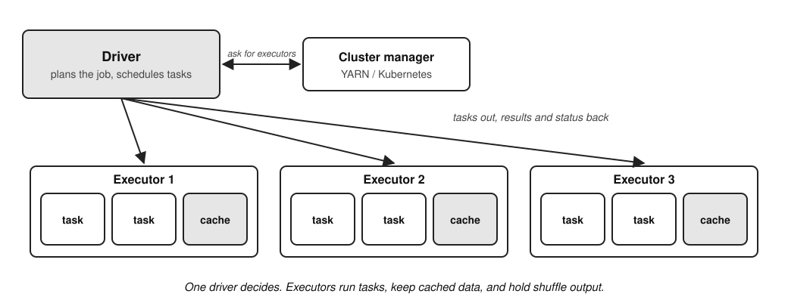
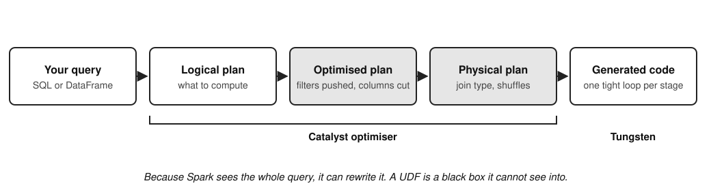
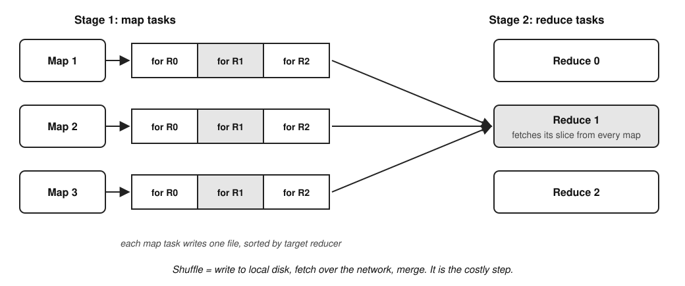
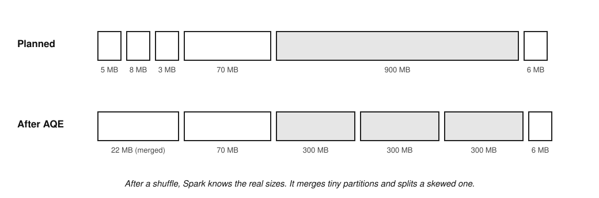
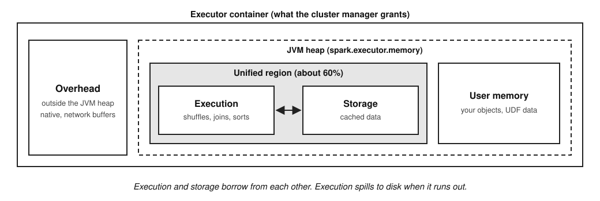

# Chapter 13 — Deep Dive: Spark

*Part I, Chapter 5 explained why Wayline's nightly job is a batch job and what makes it safe to re-run. This chapter goes inside Spark, at interview depth. Examples are in Scala.*

## Spark in one page

- Spark runs a computation over data split into **partitions**, in parallel, on a cluster.
- You describe the computation with the **DataFrame** API or SQL. Spark's optimiser turns it into a physical plan.
- Nothing runs until an **action** (write, count, collect) asks for a result. Until then, **transformations** only build up a plan. This is **lazy evaluation**.
- A **job** is split into **stages** at each shuffle. A stage is split into **tasks**, one per partition.
- Failed tasks are retried. Lost intermediate data is recomputed from its inputs.

What Spark is good at: large transformations and joins that do not fit on one machine, with recovery from machine failures part-way through. What it is not for: millisecond responses, or point lookups.

## Topic 1: driver, executors, jobs, stages, tasks



- The **driver** runs your program. It builds the plan, asks the cluster manager for executors, hands out tasks, and tracks them.
- **Executors** are processes on worker machines. They run tasks, hold cached data, and keep the shuffle files they produced.
- The **cluster manager** (YARN, Kubernetes) only hands out containers.

The hierarchy of work:

| Unit | Created by | Example |
|---|---|---|
| **Job** | each action | one `write` |
| **Stage** | each shuffle boundary | "scan and pre-aggregate", then "final aggregate" |
| **Task** | each partition in a stage | process one file chunk |

A transformation is **narrow** if each output partition depends on one input partition (`filter`, `select`, `map`). Narrow transformations are chained into a single stage with no data movement. It is **wide** if an output partition depends on many input partitions (`groupBy`, `join`, `repartition`). A wide transformation needs a shuffle and starts a new stage.

The nightly job from Chapter 5:

```scala
val day = java.sql.Date.valueOf("2026-11-12")

val totals = spark.table("lake.wayline.pings")
  .where(to_date($"event_time") === day)
  .groupBy($"segment_id", hour($"event_time").as("hour"))
  .agg(sum($"speed_kmh").as("speed_sum"), count(lit(1)).as("ping_count"))
  .withColumn("day", lit(day))

totals.writeTo("lake.wayline.daily_totals").overwritePartitions()   // the action
```

Only the last line starts any work. It produces one job with two stages.

**What interviewers probe**

- *What happens if the driver dies?* The application fails. The driver holds the plan and all scheduling state. Executors are replaceable and the driver is not.
- *What happens if an executor dies?* Its running tasks are rescheduled. If it held shuffle output that a later stage needs, the tasks that produced that output are re-run as well.
- *Why is `collect()` dangerous?* It brings every row to the driver's memory. Use it only on small results.
- *Client mode or cluster mode?* Where the driver runs: on the submitting machine, or inside the cluster. Production jobs use cluster mode.

## Topic 2: DataFrames, Catalyst and Tungsten

Spark has two levels of API. **RDDs** are distributed collections of arbitrary objects, with functions that Spark cannot look inside. **DataFrames** are tables with a known schema and operations Spark understands. That understanding is what makes optimisation possible.



The **Catalyst** optimiser rewrites the plan:

- **Predicate pushdown:** apply filters as early as possible, ideally inside the file reader, so that Iceberg can prune files.
- **Column pruning:** read only the columns that are used.
- **Constant folding, filter reordering, join reordering** using table statistics.

**Tungsten** then generates code for each stage: one compact loop over a binary row format, with no object created per row.

Always check what Spark decided:

```scala
totals.explain("formatted")
```

```
== Physical Plan ==
* HashAggregate (5)                 final: merge partial sums
+- Exchange (4)                     hashpartitioning(segment_id, hour, 200)   <- the shuffle
   +- * HashAggregate (3)           partial: sum and count per task
      +- * Project (2)
         +- BatchScan iceberg (1)   filters: event_time ..., columns: 3 of 6
```

Read it from the bottom up. `Exchange` is a shuffle. The two `HashAggregate` nodes are the partial and final aggregation from Chapter 5. The scan line shows whether the filter and the column pruning reached the reader.

**What interviewers probe**

- *Why are DataFrames faster than RDDs?* The optimiser can rewrite the query, and the generated code works on a compact binary format without creating objects.
- *What is wrong with UDFs?* A user-defined function is opaque. Catalyst cannot push a filter through it or prune around it, and values must be converted to and from Spark's internal format. In Python it is worse, because rows are shipped to a separate process. Prefer built-in functions.
- *What about the typed Dataset API in Scala?* `ds.filter(p => p.speed > 30)` is a lambda: just as opaque as a UDF, and it forces each row to be turned into an object. `ds.filter($"speed" > 30)` is an expression that Catalyst can optimise.
- *How do you know that a filter was pushed down?* It appears in the scan node of the plan, not in a separate `Filter` node above it.

## Topic 3: the shuffle

A shuffle regroups rows by key across the cluster.



1. **Map side.** Each task works out the target partition of each row, `hash(key) mod N`, and writes its output to local disk as one file, ordered by target partition, with an index.
2. **Reduce side.** Each task of the next stage fetches its slice from every map task's file, over the network, then merges or hashes the rows.

N is `spark.sql.shuffle.partitions`, 200 by default. Too few partitions and each is large, so tasks spill to disk or run out of memory. Too many and there are thousands of tiny tasks and tiny output files. A sound target is 100 to 200 MB per partition.

Why the shuffle is costly: rows are serialised, written to disk, sent over the network, read and deserialised. When a partition does not fit in a task's memory, Spark **spills** sorted runs to disk and merges them, which is slower again.

How to shuffle less:

- **Filter and project first.** Fewer and narrower rows.
- **Aggregate before joining.**
- **Broadcast small tables** to avoid shuffling the big one.
- **Let partial aggregation work.** `sum`, `count`, `min` and `max` are reduced on the map side. `collect_list` and exact `count(distinct)` are not.
- **Bucket** tables that are repeatedly joined on the same key, so that the data is already grouped.

**What interviewers probe**

- *`repartition` or `coalesce`?* `repartition(n)` does a full shuffle and gives evenly sized partitions, and can increase or decrease the count. `coalesce(n)` only merges existing partitions without a shuffle: cheap, but the results can be uneven, and it can reduce the parallelism of the work upstream of it.
- *What is a `FetchFailed` error?* A reduce task could not fetch shuffle data, usually because the executor that held it was lost. Spark re-runs the map tasks that produced it.
- *Why does a lost machine cost more than its own tasks?* Its shuffle files went with it. An external shuffle service, or moving shuffle data off a node before it is removed, reduces the damage.
- *How many shuffle partitions?* Size the count from the data, about 128 MB each, or let adaptive execution decide (Topic 5).

## Topic 4: joins

Spark has three main ways to join.

| Strategy | How | When chosen | Weak spot |
|---|---|---|---|
| **Broadcast hash join** | send the small table to every executor, and probe it while scanning the big one | one side below `spark.sql.autoBroadcastJoinThreshold` (10 MB by default) | the small side must fit in memory, on the driver too |
| **Sort-merge join** | shuffle both sides by key, sort, merge | default for two large tables | two shuffles and a sort; suffers from skew |
| **Shuffle hash join** | shuffle both, build a hash table on the smaller side per partition | when one side is much smaller per partition | the hash table must fit in memory |

```scala
import org.apache.spark.sql.functions.broadcast

val byCity = totals
  .join(broadcast(segments.select("segment_id", "city", "speed_limit_kmh")), "segment_id")
  .groupBy("city").agg(sum("speed_sum") / sum("ping_count"))
```

The hint forces a broadcast when you know that a table is small and Spark's estimate is missing or wrong.

Order matters as much as strategy. Filter each side before joining, and aggregate the fact table before joining it to a dimension. A join that multiplies rows, many-to-many on a non-unique key, is the most common reason for a job that never finishes.

**What interviewers probe**

- *The broadcast join failed with out-of-memory. Why?* The "small" table was not small. The size estimate was wrong, or it grew. The driver collects the table before broadcasting, so the driver can fail too.
- *How do you avoid the shuffle in a join that runs every night?* Bucket both tables by the join key with the same number of buckets. With Iceberg, tables partitioned compatibly on the join key can be joined partition by partition.
- *The join output has far more rows than either input.* Duplicate keys on both sides. Check for uniqueness before joining.
- *Nulls in the join key?* Nulls never match in an equi-join, but they all hash to the same partition and create skew. Filter them out first.

## Topic 5: adaptive query execution

Classic optimisers plan everything up front, from estimates. Estimates are often wrong. **Adaptive query execution (AQE)**, on by default in current Spark versions, re-plans during the job, using the real sizes observed after each shuffle.



It does three things:

1. **Coalesces shuffle partitions.** Starting from the configured count, it merges small neighbouring partitions up to a target size. You no longer have to guess the right number.
2. **Switches join strategy.** If, after filtering, one side turns out to be small, a planned sort-merge join becomes a broadcast join.
3. **Splits skewed partitions.** In a join, a partition far larger than the median is split into several, and the matching partition of the other side is duplicated for each piece.

A related feature, **dynamic partition pruning**: when a large partitioned fact table is joined to a filtered dimension, Spark first evaluates the dimension filter, then uses the resulting keys to skip partitions of the fact table.

```properties
spark.sql.adaptive.enabled=true
spark.sql.adaptive.coalescePartitions.enabled=true
spark.sql.adaptive.skewJoin.enabled=true
spark.sql.adaptive.advisoryPartitionSizeInBytes=128m   # default 64m
```

**What interviewers probe**

- *Does AQE remove the need for tuning?* It removes most guessing about partition counts and many skew problems in joins. It does not fix skew in aggregations that cannot be partially aggregated, bad join order, or exploding joins.
- *Why can AQE only act between stages?* It needs the real statistics that a completed shuffle provides.
- *The plan in the UI differs from `explain`.* Expected with AQE: the final plan is only known when the job has run.

## Topic 6: skew

Skew means that a few keys hold most of the rows. One task gets a partition a hundred times larger than the others. Every other task finishes in a minute, and that one runs for an hour or runs out of memory.

**Diagnosis.** In the Spark UI, open the slow stage and compare task durations and shuffle read sizes: the median against the maximum. A large gap is skew. Then find the keys:

```scala
pings.groupBy("segment_id").count().orderBy(desc("count")).show(20)
```

**Cures**, in order of preference:

1. **Is the key legitimate?** Nulls, zeros and "unknown" placeholders are the commonest hot keys. Filter them or handle them separately.
2. **Broadcast the other side**, if it is small. No shuffle means no skew.
3. **Let AQE split it** (joins only).
4. **Handle the hot keys separately**: join the few heavy keys with a broadcast and the rest normally, then union.
5. **Salt the key.** Spread a hot key over several partitions by adding a random suffix:

```scala
val salts = 16
val big   = pings.withColumn("salt", (rand() * salts).cast("int"))
val small = segments.withColumn("salt", explode(array((0 until salts).map(lit): _*)))

big.join(small, Seq("segment_id", "salt"))
```

The big side gets a random salt. The small side is replicated once per salt value so that every combination still finds its match.

For **aggregations**, the equivalent is two steps: aggregate by `(key, salt)`, then by `key`. It works only for aggregates that combine, such as sum and count.

**What interviewers probe**

- *Does adding executors fix skew?* No. The oversized partition is still one task on one executor.
- *Does raising the shuffle partition count fix skew?* No. All rows of one key still hash to one partition.
- *Why does `groupBy().sum()` usually survive skew while a join does not?* Partial aggregation shrinks the hot key to one row per map task before the shuffle. A join must move every row.

## Topic 7: memory and out-of-memory errors



An executor's container has two parts. The **JVM heap** is `spark.executor.memory`. The **overhead**, 10% extra by default with a minimum of 384 MB, covers memory outside the heap: network buffers, native libraries, Python workers.

Inside the heap, a **unified region** of about 60% is shared between:

- **execution memory**: for shuffles, joins, sorts and aggregations;
- **storage memory**: for cached data.

Each can borrow from the other. Execution can evict cached data to reclaim its share. When execution memory runs out, Spark spills to disk rather than failing, where the operation supports that.

The failures, and what each one means:

| Symptom | Likely cause | Fix |
|---|---|---|
| Driver out of memory | `collect()`, a large broadcast, too many partitions or files to track | do not collect; lower the broadcast threshold; fewer partitions |
| Executor out of memory in one task | a skewed or oversized partition | fix the skew; more shuffle partitions |
| Container killed for exceeding memory | off-heap use beyond the overhead | raise the memory overhead |
| Long garbage-collection pauses | too many objects: UDFs, RDD code, a very large heap | DataFrame operations; smaller executors, more of them |

**Caching** keeps a DataFrame's partitions so that later actions reuse them. It pays when the same expensive result is used more than once, and costs memory otherwise. Unpersist when done.

```scala
val cleaned = pings.where($"speed_kmh".between(0, 200)).persist()
// ... two or more actions use `cleaned` ...
cleaned.unpersist()
```

**What interviewers probe**

- *Many small executors or a few large ones?* Very large heaps suffer long garbage-collection pauses. Very small executors waste overhead and cannot hold a large partition. Around 4 to 5 cores and a moderate heap per executor is a common starting point.
- *When does caching hurt?* When the data is used once, or when it evicts memory that execution needs.
- *"Container killed by YARN for exceeding memory limits"?* The process used more than heap plus overhead. This is not a Java heap error. Raise the overhead, or reduce off-heap use.

## Topic 8: Structured Streaming

Spark's streaming model treats a stream as a table that keeps growing, and runs the query as a series of small batches.

```scala
val pings = spark.readStream.format("kafka")
  .option("kafka.bootstrap.servers", "broker:9092")
  .option("subscribe", "pings").load()
  .select(from_avro($"value", schema).as("p")).select("p.*")

val live = pings
  .withWatermark("event_time", "30 seconds")
  .groupBy(window($"event_time", "1 minute"), $"segment_id")
  .agg(sum("speed_kmh").as("speed_sum"), count(lit(1)).as("ping_count"))

live.writeStream
  .outputMode("update")
  .option("checkpointLocation", "s3://wayline/checkpoints/live-speed")
  .trigger(Trigger.ProcessingTime("10 seconds"))
  .foreachBatch { (batch: DataFrame, batchId: Long) => upsert(batch) }
  .start()
```

- Each **micro-batch** reads a range of offsets, runs the query incrementally, and writes output.
- The **checkpoint location** stores the offsets of each batch and the **state**, such as the running sums per window. On restart, Spark resumes from the last recorded batch.
- **Watermarks** work as in Flink: they bound lateness, and allow old window state to be dropped.
- **Output modes:** `append` emits a window once, after the watermark passes it. `update` emits rows as they change. `complete` re-emits the whole result.
- **Exactly-once** needs a replayable source, the checkpoint, and an idempotent sink. `foreachBatch` passes a batch id that the sink can use to ignore a batch it has already applied.

Compared with Flink: latency is bounded below by the batch interval, typically seconds. Event-time and state features are less extensive. In exchange, it uses the same API and engine as batch, so the batch and streaming versions of a job can share code.

**What interviewers probe**

- *Why does `append` mode produce nothing for a while?* A window is emitted only after the watermark passes its end.
- *You changed the query and the job will not restart from its checkpoint.* Stateful queries tie the checkpoint to the query's shape. Many changes require a new checkpoint and a replay.
- *State keeps growing.* A missing watermark, or an aggregation or join with no time bound.
- *Structured Streaming or Flink?* Seconds of latency and a Spark team: Structured Streaming. Sub-second latency, complex event-time logic or very large state: Flink.

## Rapid-fire questions

**Transformation or action?**
A transformation builds the plan and returns a new DataFrame. An action triggers execution.

**What is lineage?**
The record of how a dataset was derived, which lets Spark recompute lost partitions instead of replicating data.

**`cache()` or `persist()`?**
`cache()` is `persist()` with the default storage level. `persist` lets you choose memory, disk or both.

**`groupByKey` or `reduceByKey` on RDDs?**
`reduceByKey` combines on the map side before the shuffle. `groupByKey` shuffles every value. The DataFrame API does the right thing for you.

**What is a broadcast variable?**
A read-only value shipped once to each executor, not with every task.

**What is speculation?**
Starting a second copy of a slow task on another executor and using whichever finishes first.

**What is dynamic allocation?**
Adding and removing executors as the workload changes. It needs shuffle data to survive the removal of an executor.

**How do you write output idempotently?**
Overwrite whole partitions atomically, and never append. With Iceberg, `overwritePartitions()` replaces exactly the partitions present in the output, in one commit.

**How do you avoid many small output files?**
Repartition by the table's partition columns before writing, aim for a target file size, and let adaptive execution coalesce.

**Why is the first stage often slow on object storage?**
Listing and opening many small files. A table format with metadata avoids the listing, and compaction reduces the file count.

**What does `spark.sql.shuffle.partitions` control?**
The number of partitions after a shuffle in DataFrame operations, which adaptive execution may then merge.

**Kryo or Java serialisation?**
Kryo is faster and more compact for RDDs and custom objects. DataFrames use their own binary format and are unaffected.

## At Wayline

| Decision | Setting | Why |
|---|---|---|
| API | DataFrame, built-in functions only | full optimisation; no opaque UDFs |
| Input | Iceberg `pings`, filter on `event_time` | partition and file pruning from metadata |
| Aggregation | sum and count per road and hour | partial aggregation: about a billion rows shuffled, not 35 billion |
| Join with `segments` | after aggregation; broadcast for the small city table | one shuffle fewer; no skew |
| Shuffle partitions | adaptive execution, 128 MB target | no hand-tuned count |
| Output | `overwritePartitions()` into `daily_totals` | idempotent, atomic re-runs |
| Cluster | started per run, mostly discounted machines, driver on a regular one | retries make lost machines cheap; the driver is not replaceable |
| Recompute window | last 3 days each night | picks up late pings |

## In Kleppmann's book

| Topic | Where in *Designing Data-Intensive Applications* (1st ed.) |
|---|---|
| Jobs split into tasks over partitions | Ch. 10, "MapReduce Job Execution" |
| Shuffle, sort-merge join, grouping | Ch. 10, "Reduce-Side Joins and Grouping" |
| Broadcast and partitioned hash joins | Ch. 10, "Map-Side Joins" |
| Skew | Ch. 10, "Handling skew" |
| Dataflow engines, no materialised intermediate state | Ch. 10, "Beyond MapReduce" |
| Recomputing lost data from lineage | Ch. 10, "Beyond MapReduce": "Fault tolerance" |
| Declarative APIs and optimisers | Ch. 10, "High-Level APIs and Languages" |
| Micro-batching | Ch. 11, "Fault Tolerance": "Microbatching and checkpointing" |
| Idempotent output | Ch. 10, "The Output of Batch Workflows"; Ch. 11, "Idempotence" |
