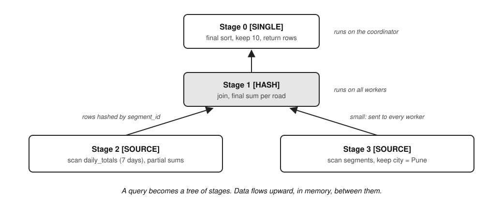
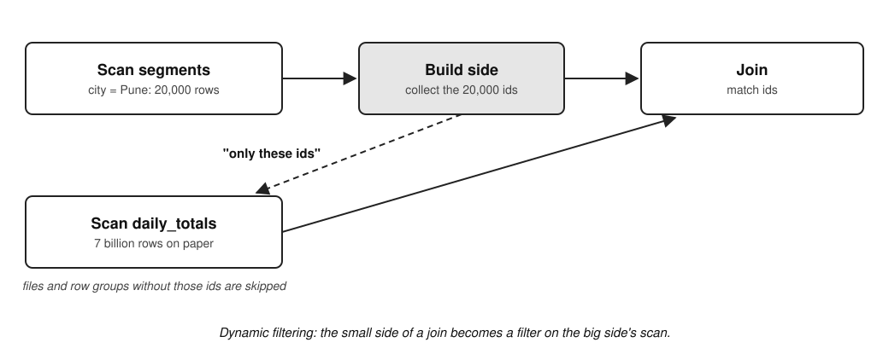
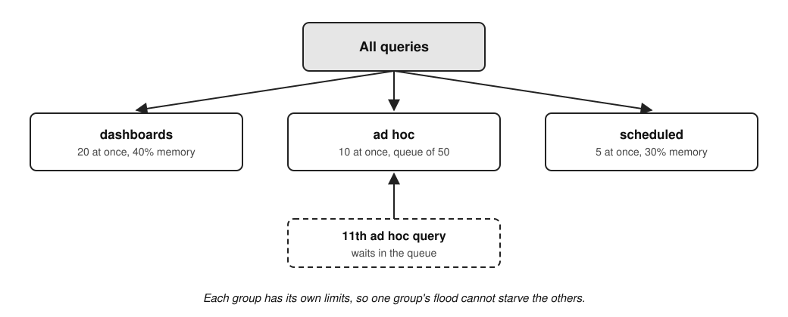
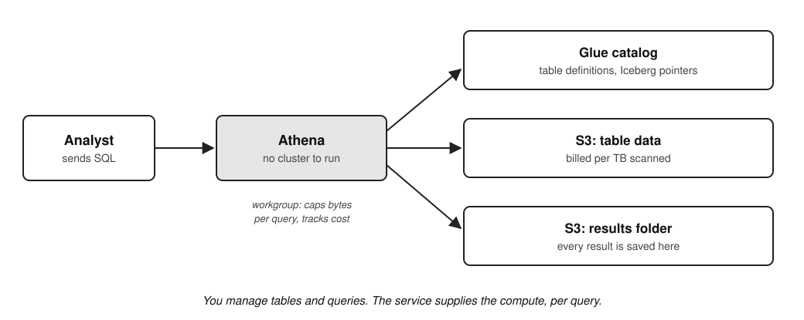
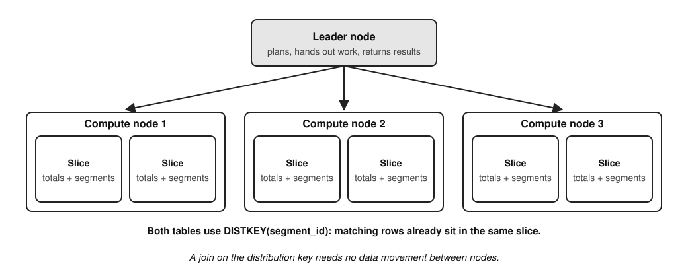

# Chapter 14 — Deep Dive: Trino, Athena and MPP Warehouses

*Part I, Chapter 6 explained how a query engine answers an ad-hoc question and how the bill shapes the design. This chapter goes inside Trino, Athena and a classic MPP warehouse (Redshift), and ends with the SQL patterns interviewers ask for.*

## The three in one page

| | Trino | Athena | Redshift |
|---|---|---|---|
| What it is | open-source distributed SQL engine | Amazon's serverless service built on Trino | Amazon's MPP data warehouse |
| Owns the data? | no: reads where it lives | no | yes: loaded into it (can also read S3) |
| You run | a cluster | nothing | a cluster, or the serverless option |
| You pay for | machines, by the hour | bytes scanned, per query | machines by the hour, or capacity used |
| Best at | interactive queries over a lake, federation | occasional queries with zero operations | many concurrent dashboard queries on curated data |

All three are **MPP** systems: one query is split into pieces that run on many machines at once. All three are columnar and vectorised. The differences are where the data sits, who operates the system, and how you are charged.

## Topic 1: how Trino runs a query

- The **coordinator** parses the SQL, plans it, and schedules the work. It does not process data, except for the final step.
- **Workers** execute. Data moves between them in memory, as **pages**: column-oriented batches of rows.
- A **connector** teaches Trino to talk to one kind of system: Iceberg, Postgres, Kafka. Each configured connector appears as a **catalog**, and tables are named `catalog.schema.table`.

The plan is cut into **stages** wherever data must be redistributed.



Each stage has a distribution, shown in square brackets in a plan:

- `SOURCE`: reads a table. It runs wherever the connector hands out **splits**, which are chunks of files.
- `HASH`: receives rows partitioned by a hash of some columns, so that equal keys meet on the same worker.
- `SINGLE`: runs on one node, for final sorts and limits.

A stage runs as **tasks**, one per worker. Unlike Spark, the stages do not run one after another: the whole tree runs at once as a pipeline, and rows flow upward as they are produced. A `LIMIT 10` can finish while the scans are still reading, and cancel them.

**What interviewers probe**

- *What does the coordinator do, and why is it a risk?* Planning, scheduling and tracking. It is a single point of failure for running queries, and it can be a bottleneck if queries are very numerous or plans are enormous.
- *What is a split?* A unit of scan work, usually part of a file. More splits mean more parallelism in the source stage.
- *How is this different from Spark's execution?* Pipelined and in-memory against staged with materialised shuffles. Faster for short queries, and traditionally with no recovery in the middle of a query.

## Topic 2: reading a query plan

The plan tells you why a query is slow before you change anything.

```sql
EXPLAIN (TYPE DISTRIBUTED)
SELECT s.name, sum(t.speed_sum) / CAST(sum(t.ping_count) AS double) AS avg_speed
FROM   lake.wayline.daily_totals t
JOIN   lake.wayline.segments s ON s.segment_id = t.segment_id
WHERE  s.city = 'Pune' AND t.day >= DATE '2026-11-09'
GROUP  BY s.name;
```

```
Fragment 1 [HASH]
    Aggregate (FINAL) [name]
    └─ InnerJoin [segment_id = segment_id]  Distribution: REPLICATED
       │    dynamicFilterAssignments = {segment_id -> df_1}
       ├─ RemoteSource [2]
       └─ RemoteSource [3]
Fragment 2 [SOURCE]
    Aggregate (PARTIAL)
    └─ TableScan [iceberg:daily_totals]  constraint on [day], dynamicFilters = {segment_id = df_1}
Fragment 3 [SOURCE]
    TableScan [iceberg:segments]  constraint on [city]
```

What to look for:

- **Scan constraints.** Did the filter on `day` reach the table scan? If it appears as a separate filter above the scan, partitions are not being pruned.
- **Join distribution.** `REPLICATED` means the right-hand side is copied to every worker, a broadcast. `PARTITIONED` means both sides are hashed.
- **Partial and final aggregation.** The same split as in Spark.
- **Dynamic filters.** See Topic 3.

`EXPLAIN ANALYZE` runs the query and adds real numbers: rows and bytes per operator, time, and memory. Compare the *estimated* rows with the *actual* rows. A large gap means missing or stale statistics.

**What interviewers probe**

- *The query scans the whole table despite a date filter. Why?* The filter wraps the partition column in a function or a cast that the engine cannot translate into a partition constraint, or it compares the wrong type. Filter on the raw column with a typed literal.
- *Where do you look first in `EXPLAIN ANALYZE`?* Input rows and bytes at the scans, then the operator with the most time or memory, then estimates against actuals.
- *What does integer division do here?* `sum(a) / sum(b)` on two integers gives an integer. Cast one side to `double`. This is a classic silent bug.

## Topic 3: statistics, join choice and dynamic filtering

Trino's **cost-based optimiser** chooses the join order and the distribution from table statistics: row counts, the number of distinct values per column, and null fractions.

```sql
ANALYZE lake.wayline.daily_totals;
SHOW STATS FOR lake.wayline.daily_totals;
```

Two decisions matter most.

**Which side is the build side.** In a hash join, one side is loaded into an in-memory hash table (the build side) and the other is streamed past it (the probe side). The build side should be the smaller one. In Trino it is the right-hand table of the join. With statistics, the optimiser reorders the join for you. Without them, the order you wrote is the order you get.

**Broadcast or partitioned.** A small build side is replicated to all workers. A large one forces both sides to be hashed across the cluster.

```sql
SET SESSION join_distribution_type = 'PARTITIONED';   -- or BROADCAST, AUTOMATIC
SET SESSION join_reordering_strategy = 'AUTOMATIC';
```

**Dynamic filtering** is the trick that makes star-schema queries fast.



While the build side is being read, Trino collects the join-key values it sees, here the 20,000 segment ids in Pune. It pushes that set down to the scan of the big table *while the query runs*. With Iceberg, files and row groups whose min/max range contains none of those ids are skipped entirely. The big table's scan shrinks from "everything in the date range" to "only what can match".

**What interviewers probe**

- *A query runs out of memory in a join. First suspicion?* The large table ended up as the build side, or a large table is being broadcast. Check the statistics and the join distribution.
- *What happens without statistics?* No reordering, and conservative choices. Put the larger table first in the `FROM` clause, and smaller ones to the right.
- *When does dynamic filtering not help?* When the build side is not selective, or when the big table is not sorted or partitioned in a way that lets the filter exclude files.

## Topic 4: memory, concurrency and failure

Trino holds a query's working data in memory. Each query has a limit, in total and per worker. A query that exceeds it is killed, with an error such as "Query exceeded per-node memory limit". The killing is deliberate: one query should fail before the whole cluster does.

Controlling a shared cluster is done with **resource groups**.



Each group has a limit on concurrent queries, a queue length and a share of memory. Rules assign each query to a group by user, source or tag. The eleventh ad-hoc query waits in the ad-hoc queue. The dashboards are unaffected.

**Failure.** In the default mode, the loss of any worker fails every query that had a task on it, and the client must re-run them. For interactive queries that is acceptable. For long ones, Trino offers **fault-tolerant execution**: intermediate data is written to external storage between stages, and failed tasks are retried. This makes Trino behave more like Spark, and costs some speed.

```properties
# fault-tolerant execution, for long-running queries
retry-policy=TASK
```

**What interviewers probe**

- *How do you protect a shared cluster?* Per-query memory and time limits, resource groups with queues, and separate clusters for scheduled and interactive work.
- *Scale up or scale out?* More workers add scan parallelism. More memory per worker helps large joins and aggregations. A join that does not fit needs memory, or a better plan, not more nodes.
- *Would you run a six-hour transformation on Trino?* Only with fault-tolerant execution. Otherwise Spark.

## Topic 5: connectors, pushdown and federation

A connector decides how much work Trino can hand to the underlying system. This is **pushdown**.

- **Predicate pushdown:** the filter is applied at the source. For Iceberg that means partition and file pruning. For Postgres it means a `WHERE` clause in the generated SQL.
- **Projection pushdown:** only the needed columns are read.
- **Aggregate, limit and join pushdown:** for database connectors, whole pieces of the query may be executed by the source database.

With several catalogs, one statement can join across systems:

```sql
SELECT c.reason, count(*) AS roads, avg(t.speed_sum / CAST(t.ping_count AS double)) AS avg_speed
FROM   postgres.public.road_closures c            -- operational database
JOIN   lake.wayline.daily_totals t                -- Iceberg on S3
       ON t.segment_id = c.segment_id AND t.day = c.closed_on
WHERE  c.closed_on >= DATE '2026-11-01'
GROUP  BY c.reason;
```

The Iceberg connector also exposes table metadata and maintenance:

```sql
SELECT snapshot_id, committed_at, operation FROM lake.wayline."pings$snapshots";

SELECT count(*) FROM lake.wayline.pings FOR TIMESTAMP AS OF TIMESTAMP '2026-11-12 06:00:00 UTC';

ALTER TABLE lake.wayline.pings EXECUTE optimize(file_size_threshold => '128MB');
```

**What interviewers probe**

- *What is the danger in federated queries?* If a filter cannot be pushed down, Trino pulls the whole remote table over the network. A federated join can also put heavy load on a production database. Point it at a read replica.
- *Is federation a replacement for loading data into the lake?* For occasional joins with small operational tables, yes. For regular heavy use, copy the data into the lake.

## Topic 6: Athena

Athena is Trino without the cluster.



- **No infrastructure.** You submit SQL. Capacity is supplied per query from a shared pool.
- **Pricing by bytes scanned:** $5 per terabyte at list price at the time of writing, with a small minimum per query. Statements that only change metadata are free.
- **Tables are defined in the Glue catalog.** Iceberg tables are supported for reads, writes and time travel.
- **Results are written to S3.** Every query's result is saved in a results location, and identical queries can reuse a recent result.
- **Workgroups** separate teams: each has its own settings, its own cost tracking, and a limit on the bytes a single query may scan.

Because the bill is bytes scanned, every optimisation from Chapters 3 and 11 is a direct saving: partition filters, column selection, columnar files, compression, and pre-aggregated tables.

A common use is creating a compact, aggregated table from a large one:

```sql
CREATE TABLE wayline.pune_week
WITH (table_type = 'ICEBERG', location = 's3://wayline/marts/pune_week/',
      is_external = false, partitioning = ARRAY['day'])
AS
SELECT t.day, t.segment_id, t.speed_sum, t.ping_count
FROM   wayline.daily_totals t
JOIN   wayline.segments s ON s.segment_id = t.segment_id
WHERE  s.city = 'Pune' AND t.day >= DATE '2026-11-09';
```

What you give up compared with your own Trino:

- no control over cluster size or memory, so a query that needs more than it is given simply fails or times out;
- account-level limits on concurrent queries, with queueing beyond them;
- a limit on how long a query may run;
- less predictable latency, since the capacity is shared.

**What interviewers probe**

- *How do you control Athena cost?* Columnar, compressed, partitioned tables. A per-query scan limit on each workgroup. Pre-aggregated tables for common questions. Result reuse for dashboards.
- *When does Athena stop being the right choice?* Steady heavy use, where a cluster is cheaper than per-scan pricing. A need for consistent low latency or high concurrency. Queries that exceed its limits.
- *Athena or Redshift Spectrum?* Both query S3. Spectrum is used from inside Redshift, to join lake data with warehouse tables.

## Topic 7: inside an MPP warehouse

Redshift is the classic design: a **leader node** that plans and coordinates, and **compute nodes**, each divided into **slices**. Every table's rows are spread across the slices, and each slice processes its share in parallel.

The table design decisions are what interviews focus on.

**Distribution style: which slice gets which row.**

| Style | Rows are placed | Use for |
|---|---|---|
| `KEY` | by a hash of one column | large tables joined on that column |
| `EVEN` | round-robin | tables with no dominant join key |
| `ALL` | a full copy on every node | small dimension tables |
| `AUTO` | chosen and changed by the system | the default |



If two tables are distributed on the same join key, matching rows are already on the same slice, and the join needs no redistribution. This is a **co-located join**, and it is the main reason to choose a distribution key carefully. A badly chosen key, with few distinct values or one dominant value, gives uneven slices: skew, again.

**Sort key: the order of rows on disk.** The warehouse keeps the minimum and maximum of each column for every block (a **zone map**). With data sorted by date, a query for one week reads only the blocks for that week. It is the same idea as Parquet statistics in Chapter 11.

```sql
CREATE TABLE daily_totals (
    day         date,
    segment_id  bigint,
    hour        smallint,
    speed_sum   bigint,
    ping_count  bigint
)
DISTKEY (segment_id)
SORTKEY (day);

CREATE TABLE cities (city_id int, name varchar(64)) DISTSTYLE ALL;
```

**Housekeeping.** Deleted rows are only marked, and new rows arrive unsorted. `VACUUM` reclaims space and re-sorts. `ANALYZE` refreshes statistics. Both are now largely automatic, but the concepts are still asked about.

**Concurrency.** Workload management puts queries into queues with memory shares. Extra capacity can be added automatically during peaks, and very short queries can be given a fast lane.

**Modern variations.** Newer node types keep data in managed storage on S3, so that storage and compute scale separately. A serverless option removes cluster sizing. Snowflake and BigQuery were designed this way from the start: Snowflake with independently sized "virtual warehouses" over shared storage, and BigQuery with no cluster at all and billing by bytes scanned or reserved capacity.

**What interviewers probe**

- *How do you choose a distribution key?* The column used in the largest joins, with high cardinality and even spread. If there is none, `EVEN`. For small dimensions, `ALL`.
- *How do you choose a sort key?* The column most often used in range filters, almost always a date or timestamp.
- *In an execution plan, what do you look for?* Whether a join step redistributes or broadcasts rows. A step that moves both tables between nodes means the distribution keys do not match the join.
- *Warehouse or lakehouse?* A warehouse gives the most predictable performance on data it owns. A lakehouse gives open formats and many engines. Many teams use both, with curated tables loaded into the warehouse.

## Topic 8: SQL patterns that come up in interviews

All examples run on Wayline's tables in Trino or Athena.

**Top N per group.** The three most congested roads in each city:

```sql
WITH road AS (
    SELECT s.city, s.name,
           sum(t.speed_sum) / CAST(sum(t.ping_count) AS double) / s.speed_limit_kmh AS ratio
    FROM   daily_totals t JOIN segments s ON s.segment_id = t.segment_id
    WHERE  t.day >= DATE '2026-11-09'
    GROUP  BY s.city, s.name, s.speed_limit_kmh
)
SELECT city, name, ratio
FROM  (SELECT *, row_number() OVER (PARTITION BY city ORDER BY ratio) AS rn FROM road)
WHERE  rn <= 3;
```

`row_number` gives exactly three rows per city. `rank` would include ties. Know the difference between `row_number`, `rank` and `dense_rank`.

**Compare with the previous period.** Week-over-week change per city:

```sql
WITH weekly AS (
    SELECT s.city, date_trunc('week', t.day) AS week,
           sum(t.speed_sum) / CAST(sum(t.ping_count) AS double) AS avg_speed
    FROM   daily_totals t JOIN segments s ON s.segment_id = t.segment_id
    GROUP  BY 1, 2
)
SELECT city, week, avg_speed,
       avg_speed - lag(avg_speed) OVER (PARTITION BY city ORDER BY week) AS change
FROM   weekly;
```

**Remove duplicates, keeping the latest.** One row per `ping_id`:

```sql
SELECT *
FROM  (SELECT *, row_number() OVER (PARTITION BY ping_id ORDER BY received_time DESC) AS rn
       FROM pings WHERE event_time >= TIMESTAMP '2026-11-12 00:00:00')
WHERE  rn = 1;
```

**Running total and moving average:**

```sql
SELECT day, pings,
       sum(pings) OVER (ORDER BY day)                                          AS running_total,
       avg(pings) OVER (ORDER BY day ROWS BETWEEN 6 PRECEDING AND CURRENT ROW) AS avg_7_days
FROM  (SELECT day, sum(ping_count) AS pings FROM daily_totals GROUP BY day);
```

**Approximate answers, cheaply:**

```sql
SELECT s.city,
       approx_distinct(p.device_id)          AS devices,       -- HyperLogLog
       approx_percentile(p.speed_kmh, 0.5)   AS median_speed
FROM   pings p JOIN segments s ON s.segment_id = p.segment_id
WHERE  p.event_time >= TIMESTAMP '2026-11-12 00:00:00'
GROUP  BY s.city;
```

**What interviewers probe**

- *`WHERE` or `HAVING`?* `WHERE` filters rows before grouping. `HAVING` filters groups after.
- *Why can't you filter on a window function in `WHERE`?* Window functions are computed after `WHERE`. Wrap the query and filter outside.
- *`count(*)`, `count(col)` or `count(DISTINCT col)`?* All rows, non-null values, and distinct non-null values. The last is the expensive one.
- *A `LEFT JOIN` returned fewer rows than expected.* A filter on the right table in the `WHERE` clause turned it into an inner join. Move that condition into the `ON` clause.
- *The join returned more rows than expected.* The join key is not unique on one side.

## Rapid-fire questions

**What does MPP mean?**
Massively parallel processing: one query is executed by many nodes at once, each working on its own share of the data.

**Trino or Presto?**
Trino is the continuation of the original Presto project under a new name, by its founders. The architecture is the same.

**Does Trino store data?**
No. It queries data where it lives, through connectors.

**What is a catalog in Trino?**
A configured connector instance: the first part of `catalog.schema.table`.

**What is a broadcast join called in a Trino plan?**
`REPLICATED` distribution.

**Why did my Trino query die when a worker restarted?**
Without fault-tolerant execution, a query fails if any node running one of its tasks is lost.

**What does Athena charge for?**
Bytes scanned by each query, after partition pruning and column selection, and after compression.

**How do you cap a runaway Athena query?**
A per-query data-scanned limit on the workgroup.

**What is a zone map?**
Per-block minimum and maximum values that let a warehouse skip blocks. It is the same idea as Parquet row-group statistics.

**What is a slice?**
A unit of parallelism inside a Redshift compute node, with its own share of each table.

**What is a co-located join?**
A join between tables distributed on the join key, so that no rows move between nodes.

**Star schema?**
A central fact table of measurements joined to small dimension tables that describe them.

**When is one machine enough?**
When the data a query touches, after pruning, fits in one machine's memory and disk. An embedded engine such as DuckDB then beats a cluster.

## At Wayline

| Decision | Setting | Why |
|---|---|---|
| Analyst engine | Athena, one workgroup per team | a handful of analysts; nothing to operate |
| Scan limit | per-query cap on each workgroup | a missing date filter costs an error, not thousands of dollars |
| Default table for questions | `daily_totals`, not `pings` | far fewer bytes per query |
| Statistics | kept current on `daily_totals` and `segments` | correct build side, and dynamic filtering by city |
| Layout | partitioned by day, sorted by `segment_id` | dynamic filters can skip files |
| Federation | Trino catalog for Postgres, pointed at a read replica | occasional joins with operational tables, with no load on the primary |
| Move to own Trino | when scanning is steady and heavy | fixed cost beats per-scan pricing |
| Warehouse | none yet | no high-concurrency dashboards |

## In Kleppmann's book

| Topic | Where in *Designing Data-Intensive Applications* (1st ed.) |
|---|---|
| Analytics as a separate workload; warehouses | Ch. 3, "Transaction Processing or Analytics?", "Data Warehousing" |
| Fact and dimension tables | Ch. 3, "Stars and Snowflakes: Schemas for Analytics" |
| Column storage, sort order, block statistics | Ch. 3, "Column-Oriented Storage" |
| Precomputed aggregate tables | Ch. 3, "Aggregation: Data Cubes and Materialized Views" |
| Declarative queries and optimisers | Ch. 2, "Query Languages for Data" |
| Distributing rows by key; skew | Ch. 6, "Partitioning of Key-Value Data" |
| One query across many nodes | Ch. 6, "Parallel Query Execution" |
| Hash joins, broadcast and partitioned | Ch. 10, "Map-Side Joins" |
| MPP databases compared with batch engines | Ch. 10, "Comparing Hadoop to Distributed Databases" |
| Queries across several systems | Ch. 12, "Unbundling Databases" |
