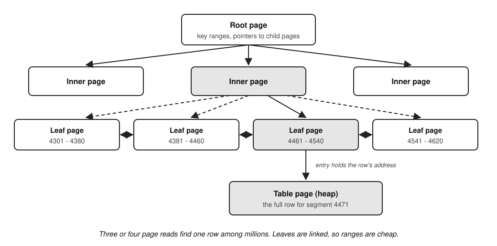
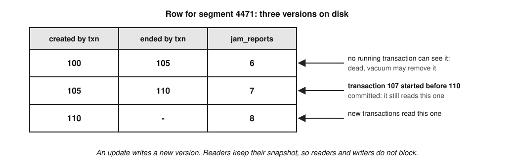
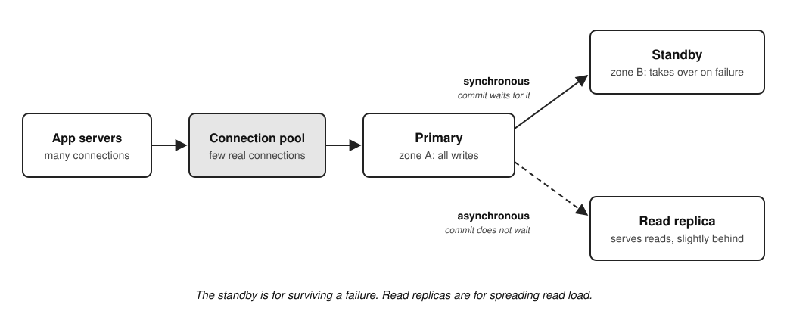
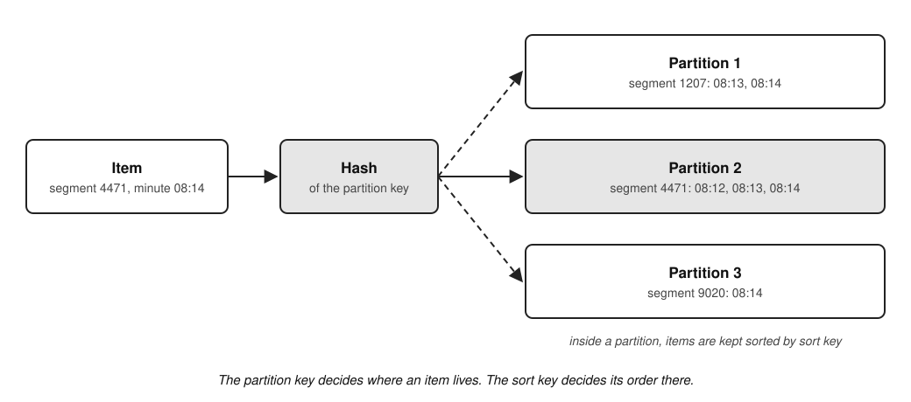
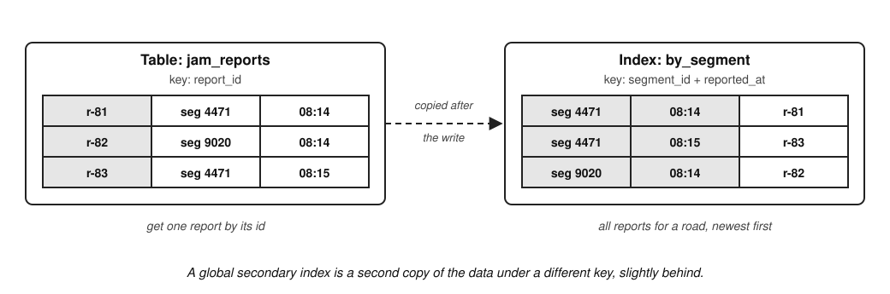

# Chapter 15 — Deep Dive: Postgres on RDS and DynamoDB

*Part I, Chapter 7 explained why the app reads from a lookup database, and why live speeds moved from Postgres to DynamoDB. This chapter goes inside both, at interview depth.*

## The two in one page

| | Postgres on RDS | DynamoDB |
|---|---|---|
| Model | relational: tables, joins, SQL | key-value and document: items found by key |
| Storage engine | heap tables with B-tree indexes | partitions, each a sorted store, replicated across three zones |
| Scales writes by | a bigger primary | adding partitions, automatically |
| Transactions | full, across any rows and tables | limited: a fixed number of items per transaction |
| Queries | anything SQL can express | only by key, or through an index you declared |
| You operate | instance size, replicas, upgrades, vacuum, connections | key design and capacity mode |
| Fails when | one primary cannot absorb the writes | the access pattern does not fit the key |

Postgres promises flexibility and strong guarantees on one machine. DynamoDB promises the same latency at any size, as long as every request names a key. It does not promise ad-hoc queries, joins, or forgiveness for a badly chosen key.

## Topic 1: how Postgres stores and finds rows

A table is a **heap**: a file of 8 KB **pages**, with rows placed wherever there is room. Finding a row without help means reading every page, a **sequential scan**.

An **index** is a separate structure that maps values to row addresses. The default is a **B-tree**.



Each page holds hundreds of keys, so the tree is shallow: three or four levels cover hundreds of millions of rows. Leaves are sorted and linked, which makes range scans and `ORDER BY` cheap.

Every index speeds up some reads and slows down every write, since each insert must update each index. The useful variations, shown on `live_speeds` as it looked while it still lived in Postgres, before Chapter 7 moved it to DynamoDB:

```sql
-- composite: serves "this road, latest minutes"; column order matters
CREATE INDEX live_by_road ON live_speeds (segment_id, minute DESC);

-- covering: the answer comes from the index alone, with no visit to the table
CREATE INDEX live_cover ON live_speeds (segment_id, minute DESC) INCLUDE (speed_sum, ping_count);

-- partial: index only the rows queries ask about
CREATE INDEX open_reports ON jam_reports (segment_id) WHERE status = 'open';

-- BRIN: a tiny index for huge tables whose rows arrive in time order
CREATE INDEX reports_time ON jam_reports USING brin (reported_at);
```

A composite index on `(a, b)` serves filters on `a`, and on `a` and `b` together. It does not serve a filter on `b` alone. Put equality columns first, and the range or sort column last.

**What interviewers probe**

- *Why did Postgres ignore my index?* The query returns a large share of the table, so a sequential scan is cheaper. Or the statistics are stale. Or the filter wraps the column in a function, or compares mismatched types.
- *What is an index-only scan?* The index contains every column the query needs, so the table is not visited. It depends on the visibility map being current, which is vacuum's job.
- *Other index types?* GIN for arrays, JSON and full-text search. GiST for geometric and range data. Hash for equality only.
- *How many indexes are too many?* Each one costs write time and memory. Remove those that the usage statistics show are never scanned.

## Topic 2: reading `EXPLAIN`

```sql
EXPLAIN (ANALYZE, BUFFERS)
SELECT minute, speed_sum, ping_count
FROM   live_speeds
WHERE  segment_id = 4471 AND minute >= now() - interval '5 minutes'
ORDER  BY minute DESC;
```

```
Index Scan using live_by_road on live_speeds
    (cost=0.57..12.40 rows=5 width=24) (actual time=0.031..0.044 rows=5 loops=1)
  Index Cond: (segment_id = 4471 AND minute >= ...)
  Buffers: shared hit=5
Planning Time: 0.110 ms
Execution Time: 0.068 ms
```

What to read:

- **The scan type.** `Seq Scan` reads the whole table. `Index Scan` walks the index and fetches rows. `Index Only Scan` never touches the table. `Bitmap Heap Scan` collects many matches from an index first, then reads the table pages in order: the choice for a medium number of rows.
- **Estimated rows against actual rows.** A large gap means the planner was working from wrong statistics. Run `ANALYZE`.
- **`Index Cond` against `Filter`.** A condition listed under `Filter` was checked row by row after fetching. "Rows Removed by Filter" in the thousands means the index is not serving that condition.
- **Buffers.** `hit` came from memory, `read` came from disk.
- **Join type.** A nested loop is right for a few rows with an index on the inner side. A hash join suits large unsorted inputs. A merge join suits inputs that are already sorted.

**What interviewers probe**

- *A query was fast and became slow with no code change.* Data grew past a threshold where the plan changed, statistics went stale, or the table bloated. Compare the plan now with the expected one.
- *How do you find the slow queries in the first place?* The `pg_stat_statements` extension, which records total time and call counts per statement. On RDS, Performance Insights shows the same by load.
- *Nested loop over a million rows?* A row estimate that was far too low. Fix the statistics before reaching for hints.

## Topic 3: MVCC and vacuum

Postgres never updates a row in place. An `UPDATE` writes a new **version** of the row and marks the old one as ended. A `DELETE` only marks. This is **multi-version concurrency control (MVCC)**.



Each version records which transaction created it and which ended it. Each transaction works from a **snapshot**: the set of transactions that had committed when it took the snapshot. It sees exactly the versions that were created by those and not ended by those.

The benefit: readers never block writers, and writers never block readers.

The cost: old versions pile up. **Vacuum** removes versions that no running transaction can still see, and makes the space reusable. **Autovacuum** runs it in the background, table by table, when enough rows have changed.

When this goes wrong:

- **Bloat.** If vacuum cannot keep up, tables and indexes grow, and every scan reads dead rows. Heavily updated tables need more aggressive autovacuum settings than the defaults.
- **Long transactions.** One transaction left open for hours holds its snapshot. Nothing newer than that snapshot can be cleaned, in any table. An idle session "in transaction" is the classic cause of mysterious bloat.
- **Transaction id wraparound.** Transaction ids are 32-bit counters. Vacuum must periodically mark old rows as "frozen" so that the ids can be reused. If it is prevented for long enough, the database stops accepting writes to protect itself.

```sql
-- sessions holding old snapshots
SELECT pid, state, xact_start, query FROM pg_stat_activity
WHERE  xact_start < now() - interval '10 minutes' ORDER BY xact_start;

-- tables with the most dead rows
SELECT relname, n_live_tup, n_dead_tup, last_autovacuum
FROM   pg_stat_user_tables ORDER BY n_dead_tup DESC LIMIT 10;
```

**What interviewers probe**

- *Why does a `count(*)` take so long?* There is no stored count. Each row's visibility depends on the asking transaction, so rows must be checked.
- *What is a HOT update?* If an update changes no indexed column and the new version fits on the same page, the indexes need no new entries. Leaving free space in pages (`fillfactor`) makes that more likely.
- *Does `VACUUM` return space to the operating system?* Plain vacuum makes it reusable inside the table. `VACUUM FULL` rewrites the table and returns space, but locks it for the duration.
- *Why is a queue table in Postgres hard?* Constant insert and delete creates dead rows at a high rate.

## Topic 4: isolation levels, lost updates and locks

Chapter 7's bug: two app servers each read a road's jam counter as 7, each add one, each write 8. One report is lost.

Postgres offers three isolation levels in practice:

| Level | What a transaction sees | Prevents | Still allows |
|---|---|---|---|
| **Read committed** (default) | a fresh snapshot for every statement | dirty reads | non-repeatable reads, lost updates in read-then-write code, write skew |
| **Repeatable read** | one snapshot for the whole transaction | the above, and lost updates (the second writer gets an error) | write skew |
| **Serializable** | as if transactions ran one at a time | everything | nothing, but transactions may be aborted and must be retried |

Four ways to fix the counter, from best to most general:

```sql
-- 1. atomic update: let the database do the read-modify-write
UPDATE segment_status SET jam_reports = jam_reports + 1 WHERE segment_id = 4471;

-- 2. explicit lock: read, decide in the application, write
BEGIN;
SELECT jam_reports FROM segment_status WHERE segment_id = 4471 FOR UPDATE;
UPDATE segment_status SET jam_reports = 8 WHERE segment_id = 4471;
COMMIT;

-- 3. optimistic: write only if nobody changed it since I read it
UPDATE segment_status SET jam_reports = 8, version = 13
WHERE  segment_id = 4471 AND version = 12;        -- 0 rows updated means retry

-- 4. raise the isolation level and retry on serialization failure
BEGIN ISOLATION LEVEL SERIALIZABLE;
```

The idempotent write that the stream job relies on is an **upsert**:

```sql
INSERT INTO live_speeds (segment_id, minute, speed_sum, ping_count)
VALUES (4471, '2026-11-12 08:14', 1140, 30)
ON CONFLICT (segment_id, minute)
DO UPDATE SET speed_sum = EXCLUDED.speed_sum, ping_count = EXCLUDED.ping_count;
```

**Write skew** is the anomaly that snapshot isolation misses: two transactions each read the same rows, each decide based on what they read, and write *different* rows. Neither overwrote the other, yet together they broke a rule. Only serializable isolation, or an explicit lock on what was read, prevents it.

**Deadlocks:** two transactions each hold a row lock the other wants. Postgres detects the cycle and aborts one. Prevent them by always locking rows in the same order, and keeping transactions short.

**What interviewers probe**

- *What is Postgres's default isolation level?* Read committed.
- *Is repeatable read in Postgres the same as in the SQL standard?* It is snapshot isolation, which is stronger than the standard requires: it also prevents phantom reads.
- *How does Postgres implement serializable?* Serializable snapshot isolation: transactions run on snapshots without blocking, the database tracks dangerous patterns of reads and writes, and aborts a transaction when one appears.
- *A schema change froze the application. Why?* `ALTER TABLE` needs an exclusive lock. It queued behind a long-running query, and every new query then queued behind it. Set a lock timeout on schema changes, and build indexes with `CREATE INDEX CONCURRENTLY`.

## Topic 5: WAL, replication and running on RDS

Every change is first appended to the **write-ahead log (WAL)**, and a commit is confirmed once its WAL record is on disk. The data pages are written later, at **checkpoints**. After a crash, Postgres replays the WAL from the last checkpoint. The same log feeds replication.



On RDS, the pieces are:

- **Multi-AZ standby.** A copy in another availability zone, kept in step synchronously. When the primary fails, the service promotes the standby and repoints the database address. Expect a minute or two of failed writes. Its purpose is availability.
- **Read replicas.** Asynchronous copies that serve reads. They lag, by milliseconds normally and more under heavy writes or long queries on the replica. Their purpose is read scale.
- **Backups.** Daily snapshots plus archived WAL give **point-in-time recovery**: restore to any second within the retention period, as a new instance.
- **Aurora** is a different engine under a Postgres interface. Storage is a shared, replicated volume, so replicas share the data and do not replay a full copy of it. Failover is faster and replica lag is lower.

**Connections** are the limit people meet first. Postgres starts one process per connection, each using memory. A few hundred are fine and several thousand are not. Many app servers, or serverless functions, each opening connections will exhaust the database. A **connection pool** (PgBouncer, or RDS Proxy) sits in between and shares a small number of real connections among many clients.

**Large tables** can be split by **declarative partitioning**:

```sql
CREATE TABLE jam_reports (
    report_id bigint, segment_id bigint, reported_at timestamptz, status text
) PARTITION BY RANGE (reported_at);

CREATE TABLE jam_reports_2026_11 PARTITION OF jam_reports
    FOR VALUES FROM ('2026-11-01') TO ('2026-12-01');
```

Queries that filter on the partition column touch only the matching partitions. Old data is removed by dropping a partition, which is instant and leaves no dead rows.

**What interviewers probe**

- *Does a Multi-AZ standby serve reads?* Not in the classic single-standby deployment. Reads need read replicas.
- *A user does not see what they just wrote.* The read went to a lagging replica. Read your own writes from the primary, for a short time after writing.
- *What causes replica lag?* A burst of writes, a long query on the replica that conflicts with replay, or a replica smaller than the primary.
- *How do you upgrade a major version with little downtime?* Logical replication to a new instance on the new version, then switch over. RDS offers a managed form of this as blue/green deployments.
- *When is one Postgres no longer enough?* When writes exceed one primary, or data exceeds one machine. Before sharding, try partitioning, archiving, moving a single hot workload elsewhere, and a bigger instance.

## Topic 6: DynamoDB's data model

A table holds **items**. Each item is found by its **primary key**:

- a **partition key** alone, or
- a partition key plus a **sort key**.



The partition key is hashed to choose a partition. All items that share a partition key sit together, ordered by sort key. That group is an **item collection**.

This gives exactly three efficient reads:

| Operation | Does | Cost |
|---|---|---|
| `GetItem` | one item by full key | one item |
| `Query` | items with one partition key, optionally a range of sort keys, in order | the items read |
| `Scan` | every item in the table | the whole table |

Wayline's live speeds, in the PartiQL form DynamoDB accepts:

```sql
SELECT minute, speed_sum, ping_count
FROM   "live_speeds"
WHERE  segment_id = 4471 AND minute >= '2026-11-12T08:10'
```

That is a `Query`: one partition, a short range, already sorted. It costs the same whether the table holds a thousand roads or fifty million.

There is no join and no filter on arbitrary attributes. A `FilterExpression` is applied *after* the items are read, so you pay for everything read, not everything returned. The design method is therefore backwards from relational modelling: **list the access patterns first, then design keys to serve each one.**

Other facts worth knowing:

- An item is limited to 400 KB.
- **Reads are eventually consistent by default.** Data is stored in three zones, and a default read may come from a copy that is slightly behind. A **strongly consistent read** can be requested per call, at twice the cost.
- **Time to live:** name an attribute holding an expiry time, and items are deleted in the background some time after it passes, at no write cost. Do not rely on the exact moment.

**What interviewers probe**

- *Query or Scan?* Query reads one partition key's items. Scan reads the table. A Scan in a request path is a design error.
- *How do you model one-to-many?* Parent id as the partition key and child id or timestamp as the sort key, so that one Query returns the children in order.
- *What is single-table design?* Storing several entity types in one table, with generic key attributes, so that related items share a partition and one Query fetches them together. It trades readability for fewer requests.
- *A new access pattern appears. What now?* Add a secondary index, or write the data a second time under another key. If neither fits, the data belongs somewhere else.

## Topic 7: capacity, throttling and hot partitions

DynamoDB charges for throughput in units:

- one **write unit** = one write per second of an item up to 1 KB;
- one **read unit** = one strongly consistent read per second of up to 4 KB, or two eventually consistent reads.

Larger items cost proportionally more. Two modes:

| | Provisioned | On-demand |
|---|---|---|
| You set | read and write units, with auto scaling | nothing |
| You pay | for what you provisioned | per request |
| Good for | steady, predictable load | spiky or unknown load |
| Risk | throttling above the provisioned rate | higher cost per request at steady high load |

Wayline's live speeds are about 200,000 small upserts a second: about 200,000 write units, steady, all day. That is a provisioned workload.

**Throttling.** A request above the available capacity is rejected with a throughput-exceeded error. The client libraries retry with backoff. Sustained throttling means too little capacity, or a hot key.

**Hot partitions.** Capacity is spread across partitions, and a single partition has a ceiling on what it can serve. If one partition key takes a large share of the traffic, that partition throttles while the table as a whole is far below its limit. The service shifts spare capacity towards busy partitions automatically, which softens the problem and does not remove it.

Avoiding hot keys:

- Choose a partition key with many values and evenly spread traffic. `segment_id` is good. `city` or `date` would be terrible.
- If one key is unavoidably hot, **shard it**: append a suffix from a small range, write to `key#0` … `key#9`, and read all ten.
- Reduce the work: write a value only when it changed, and batch.

```python
# 100 roads for one route in a single round trip, not 100
dynamodb.batch_get_item(RequestItems={"live_speeds": {"Keys": keys}})
```

**What interviewers probe**

- *The table is throttling at 30% of provisioned capacity.* A hot partition key. Find it with the service's key-level traffic diagnostics, then fix the key design.
- *Provisioned or on-demand?* On-demand until the load is understood and steady. Then provisioned with auto scaling, which is cheaper.
- *How do you cut the bill for 200,000 writes a second?* Keep items under 1 KB. Skip writes whose value has not changed. Write one item per road holding the last few minutes, not one item per road per minute. Ask whether every road needs 10-second freshness.
- *What does a batch write not give you?* Atomicity. Some items may succeed and others be returned as unprocessed, to be retried.

## Topic 8: secondary indexes, conditional writes and streams

Suppose jam reports outgrew Postgres and moved to DynamoDB, keyed by `report_id`. The app also needs "all reports for this road, newest first". That is a different key, so it needs an index.



| | Global secondary index (GSI) | Local secondary index (LSI) |
|---|---|---|
| Key | any partition key and sort key | same partition key, different sort key |
| Created | at any time | only when the table is created |
| Consistency | eventual only | strong reads possible |
| Capacity | its own | shared with the table |

A GSI is maintained asynchronously, so a read from it can miss a write made a moment ago. It has its own capacity, and if the index cannot keep up, writes to the base table are throttled.

**Conditional writes** are DynamoDB's answer to the lost update. A write can carry a condition that is checked atomically with it:

```python
# atomic counter: no read needed
table.update_item(
    Key={"segment_id": 4471},
    UpdateExpression="ADD jam_reports :one",
    ExpressionAttributeValues={":one": 1})

# optimistic lock: apply only if the version is the one I read
table.update_item(
    Key={"segment_id": 4471},
    UpdateExpression="SET speed_limit = :s, version = :new",
    ConditionExpression="version = :old",
    ExpressionAttributeValues={":s": 50, ":old": 12, ":new": 13})
```

A condition of "attribute does not exist" makes an insert idempotent: the second attempt fails harmlessly.

**Transactions** group a limited number of reads or writes, across tables, into one all-or-nothing operation, at double the capacity cost. They are for the few cases that need it, not for general use.

**Streams** publish every change to a table as an ordered log per item, kept for a day. A function or consumer reads it to update a search index, send a notification, or copy data elsewhere. It is change data capture as a built-in feature.

**Global tables** replicate a table across regions, with writes accepted in each. In the default mode, replication is asynchronous and conflicts are settled by last writer wins, with the hazards Chapter 8 described. A newer mode offers strong consistency across regions, at the cost of write latency.

**What interviewers probe**

- *GSI or LSI?* Almost always a GSI. An LSI is for a second sort order within the same partition, when strongly consistent reads are required, and it must be planned at creation.
- *Why did a read from the index miss my write?* Indexes are eventually consistent. Read the base table when it matters.
- *How do you make a write idempotent?* A deterministic key and a conditional put, or an upsert whose result is the same when repeated.
- *Is DynamoDB the "Dynamo" from the paper?* No. The paper describes a leaderless design with quorums and conflict resolution by the client. The service uses a leader per partition with replicas, and offers strongly consistent reads.

## Rapid-fire questions

**Clustered index in Postgres?**
There is none that is maintained. Tables are heaps. `CLUSTER` reorders a table once and the order decays.

**Primary key or unique index?**
A primary key is a unique index on columns that cannot be null, with the role of identifying the row.

**`VACUUM` or `ANALYZE`?**
Vacuum removes dead row versions. Analyze refreshes the statistics the planner uses.

**What is the WAL for?**
Durability and crash recovery, and it is the stream that replicas and point-in-time recovery consume.

**Why pool connections?**
Each Postgres connection is a process. A pool lets thousands of clients share tens of connections.

**`SELECT ... FOR UPDATE`?**
Locks the selected rows until the transaction ends, so that a read-then-write sequence is safe.

**What is write skew?**
Two transactions read overlapping data and write different rows, together breaking a rule that each alone respected.

**Multi-AZ or read replica?**
Multi-AZ is a synchronous standby for failover. A read replica is an asynchronous copy for read load.

**Partition key or sort key?**
The partition key chooses the partition. The sort key orders items within it and allows range queries.

**Why avoid Scan?**
It reads, and charges for, the entire table.

**What does TTL cost?**
Nothing for the deletes, but timing is approximate.

**Strong or eventual reads in DynamoDB?**
Eventual by default. Strong on request for the table and local indexes, at twice the read cost, and never for global indexes.

**SQL or NoSQL for a new system?**
Postgres, unless a known access pattern needs write scale or size that one primary cannot give.

## At Wayline

| Decision | Setting | Why |
|---|---|---|
| Relational data (roads, accounts, jam reports) | Postgres on RDS, Multi-AZ | joins and transactions; this is a system of record |
| Typical speeds | Postgres, one row per road with 168 values, primary key `segment_id` | one lookup returns the whole week; 50 million rows fit one machine |
| Reads of speeds | read replicas | staleness is harmless |
| Read after a user's own write | primary | avoids the missing-report bug |
| Connections | pooled | many app servers, few database processes |
| Jam counter | atomic `UPDATE ... SET n = n + 1` | no lost updates, no explicit locks |
| Live speeds | DynamoDB, partition key `segment_id`, sort key minute | about 200,000 writes a second is beyond one primary; one access pattern |
| Capacity mode | provisioned with auto scaling | steady, predictable load |
| Expiry | TTL on live-speed items | old minutes delete themselves |
| Writes from the stream job | upsert by `(segment_id, minute)` | repeats after recovery are harmless |
| Route lookups | batched, eventually consistent reads | fewer round trips, half the read cost |

## In Kleppmann's book

| Topic | Where in *Designing Data-Intensive Applications* (1st ed.) |
|---|---|
| B-tree indexes, write-ahead log | Ch. 3, "B-Trees" |
| Composite and covering indexes | Ch. 3, "Other Indexing Structures" |
| Row versions and snapshots | Ch. 7, "Snapshot Isolation and Repeatable Read" |
| Read committed | Ch. 7, "Read Committed" |
| Lost updates: atomic writes, locking, compare-and-set | Ch. 7, "Preventing Lost Updates" |
| Write skew | Ch. 7, "Write Skew and Phantoms" |
| Serializable snapshot isolation | Ch. 7, "Serializable Snapshot Isolation (SSI)" |
| Standby and replicas; shipping the log | Ch. 5, "Leaders and Followers" |
| Replica lag, reading your own writes | Ch. 5, "Problems with Replication Lag" |
| Hashing a key to a partition | Ch. 6, "Partitioning of Key-Value Data" |
| Hot keys | Ch. 6, "Skewed Workloads and Relieving Hot Spots" |
| Global and local secondary indexes | Ch. 6, "Partitioning and Secondary Indexes" |
| Last writer wins across regions | Ch. 5, "Multi-Leader Replication" |
| The Dynamo paper's design, for contrast | Ch. 5, "Leaderless Replication" |
| Change streams | Ch. 11, "Change Data Capture" |
