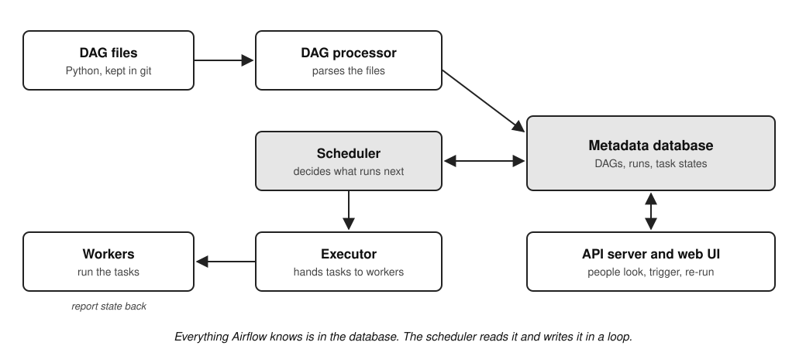
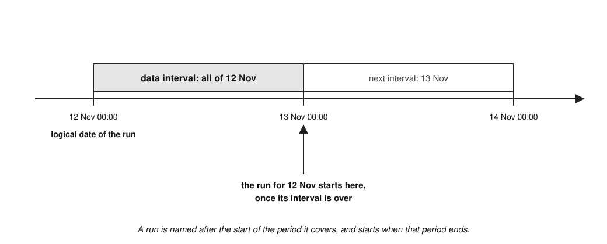
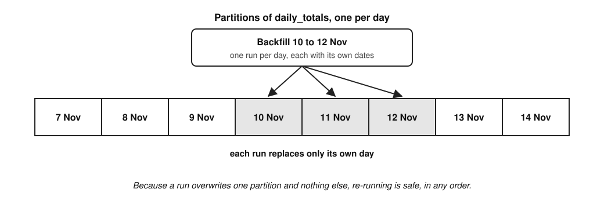
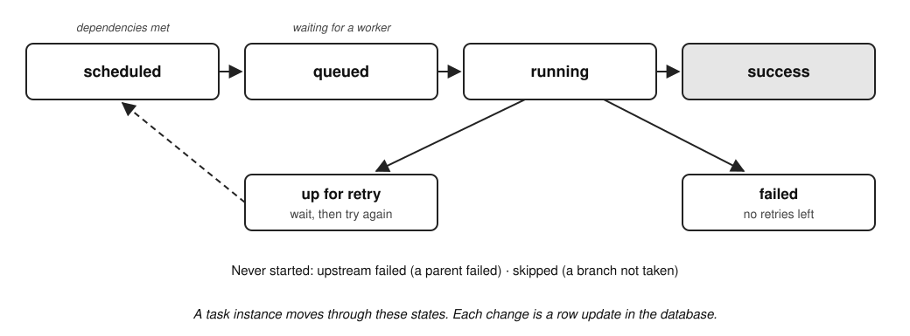
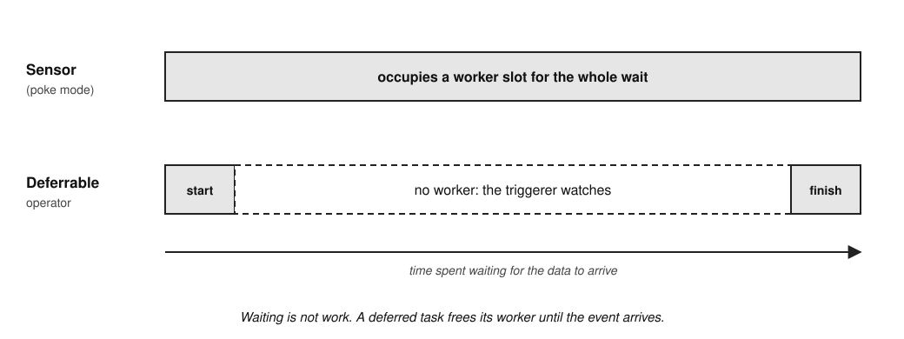

# Chapter 16 — Deep Dive: Airflow

*Part I, Chapter 9 explained why Wayline's nightly work is a graph of tasks, each run for a named day. This chapter goes inside Airflow, at interview depth.*

## Airflow in one page

- Airflow is an **orchestrator**. It decides *when* work runs, in *what order*, and what to do when a step fails. It does not process the data itself.
- A workflow is a **DAG**: tasks, with "this before that" arrows and no loops. DAGs are written in Python.
- Each scheduled **run** of a DAG covers a named period of time. Each task in a run is a **task instance** with a state.
- Airflow retries failed tasks, records every run, and lets a person re-run any task for any past period.

What Airflow promises: tasks run in dependency order, on schedule, with retries and a history. What it does not promise: that a task does its work exactly once, that it is safe to run twice, or that it runs at a precise second. Making tasks safe to repeat is the author's job.

A note on versions. Airflow 3 changed several names and defaults that had been stable through the 2.x releases. This chapter uses current terms and points out the older ones where an interviewer may use them.

## Topic 1: architecture



- **DAG files** are Python files in a folder, normally deployed from git.
- The **DAG processor** imports those files again and again, and stores the resulting DAG structure in the database.
- The **metadata database** (Postgres, usually) holds everything: DAGs, runs, task instances and their states, connections, variables.
- The **scheduler** loops: which runs are due, which tasks have their dependencies met, which can be queued. It writes each decision as a state change.
- The **executor** decides *where* a queued task runs.
- **Workers** run the task's code and report the result.
- The **API server and web UI** show the state and accept commands.
- The **triggerer** is a small process that waits on behalf of deferred tasks (Topic 6).

The executor is the main deployment choice:

| Executor | Tasks run | Use when |
|---|---|---|
| Local | as processes beside the scheduler | small installations |
| Celery | on a fixed pool of worker machines, through a queue | many short tasks, low start-up delay |
| Kubernetes | each in its own new pod | tasks with different images or resources; scale to zero |

On AWS, the managed service MWAA runs these parts for you.

**What interviewers probe**

- *What happens if the scheduler dies?* Running tasks continue, and nothing new is scheduled. Several schedulers can run at once for availability: they coordinate through row locks in the database.
- *What happens if the metadata database is down?* Everything stops. It is the one component that must be backed up and highly available.
- *What happens if a worker dies in the middle of a task?* The task stops sending heartbeats. The scheduler marks it failed and the retry policy applies. The work it had half done is the task's own problem, which is why tasks must be idempotent.
- *Celery or Kubernetes executor?* Celery starts tasks in about a second and suits many small tasks. Kubernetes isolates each task and wastes nothing when idle, but each task pays the pod start-up time.

## Topic 2: DAGs, tasks and operators

A task is an instance of an **operator**: a class that knows how to do one kind of thing, such as submit a Spark job, run a SQL statement or call a Python function. Operators from **providers** cover most systems.

Wayline's nightly graph from Chapter 9:

```python
from airflow.sdk import dag, task          # Airflow 2: from airflow.decorators import dag, task
from datetime import datetime, timedelta

@dag(schedule="@daily", start_date=datetime(2026, 1, 1), catchup=False,
     max_active_runs=3,
     default_args={"retries": 3, "retry_delay": timedelta(minutes=5),
                   "retry_exponential_backoff": True})
def nightly_speeds():

    @task
    def daily_totals(ds=None):                 # ds = the day this run covers
        submit_spark("daily_totals", day=ds)

    @task
    def typical_speeds(ds=None): submit_spark("typical_speeds", day=ds)

    @task
    def checks(ds=None): run_checks(day=ds)

    @task
    def publish(ds=None): swap_in_new_table(day=ds)

    day_complete() >> daily_totals() >> typical_speeds() >> checks() >> publish()

nightly_speeds()
```

The most important fact about a DAG file: **it is not run once. It is imported repeatedly**, by the DAG processor and by every worker that runs one of its tasks. So:

- Code at the top level of the file must be fast and free of side effects. No database queries, no API calls, no large imports. Such work belongs inside a task.
- The structure of the DAG should not depend on something that changes from one parse to the next, such as the current time.

**Dynamic task mapping** creates a variable number of task instances at run time from a list:

```python
@task
def cities(): return ["Pune", "Mumbai", "Delhi"]

@task
def city_report(city, ds=None): ...

city_report.expand(city=cities())      # one task instance per city
```

**What interviewers probe**

- *Why is the UI slow to show my DAG, or the scheduler lagging?* Slow top-level code in DAG files. Each parse repeats it.
- *How do you generate many similar DAGs?* A loop or a factory function over a configuration file, read at parse time and kept cheap. For a variable number of *tasks*, use dynamic task mapping.
- *Operator or Python task?* Use a provider's operator when one exists: it handles submission, polling, and cancellation. Use a Python task for small glue logic.
- *What is a task group?* A visual and naming grouping of tasks inside a DAG. It replaced sub-DAGs.

## Topic 3: schedules, data intervals and the logical date

This is the topic that confuses everyone once.



A scheduled run covers a **data interval**. For a daily schedule, the run for 12 November covers 12 Nov 00:00 to 13 Nov 00:00. It cannot start before the data exists, so it starts at **the end of its interval**: just after midnight on the 13th.

The run is identified by its **logical date**, the start of the interval: 12 November. (Airflow 2 called this the execution date, a name that misled everyone, since it is not when the run executes.)

Tasks receive these values and must use them, never the clock:

| Template | Meaning for the run above |
|---|---|
| `{{ ds }}` | `2026-11-12`, the logical date |
| `{{ data_interval_start }}` | 12 Nov 00:00 |
| `{{ data_interval_end }}` | 13 Nov 00:00 |

```python
SQLExecuteQueryOperator(
    task_id="count_day",
    sql="SELECT count(*) FROM pings WHERE event_time >= '{{ data_interval_start }}' "
        "AND event_time < '{{ data_interval_end }}'")
```

A task that calls `now()` or computes "yesterday" works on the day it is written, and silently does the wrong thing when it is retried after midnight or re-run a week later.

**Catchup.** If a DAG is switched on with a start date in the past, or was paused for a week, `catchup=True` makes the scheduler create a run for every interval that was missed. `catchup=False` creates only the latest. The default changed between major versions, so set it explicitly.

Schedules are cron expressions, presets such as `@daily`, or fixed intervals. Cron expressions are evaluated in UTC unless the DAG has a time zone, which matters twice a year where clocks change.

**What interviewers probe**

- *My daily DAG has a start date of today and it has not run. Why?* The first run covers today, and starts when today ends.
- *What is the difference between the logical date and the time a run started?* The logical date names the data period. The start time is when Airflow began the run. A backfill has an old logical date and a start time of now.
- *What goes wrong with a start date of `datetime.now()`?* The start date moves at every parse, so an interval never completes and the DAG never runs. Use a fixed date.
- *The pipeline was paused for three days. What happens on resume?* With catchup on, three runs are created, limited by `max_active_runs`. With it off, only the latest, and the missing days must be backfilled deliberately.

## Topic 4: idempotent tasks and backfills

Airflow retries tasks, re-runs them when a person clears them, and backfills them over past dates. A task therefore *will* run more than once for the same period. The design rule from Chapter 5 is what makes that harmless:

1. **Take the period as input.** Read `ds` or the data interval, never the clock.
2. **Replace, do not append.** Overwrite the output partition for that period, or upsert by a deterministic key.
3. **Publish atomically.** Readers see the old output or the new one, never half.



A **backfill** runs the DAG for a range of past intervals:

```bash
# Airflow 3
airflow backfill create --dag-id nightly_speeds --from-date 2026-11-10 --to-date 2026-11-12

# Airflow 2
airflow dags backfill -s 2026-11-10 -e 2026-11-12 nightly_speeds
```

To re-run part of a past run, **clear** the task instances in the UI or from the command line. Clearing sets them back to "no state", and the scheduler runs them again, with everything downstream if asked.

Controls that matter in a backfill:

- `max_active_runs`: how many runs of this DAG at once. Without it, a year-long backfill starts 365 Spark jobs.
- `depends_on_past=True`: a task waits for its own previous run to succeed. Use it when each day builds on the previous day's output.
- **Pools** (Topic 7), so that the backfill cannot starve the nightly run.

Wayline's typical-speed task reads the last 56 days. Backfilling a month means running it in date order, or more cheaply: backfill all the daily totals in parallel first, then run typical speeds once.

**What interviewers probe**

- *Is Airflow exactly-once?* No. It is at-least-once, with retries. Exactly-once *effect* comes from idempotent tasks.
- *A task failed after writing half its output. What now?* Nothing special, if the task overwrites a partition atomically: the retry replaces it. If the task appends, there are now duplicates, and that is the bug.
- *How do you backfill after fixing a bug in the logic?* Deploy the fix, then clear or backfill the affected dates with limited parallelism. For a changed definition, build a new table alongside and compare, as in Chapter 9.
- *Old runs with new code?* A backfill runs today's DAG code for past dates. If the logic for old dates must differ, the code must branch on the date. Airflow 3 records DAG versions for display, which helps in reading history and does not change this.

## Topic 5: task states, retries and failure handling



A task instance is **scheduled** when its dependencies are met, **queued** when handed to the executor, and **running** on a worker. It ends as **success** or **failed**. A failure with retries left becomes **up for retry**, waits, and goes round again. A task whose parent failed is **upstream failed** and never runs. A task on a branch not taken is **skipped**.

The settings that shape failure behaviour:

```python
default_args = {
    "retries": 3,
    "retry_delay": timedelta(minutes=5),
    "retry_exponential_backoff": True,          # 5, 10, 20 minutes
    "execution_timeout": timedelta(hours=2),    # kill a hung task
    "on_failure_callback": page_on_call,
}
```

- **Retries** handle transient faults: a lost spot instance, a throttled API. They do not fix a bug, and three retries of a two-hour job cost six hours before anyone is told. Match the count to the cost.
- **Timeouts** turn a hung task into a failed one. Without one, a stuck task blocks the pipeline with no alert.
- **Trigger rules** decide when a task runs relative to its parents. The default is `all_success`. `all_done` runs whatever happened, which suits clean-up. `none_failed` tolerates skipped parents.

```python
@task(trigger_rule="all_done")
def tidy_up(): ...          # runs even if a check failed
```

- **Lateness alerts.** A failure alert does not fire for a task that never started. Wayline promises typical speeds by 06:00, so it also needs an alert on "not finished by 05:00". Airflow 2 had SLAs for this. Airflow 3.0 removed them, and 3.1 added deadline alerts in their place, marked experimental when introduced. An external check on the freshness of the output table is the most dependable form.

**What interviewers probe**

- *A task shows "upstream failed". What do you do?* Fix and clear the parent that failed. Downstream tasks then run.
- *What is a zombie task?* A task that the database believes is running while its process is gone. The scheduler detects the missing heartbeat and fails it.
- *How do you stop one failed check from publishing bad data?* The publish task depends on the check with the default trigger rule, so a failed check blocks it. This is write-audit-publish from Chapter 9.
- *Retries and non-idempotent tasks?* A task that sends an email or charges a card must not be retried blindly. Give the downstream system an idempotency key, or set retries to zero and alert.

## Topic 6: waiting for something

Wayline's first task asks "is the day complete?": has the lake writer committed everything up to midnight? Starting at a fixed time would silently process an incomplete day whenever the writer is late.

A **sensor** is a task that waits for a condition:

```python
@task.sensor(poke_interval=300, timeout=6 * 3600, mode="reschedule")
def day_complete(data_interval_end=None):
    return lake_committed_up_to() >= data_interval_end
```

How it waits is the interview topic.



| Mode | While waiting | Cost |
|---|---|---|
| `poke` | the task keeps its worker and sleeps between checks | one worker slot for hours |
| `reschedule` | the task gives up its worker and is queued again for each check | no slot, some scheduling overhead |
| **Deferrable** | the task hands its wait to the triggerer, an async process that can watch thousands of conditions | almost nothing |

Always set a **timeout**. A sensor without one waits forever, and the pipeline is late with no failure to alert on.

The alternative to waiting is being told. With **assets** (called datasets in Airflow 2), a task declares that it produces something, and another DAG is scheduled on that thing being updated:

```python
from airflow.sdk import Asset

daily_totals = Asset("s3://wayline/lake/daily_totals")

@task(outlets=[daily_totals])
def build_daily_totals(ds=None): ...

@dag(schedule=[daily_totals])          # runs when the asset is updated
def city_reports(): ...
```

This removes the guesswork of "run the reports at 03:00 and hope the totals are done".

**What interviewers probe**

- *All workers are busy and nothing is progressing.* Sensors in poke mode are holding the slots, each waiting for a task that cannot get a slot. Use reschedule mode or deferrable operators.
- *How do you depend on another team's DAG?* Prefer an asset or a check on the data itself. A sensor on the other DAG's run couples the two schedules and breaks when either changes.
- *Schedule by time or by data?* By data, where correctness depends on the input being complete. Time is only a proxy for it.

## Topic 7: keeping Airflow thin

**Orchestrate, do not process.** A worker should submit a Spark job and wait, not load a million rows into its own memory. Heavy work in workers makes them the bottleneck and ties the pipeline's capacity to Airflow's.

**XCom** is how tasks pass small values: a returned value is stored in the metadata database and can be read by later tasks. It is for a file path, a row count or a job id. Passing a dataset through it bloats the database. Pass a reference to where the data is.

```python
@task
def daily_totals(ds=None) -> dict:
    return {"path": f"s3://wayline/lake/daily_totals/day={ds}", "rows": 1_200_000_000}

@task
def checks(result: dict): assert result["rows"] > 0
```

**Limits on concurrency**, from widest to narrowest:

| Setting | Limits |
|---|---|
| `parallelism` | task instances running in the whole installation |
| `max_active_runs` | simultaneous runs of one DAG |
| `max_active_tasks` | simultaneous tasks of one DAG |
| **Pool** | tasks that share a named resource, across all DAGs |

A **pool** protects something scarce. Wayline puts every task that starts a Spark cluster in a pool of five slots. A backfill of sixty days then queues politely behind the nightly run, which is given a higher `priority_weight`.

**Connections and secrets.** Credentials are stored as connections and referred to by id. In production they come from a secrets backend such as AWS Secrets Manager, not from the metadata database or from code.

**What interviewers probe**

- *The metadata database is huge. Why?* Large XComs, and years of task history and logs. Keep XComs small and purge old records on a schedule.
- *How do you pass a DataFrame between tasks?* You do not. Write it to storage and pass the path.
- *How do you limit load on a shared database?* A pool sized to what it can take, used by every task that touches it.
- *Variables at the top of a DAG file?* Each read is a database query at every parse. Read them inside tasks, or through templates.

## Topic 8: testing, deployment and alternatives

**Testing.** Three levels are worth having:

```python
def test_dags_import_cleanly():
    bag = DagBag(include_examples=False)
    assert bag.import_errors == {}                       # every file parses

def test_nightly_shape():
    dag = DagBag().get_dag("nightly_speeds")
    assert dag.get_task("publish").upstream_task_ids == {"checks"}
```

1. **Import test** in continuous integration: every DAG file loads without error and quickly. This catches most breakages.
2. **Unit tests** of the business logic, which should live in ordinary functions and jobs that do not need Airflow to run.
3. **A full run** of the DAG for one date against a test environment, with `dag.test()` or a staging installation.

**Deployment.** DAGs are code: reviewed, versioned in git, deployed by a pipeline. A change to a DAG applies to runs that start afterwards. Avoid renaming a DAG or a task casually, since history is attached to those ids.

**Alternatives**, and when each fits:

| Tool | Idea | Choose when |
|---|---|---|
| cron | start a command at a time | one independent job |
| **Airflow** | scheduled DAGs of tasks | the default for batch pipelines; largest ecosystem |
| Dagster | the unit is the data asset, not the task | lineage and asset freshness are central |
| Prefect | Python functions as flows, light infrastructure | dynamic, Python-heavy workflows |
| AWS Step Functions | managed state machines | event-driven, serverless steps inside AWS |
| Temporal | durable code for long-running business workflows | orders and sagas, not nightly batches |
| dbt | SQL models with dependencies | transformations inside a warehouse, often *run by* Airflow |

Airflow is a poor fit for streaming, for sub-minute schedules, and for workflows triggered thousands of times a second.

**What interviewers probe**

- *How do you test a DAG?* An import test in CI, logic tested outside Airflow, and a run for one date in staging.
- *How do you deploy without disturbing running tasks?* Deploy DAG changes between runs where possible. Make changes backward compatible, since a run in progress may execute later tasks with the new code.
- *Why not put the business logic in the DAG file?* It could then only be tested and run through Airflow. Keep the DAG as a thin description of order, and the logic in jobs.
- *Airflow or Dagster?* Airflow thinks in tasks and schedules. Dagster thinks in assets and their freshness. Airflow's assets feature moves it in the same direction.

## Rapid-fire questions

**What is a DAG?**
A directed acyclic graph: tasks with dependencies and no cycles.

**DAG run or task instance?**
A DAG run is one execution of the whole graph for one data interval. A task instance is one task within that run.

**What does the scheduler do?**
Creates runs when they are due and queues the tasks whose dependencies are met.

**What does the executor do?**
Decides where and how queued tasks run.

**What is the logical date?**
The start of the data interval a run covers. It is not the time the run starts.

**What does catchup do?**
Creates runs for every interval missed between the start date, or last run, and now.

**What is XCom for?**
Small values passed between tasks. Not data.

**What is a pool?**
A named limit on how many tasks may use a shared resource at once.

**Sensor or deferrable operator?**
Both wait for a condition. A deferrable operator waits without occupying a worker.

**What is a trigger rule?**
The condition on a task's parents under which it runs: all succeeded by default.

**How do you re-run one failed task?**
Clear it. The scheduler runs it again, and optionally everything downstream.

**Does Airflow move data?**
No. It starts and watches the systems that do.

**What makes a task safe to retry?**
It takes its period as input, and replaces its output for that period atomically.

## At Wayline

| Decision | Setting | Why |
|---|---|---|
| Schedule | daily, one run per calendar day | every run is for a named day |
| Start condition | a deferrable check that the lake is committed up to midnight, with a timeout | start by the data, not by the clock |
| Task inputs | the data interval, never `now()` | re-runs and backfills do the right day's work |
| Outputs | overwrite one partition; publish by swapping tables | idempotent, atomic |
| Order | day complete → daily totals → typical speeds → checks → publish → tidy | nothing is published before checks pass |
| Tidy-up | trigger rule `all_done` | temporary data is removed even after a failure |
| Retries | 3, with exponential backoff, and a 2-hour timeout | lost machines are routine; hangs must surface |
| Lateness | alert if typical speeds are not published by 05:00 | the promise is 06:00, and a failure alert would not fire |
| Concurrency | `max_active_runs` 3; a pool of 5 for Spark clusters | backfills cannot starve the nightly run |
| Heavy work | in Spark, submitted by Airflow | workers stay small |
| Downstream reports | scheduled on the `daily_totals` asset | run when the data is ready |

## In Kleppmann's book

| Topic | Where in *Designing Data-Intensive Applications* (1st ed.) |
|---|---|
| Chains of batch jobs and workflow schedulers | Ch. 10, "MapReduce workflows" |
| Immutable inputs, replaceable outputs, safe re-runs | Ch. 10, "The Output of Batch Workflows" |
| Retrying without duplicating effects | Ch. 11, "Idempotence" |
| Re-running over old data after a change | Ch. 12, "Reprocessing data for application evolution" |
| Deriving one dataset from another, in order | Ch. 12, "Derived data versus distributed transactions" |
| Checking results, not trusting them | Ch. 12, "Trust, but Verify" |
| Timeouts as the only failure detector | Ch. 8, "Timeouts and Unbounded Delays" |
| Systems that people can run | Ch. 1, "Operability: Making Life Easy for Operations" |
